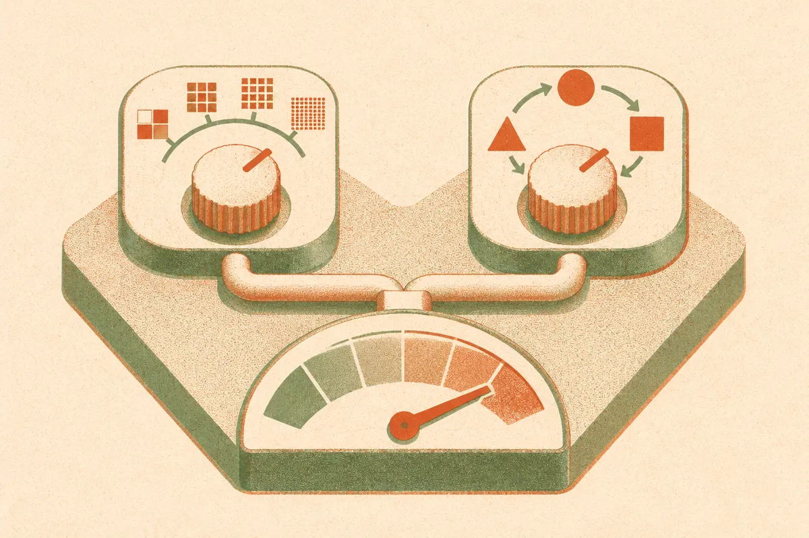

TL;DR: For small quantized local models, the paper "Bits or permutations?" finds that 6-bit weights match fp16 accuracy, and once you have 6 or more bits, spending leftover inference budget on averaging four option orders beats spending it on more precision.

This is one of those small papers that answers a question you probably never framed cleanly but have definitely hit in practice. You are running a tiny model locally. You have a fixed amount of memory bandwidth and compute to spend per answer. Do you spend it on keeping weights precise, or on running the question a few times with the answer choices shuffled and averaging? The paper "Bits or permutations? Spending a fixed inference budget on weight precision or on option-order averaging in small local language models" (arXiv, cs.AI and cs.CL) actually prices both in the same unit and gives you a decision table. I like that. Most inference-efficiency work gives you a tradeoff curve and leaves the spending decision to vibes.

## What did the paper actually test?

The setup is deliberately small and controlled. Two models: Qwen3-0.6B and Qwen3-1.7B. Simulated round-to-nearest weight quantization at 8, 6, 4, and 3 bits, with fp16 as the reference. Four multiple-choice benchmarks (ARC-Easy, ARC-Challenge, MMLU, HellaSwag), 300 items each, scored by reading the logits for the letters A through D. So this is a clean multiple-choice harness, not open-ended generation.

Two knobs. Knob one is precision: fewer bits per weight saves memory and bandwidth but adds noise. Knob two is option-order averaging: multiple-choice models are famously sensitive to which slot the correct answer sits in, so you run the same item several times with the choices cyclically rotated and average the logits. The authors ask whether cutting precision makes the order sensitivity worse, and which knob buys you more accuracy per unit of cost.

The honest framing matters here. The authors say plainly that a title-level search found no earlier study combining quantization with option order, so this is early ground, two small models, the simplest quantizer, everything simulated. They are not claiming a universal law. They are planting a flag and showing their arithmetic.

## Where does precision stop paying off?

The precision results are the part that should change how you set up a local model today.

6 bits lose no accuracy against fp16. In fact they score slightly higher: +1.8 points on the 0.6B and +0.9 on the 1.7B, with confidence intervals that stay positive. The authors are refreshingly honest that they do not explain why 6-bit comes out marginally ahead of full precision. It is probably noise-as-regularization territory, but they do not pretend to know. 8 bits land almost exactly on fp16 (a hair below, -0.7 and -0.4 points).

So on these models and tasks, there is no accuracy reason to carry more than 6 bits of weight precision. That is the first practical takeaway and it matches what a lot of local-model users have found empirically: 6-bit and even some 4-bit quants feel fine. The paper gives you numbers behind the feeling.

The floor shows up at 4 bits. The answer-slot skew (how lopsided the model gets toward particular answer positions) jumps from 0.15 to 0.53 on the 0.6B model. That is a big swing. On the 1.7B it moves much less, 0.07 to 0.12, which tells you the smaller model is far more fragile under aggressive quantization. And the authors are careful here too: a Gaussian-noise control at the same weight signal-to-noise ratio produces comparable skew, so they say the control is inconclusive on whether rounding specifically adds slot skew beyond what equal-power noise would. In other words, do not over-read 4-bit as uniquely cursed. It is just noisy, and noise bends the model toward lazy answer positions.

## So which is the cheaper way to spend the budget?

Here is the part I find genuinely useful. The authors price everything in one machine-independent unit: weight bytes read times passes. Lower precision means fewer bytes read per pass. More option orders means more passes. Put both on the same axis and you can actually ask, with a fixed total, whether the marginal unit buys more as precision or as averaging.

The averaging payoff is real. Averaging four cyclic orders recovers +12.6 points at 4 bits on the 0.6B model, and still adds +5.3 points even at fp16. That is a large correction for what is essentially running the item four times with shuffled choices. The order sensitivity in small models is a bigger accuracy leak than people assume, and it is cheap to patch.

But the cost-matched comparison has a catch. Extra orders beat extra bits only when the weights already have 6 or more bits. Below that, you are better off buying precision back first. The decision table collapses to a one-liner: use 6-bit weights, then spend whatever budget is left on up to four option orders, one pass each. Clean. That is the kind of result you can act on without a GPU cluster and a research team.

## How would a builder actually use this?

If you run small local models for anything multiple-choice or classification-shaped (routing, grading, structured decisions, eval harnesses), this is close to a plug-in recipe. Quantize to 6-bit rather than reaching for 4-bit to save that last chunk of memory, because on these results 4-bit costs you accuracy and stability that four averaging passes at 6-bit would have recovered more cheaply. Then, if you have leftover latency or compute budget per item, add option-order averaging before you add precision. Two to four cyclic rotations, average the logits, done.

The catch most readers will miss: this is scoped to a multiple-choice logit-reading harness on two tiny Qwen models with a simulated quantizer. Option-order averaging only makes sense when your task has discrete reorderable options and you can read logits. For open-ended generation it does not map cleanly. And real quantizers (GPTQ, AWQ, llama.cpp k-quants) are not round-to-nearest, so the exact crossover point may shift on your stack. Treat "6 bits then four orders" as a strong default to test, not a proven constant. The discipline worth stealing regardless is the pricing move: put every inference trick in one shared unit, bytes times passes, and let the arithmetic pick. Most teams never do that, which is why they keep paying for precision they cannot use.
