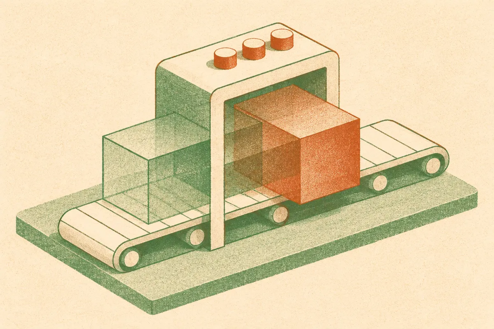

TL;DR: B3 is a practical inference-side speedup for self-editing diffusion language models, but it matters most to teams already betting on DLMs for latency-sensitive generation.

## What problem does B3 actually fix?

The primary source is the arXiv paper “Blurring the Block Boundaries: Overlapping Block Denoising for Efficient Diffusion Language Models.” The supplied cs.AI and cs.CL entries describe the same paper, so I’m treating this as one research result, not two independent confirmations.

The core issue is simple: block diffusion language models generate text in chunks, then refine those chunks over several denoising steps before moving on. That gives DLMs a different latency profile than autoregressive models, which produce one token after another. DLMs can be attractive when you care about fast generation, especially if the model can revise its own draft inside a block.

But block generation creates a bottleneck. A block is only done when its slowest token is ready. The next block has to wait. That means useful compute can sit idle while the model finishes polishing one stubborn part of the current block.

B3, short for Blurring the Block Boundaries, attacks that wait time. Instead of finishing one block completely and then starting the next, it refines two blocks in parallel inside a shared forward pass. The paper says B3 decides on the fly when to open the next block, based on whether the model is ready, rather than using a fixed hand-tuned schedule.

That last part matters. A speed trick that needs retraining, task-specific tuning, or a pile of fragile parameters is less useful in production. The B3 paper reports that the method is training-free and hyperparameter-free, and can plug into any self-editing block diffusion model.

## How much speed are we talking about?

The headline number is modest and useful: the paper reports 11.5% to 14.5% speedup over the base model, with generation quality on par, across 10 datasets spanning different tasks and difficulty levels.

That is not a “new model beats everything” claim. Good. It is a systems-flavored inference improvement. If the result holds up, it pushes the latency-quality trade-off for a specific class of models without asking users to retrain.

This is the kind of gain operators should care about more often. Ten to fifteen percent faster generation can be meaningful at scale. It can reduce queue time, improve interactive UX, or let you hit a latency budget with a slightly larger model. Not glamorous. Very real.

The catch is that the paper is about diffusion language models, not the dominant autoregressive stack most teams run today. If your app is built on GPT-style next-token generation, B3 does not drop into your pipeline. It is relevant if you are experimenting with DLMs, building low-latency text systems, or tracking alternatives to autoregressive decoding.

## What should builders take from this?

The broader signal is that language model latency is no longer just a model-size problem. It is also a scheduling problem. Autoregressive decoding has its own bag of tricks, like speculative decoding, caching, batching, and better kernels. Diffusion language models are developing their own equivalent layer of inference engineering.

B3’s idea is appealing because it exploits structure already present in block diffusion. It does not try to make each denoising step smarter. It reduces dead time between blocks. That is often where practical wins come from: not changing the task, just removing unnecessary waiting.

I would still want to see more before treating this as a default production method. The abstract says quality stays on par, but “on par” depends on the evaluation setup, the models tested, and the tasks chosen. It also does not tell us how the speedup behaves under real serving constraints: batching, memory pressure, mixed request lengths, streaming UX, and hardware-specific kernels. Those details decide whether a research gain becomes a product gain.

For builders, the move is not “switch to DLMs because B3 exists.” The move is narrower. If you already test self-editing block diffusion models for latency-critical workloads, add B3-style overlapping to your inference benchmark. Compare time-to-first-useful-output, total latency, quality, and GPU utilization against your current decoding path. The missed catch: a 14% model-side speedup can disappear if your product bottleneck is retrieval, orchestration, network round trips, or post-processing.
