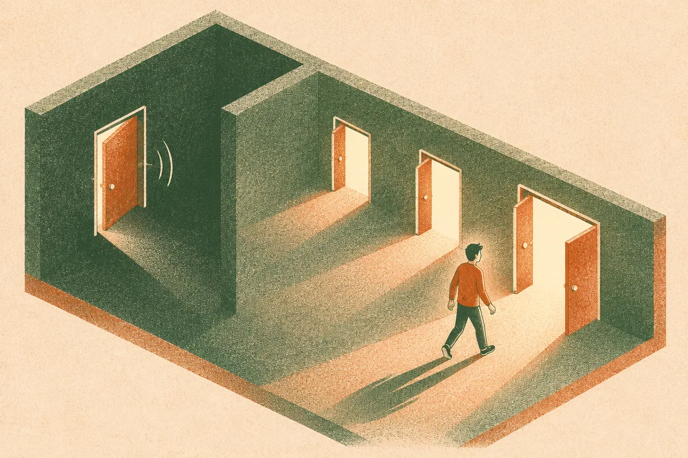
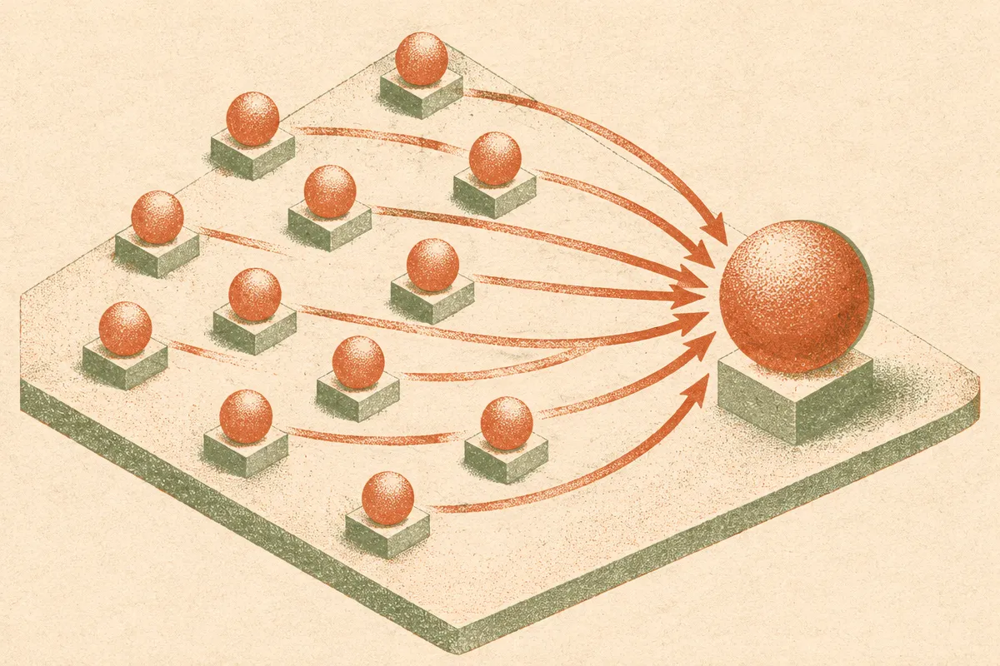

TL;DR: A discovery agent that rejects one hypothesis at a time throws away most of what its experiments reveal, and scoring evidence across a set of mutually exclusive explanations recovers the answer the rejection was pointing at.

The paper is "Contrastive Discovery: Open-Ended Scientific Discovery over Competing Explanations," posted to arXiv across cs.AI, cs.CL, and cs.LG. I want to pull it apart because it fixes a bug in how most agentic science setups actually reason, and the fix is small enough to bolt onto something you already run.

## What is the actual problem with how discovery agents test hypotheses?

Most LLM discovery agents work pointwise. They form a hypothesis h, run an experiment, and ask whether the evidence supports h or its complement, not-h. When the evidence kills h, the agent learns one thing: that explanation is unlikely. It does not learn which explanation the evidence actually favors.

That gap matters more than it sounds. The authors report that across six domains, 89% of the pointwise candidates with the largest belief shifts were rejections. Read that again. The experiments that moved belief the most were overwhelmingly the ones that told the agent "not this," and then left it standing there. The most informative moments in the search were also the least resolved. A human scientist in that spot does not stop. They say, okay, not that, so probably this other thing, and keep going. The pointwise agent registers surprise and halts.

This is a measurement-unit problem, not a model-capability problem. The agent is asking the wrong question of its own data. It measures distance from a single claim instead of redistribution of belief across the live possibilities. And because rejections dominate the high-signal results, a huge share of the agent's best evidence gets logged as a dead end rather than a clue.

## How do contrast sets change what the agent scores?

The fix the authors propose is a contrast set: a scientific question paired with competing explanations that are mutually exclusive and collectively exhaustive. Instead of "is h true," the unit becomes "which of these explanations does the evidence support." Each experiment is scored by how it redistributes belief across the set, and the question counts as resolved when belief concentrates on one explanation.

The important design choice is that this changes only the unit an agent proposes and scores. It does not require a new agent, a new model, or a new training run. The authors are explicit that an existing agent can use contrast sets two ways: re-evaluate evidence it already collected, or guide fresh search. That second part is the one operators should notice. You can take experiments already sitting in your logs and re-score them against competing explanations without spending a dollar on new data collection.

The numbers back the reframing. On the same evidence that pointwise scoring left as rejections, contrast sets resolved 73% of those high-belief-shift candidates to a specific alternative. So roughly three out of four "dead ends" were not dead at all. They were answers the pointwise framing could not read.

When contrast sets drive the search rather than just re-reading old results, the agent resolved 67% more questions than pointwise surprisal under the same experiment budget. That is the line I would put on a slide. Same compute, same experiments, same model, two-thirds more resolved questions, because the agent stopped treating "not this" as the end of the thought.

## Does the resolved answer actually hold up to human experts?

This is where a lot of agentic-science papers get soft, and this one does not. The authors ran a blinded study with 38 human experts. On resolved questions, experts chose the same explanation the contrast-set agent did 78% of the time. And on the questions where the pointwise agent had rejected its hypothesis and stopped, experts agreed with the contrast-set resolution 82% of the time.

That second figure is the one that earns my attention. These are exactly the cases where pointwise reasoning gave up. The contrast-set agent pushed to an answer, and in more than four out of five of those, independent experts landed on the same explanation. That is not the agent being clever in a vacuum. That is the agent recovering a conclusion a human would have reached from the same evidence, which is the honest bar for "discovery" rather than "pattern noise."

I will keep the skepticism on too. Agreement is not correctness. Experts can be wrong together, and a contrast set is only as good as the explanations you load into it. If your set is not actually exhaustive, belief concentrates on the best of a bad lineup and the agent reports false confidence. The paper's framing assumes you can enumerate the real competing explanations up front, which in genuinely open-ended discovery is the hard part. Mutually exclusive and collectively exhaustive is a strong claim about the world, not a free lunch. The method tells you which listed explanation the evidence favors. It cannot tell you about the explanation nobody wrote down.

## What should a builder actually do with this?

Practitioner's take: if you run any kind of agentic analysis loop, data triage, experiment planning, root-cause work, hypothesis search over a dataset, go find where your agent logs "rejected" or "inconclusive" and treat that log as a backlog, not a graveyard. The cheapest experiment here is retroactive. Pull the cases where your agent registered a big surprise and then stopped, define two to four competing explanations for each, and re-score the existing evidence by how it shifts belief across that set. The paper's own result is that most of those will resolve to a specific answer you already had the data for.

The structural move is to change the unit before you change the model. Stop asking your agent "is this true" and start asking "which of these is it." Force the explanations to be exclusive and exhaustive, and make the agent report where belief concentrated rather than a pass/fail on one claim. That one change, per the authors, buys 67% more resolved questions on the same budget.

The catch most readers will miss: the whole method lives or dies on the quality of your contrast set. Garbage explanations in, confident garbage out. Budget real effort on enumerating the candidate explanations, ideally with a human or a second model whose job is to ask "what are we not listing," before you let the agent concentrate belief. The agent is good at reading evidence across options. Giving it the right options is still your job.
