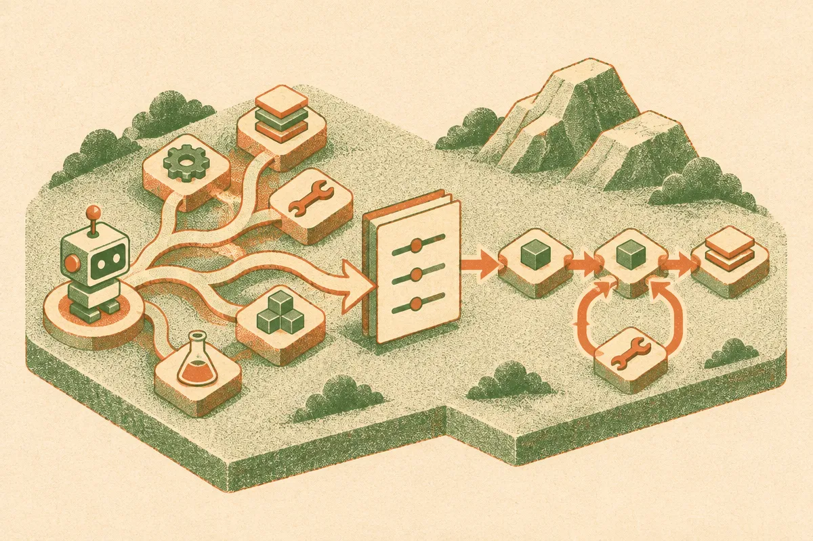

TL;DR: ReTrace shows a useful pattern for agent work at scale: let the agent explore the SOP, then distill its logged reasoning into deterministic workflow code for the jobs you repeat.

## What problem is ReTrace actually solving?

The arXiv paper “ReTrace: Distilling Tool-Using Agents into Planner-Free Workflows” is aimed at a boring, valuable corner of AI: repeated business processes.

Think refund reviews, lead qualification, account updates, support triage, compliance checks. The same Standard Operating Procedure runs again and again on different inputs. An LLM agent can read the SOP and decide each next step, but that means calling a model over and over just to choose actions the system has often seen before.

That is expensive. It is also slow. And in many production workflows, the magic is not in improvisation. It is in getting the same branches right every time.

ReTrace takes an SOP plus a few logged agent runs and turns them into a reusable workflow where code, not an LLM, picks the next step. The important move is that it does not only look at tool calls. It uses the agent’s written reasoning around each tool call, because that reasoning often says why the agent chose a branch.

That matters. A raw trace might show: call CRM, check subscription status, send escalation. The reasoning can expose the condition: escalate if the customer is enterprise and renewal is inside a certain window. ReTrace extracts those conditions, merges them across runs into a compact rule document, then generates executable workflow code.

## How close does distilled workflow code get to the agent?

The numbers are interesting because they are not perfect, and that makes them more useful.

On 79 procedures from the ReTrace team’s production platform, ReTrace workflows reached 93.8% completion versus 96.8% for the original agent, at 24% lower cost per task. That is a trade many operators would at least test: a 3 point completion gap for lower cost and simpler runtime behavior.

The latency result is sharper. On τ²-Bench, ReTrace hit 75.8% task success versus 80.6% for the agent, but ran in 1.3 seconds instead of 170 seconds. That is not a small optimization. That changes where the system can be used.

The repair loop is the part I would watch. Three rounds of repair on training failures lifted k=2 workflows from 66.7% to 81.2%. On eight SOP-Bench procedures, ReTrace without repair trailed few-shot generation, 80.6% versus 83.6%. With repair from labeled training failures, it rose to 87.8% at 0.40 seconds per task, compared with 85.5% in 46.6 seconds for the agent.

So the story is not “agents are dead.” It is “agents may be great teachers for workflows that should not remain agents forever.”

## Where does this fit in a real automation stack?

I like the separation here. ReTrace produces a rule document before generating platform-specific workflow code. The paper says only the last stage depends on the orchestration platform, which means the same distilled logic can be compiled elsewhere.

That is the right abstraction for companies that do not want business logic trapped inside one agent framework. SOPs change. Vendors change. Model prices change. Audit requirements change. A compact rule layer gives humans something to inspect and maintain.

The catch is coverage. Distillation works best when the process is repeated enough to have meaningful traces, and bounded enough that edge cases do not explode. If the job is genuinely open-ended, keep the agent in the loop. If the job is a high-volume SOP with a known decision tree hiding inside it, ReTrace is the more practical shape.

Practitioner’s take: start with one repetitive agent workflow that already has logs, not your hardest process. Capture the agent’s tool calls and its reasoning, extract the branch conditions, then compile the common path into code with an agent fallback for misses. The catch most teams miss is evaluation data. Without labeled failures and repair rounds, you are just freezing today’s agent behavior, including its mistakes.
