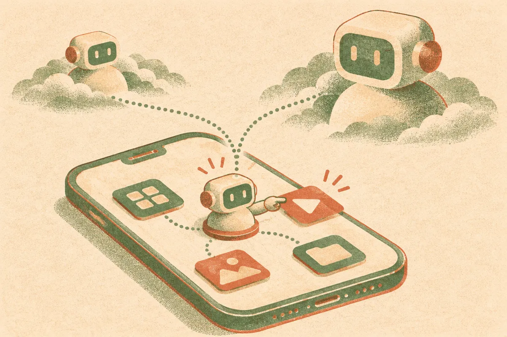

TL;DR: If Tether’s reported BotPsy results hold up, the useful lesson is that phone agents may not need giant models, they need tight task design, local execution, and honest evals.

## What is Tether claiming with BotPsy?

Decrypt reported in “Tether's Tiny AI Agent Beats Models 2.5 Times Its Size at Controlling Your Phone” that Tether has an 800 million parameter AI assistant, BotPsy, built to manage everyday phone tasks locally. Decrypt also reported that BotPsy outperformed rival models 2.5 times its size at phone control.

That is the whole story worth paying attention to. Not because it proves Tether has cracked agents. It does not. We do not get enough detail from the report to know the task suite, the baseline models, the devices used, the scoring rules, the failure cases, or whether the tests were representative of messy real phones.

But the shape of the claim is interesting.

Most consumer AI agent demos still lean on big cloud models watching screens, parsing UI state, then deciding what to tap next. That can work in demos. It can also be slow, expensive, brittle, and uncomfortable from a privacy standpoint. A smaller local model changes the product question. Instead of asking, “Can GPT-class intelligence run my phone?”, the question becomes, “Can a compact model do enough structured action planning to handle common phone workflows?”

That is a better question.

Phone agents do not need to write poetry. They need to open the right app, understand screen state, avoid destructive actions, recover from errors, and know when to stop. A small model tuned around those behaviors may beat a larger general model that is not shaped for the environment.

## Why would a tiny phone agent beat a larger model?

Parameter count is a bad proxy for this job.

A phone-control agent lives in a narrow action space. Tap. Type. Swipe. Wait. Read screen. Confirm. Cancel. Ask the user. Those primitives can be powerful if the model has a good representation of UI patterns and is trained or post-trained against real interaction traces.

So an 800 million parameter model can be plausible here, if the training data and eval design are focused. Smaller models also have practical advantages on-device: lower memory pressure, lower latency, less battery hit, and fewer cloud round trips. None of those are guaranteed by “800 million parameters,” but they are the reason builders care.

The hard part is reliability. Phone agents fail in ways that feel worse than chatbots. A chatbot hallucination is annoying. A phone agent tapping the wrong button can send the wrong message, delete something, approve a payment, or leak private context. This is where “beats bigger models” needs receipts.

I would want to see task-level pass rates, intervention rates, latency, rollback behavior, refusal behavior, and results across different phones, languages, apps, and accessibility settings. A demo benchmark is not enough. A good phone agent should be judged like a junior operator with limited permissions, not like a chatbot with a screen.

## What does the Tether angle change?

Tether’s broader push, as Decrypt frames it, is decentralized AI. Since Tether sits in the crypto world, that angle will attract the usual noise. I would separate the AI mechanics from any market narrative. No token story is needed to evaluate whether local agents are useful.

The operator question is simpler: can small local models make AI assistants cheaper, more private, and more dependable for repetitive device work?

Maybe. The idea fits where the market is already moving. Big models remain useful for planning, language, and general reasoning. Smaller models can sit closer to the user and handle constrained actions. That split is likely where practical agents land: large models for hard thinking, small local agents for routine execution, with guardrails between them.

The catch is that “local” does not automatically mean safe. A local agent still needs permissions, logs, confirmation flows, and scoped actions. If it can touch your apps, it needs product design as much as model quality.

For builders, the move is not to clone a full phone assistant tomorrow. Pick one narrow workflow on one device class, like filing receipts, triaging screenshots, or updating a CRM from messages. Use the smallest model that can perceive state and choose actions reliably. Measure interventions, not vibes. The catch most readers miss: the winning agent is probably not the smartest model, it is the one that fails predictably and asks for help before it taps the dangerous button.
