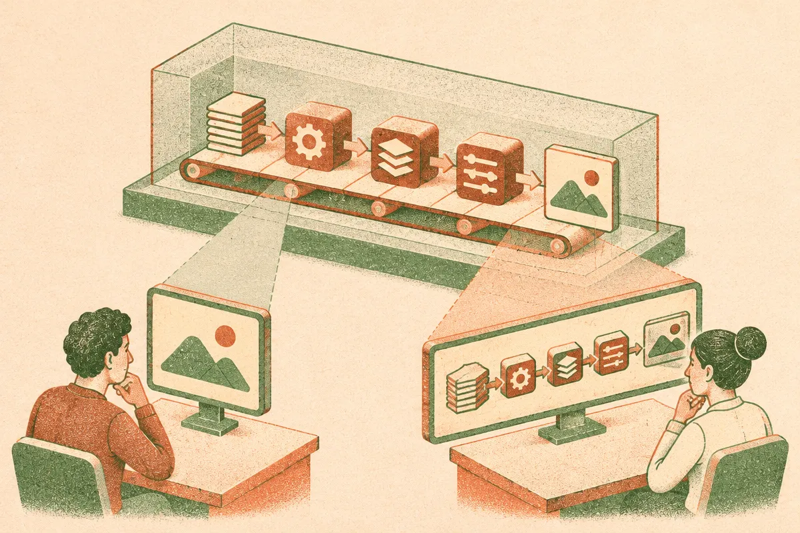

TL;DR: If your agent evaluator only sees the final text answer, it misses the subtle failures that live in the trace, and no single evaluation method catches both functional bugs and security holes, so you need two.

Most teams shipping agents treat evaluation as a checkbox. Run a judge model over the outputs, get a score, move on. The paper I want to walk through, "Comparative Analysis of Agent Evaluation Frameworks: Stability, Detection, and Discovery in Enterprise Analytics Agents" (arXiv, cs.AI/cs.CL/cs.LG), takes that assumption apart. It runs three different evaluation paradigms against two real analytics agents and measures, concretely, which ones catch what. The headline finding is boring in the best way: the quality of your evaluation is capped by the information your evaluator can see.

## What does the study actually test?

The authors built a three-phase comparison. Three evaluation frameworks, each a distinct paradigm: trace-based LLM judging (the evaluator sees the full execution trace, every tool call and intermediate step), text-only LLM judging with red-teaming (the evaluator sees the final text plus adversarial probes), and deterministic heuristics (rule-based checks, no model in the loop). They ran all three against two analytics agents using frozen execution traces, which is the right call. Freezing the traces means you are comparing the evaluators, not the random variance of the agents re-running.

That controlled setup matters because agent evaluation is notoriously noisy. An agent can succeed on Monday and fail on Tuesday on the same prompt. If you want to know whether your harness is any good, you have to hold the agent's behavior constant and vary only the thing you are studying. This paper does that.

## Why does trace visibility change the result so much?

Phase 1 is about stability. Can you trust the harness to give you the same answer twice? They found 97% of configurations met their stability threshold, and the stability patterns were agent-independent. That second part is quietly useful. It means a harness that is stable on one agent tends to be stable on another, so you can validate your evaluation setup once rather than re-proving it for every agent you ship.

Phase 2 is where the real lesson lands. On 72 ground-truth test cases, the trace-based framework hit the best precision-recall balance, an F1 of 0.90. The text-only evaluator matched it on recall, meaning it caught roughly the same real failures, but it generated five times more false alarms. That is the number to sit with. Five times the noise for the same catch rate.

If you have ever run a text-only judge in production, you know what five times the false positives feels like. Every alert costs a human a few minutes to triage. A flood of false positives trains your team to ignore the alerts, which defeats the point of having them. The trace-based evaluator does better not because it is a smarter model but because it can see the work. When the agent calls the wrong tool, retrieves the wrong table, or silently drops a filter, that failure is visible in the trace and invisible in the polished final sentence. A text-only judge is grading an essay without seeing whether the student cheated to write it.

This is the paper's first stated conclusion, and it generalizes well beyond analytics agents: the information available to the evaluation harness determines evaluation quality. You cannot judge what you cannot observe.

## Do functional and security evals find the same bugs?

No, and this is the part I did not expect. Phase 3 looked at unknown risk discovery, the failures nobody wrote a test for. The harnesses surfaced 24 novel failures with zero overlap between functional testing and security red-teaming. Zero. The functional evaluator found bugs the security red-team never touched, and the red-team found holes the functional tests never approached.

That disjoint set is the argument for running both. If you only do functional evaluation, you ship with your security surface untested. If you only red-team, you ship with functional correctness unverified and you will find out from users. The two are not redundant layers of the same net. They are two different nets catching two different kinds of fish.

The authors also note that the LLM-based harnesses surfaced subtle errors human reviewers miss. I read that with the usual caution. "Humans miss things" is a common finding in papers that sell automated evaluation, and the honest framing is that machines and humans miss different things, same as the two eval types do. But the controlled, frozen-trace setup here makes the claim more credible than the usual hand-wave, because the comparison is apples to apples.

## What should a builder actually run?

The paper lands on a clean recommendation: a two-framework strategy. Trace-based evaluation for functional assessment, adversarial red-teaming for security validation. Not one judge to rule them all. Two complementary systems, each matched to what it can see and what it is looking for.

A few honest caveats. This is two analytics agents in a research setting, not a hundred agents across a dozen domains. The F1 of 0.90 and the 5x false-alarm figure are from this specific setup, so treat them as directional, not as targets to hit. And the deterministic heuristics paradigm gets less airtime in the abstract than the two LLM-based ones, which makes me want to see the full numbers before I write off rule-based checks. Cheap deterministic guards still have a place as a first filter.

What I take from it: instrument your agents so the full trace is capturable before you worry about which judge model to use. The evaluator upgrade that matters most is not a better model, it is better observability. Most teams I see are grading final answers because that is the only thing they bothered to log. Fix the logging first and your text-only judge quietly gets closer to the trace-based one, because you have given it something to look at.

Then run two passes. A functional pass over traces for correctness, and a separate adversarial pass for security, and do not assume either one covers the other. Budget for both. The zero-overlap finding means the pass you skip is exactly the one that catches the failure you did not anticipate. The catch most people miss is that "we have evals" usually means one narrow thing, and this paper is a tidy argument that one narrow thing is not evaluation, it is half of it.
