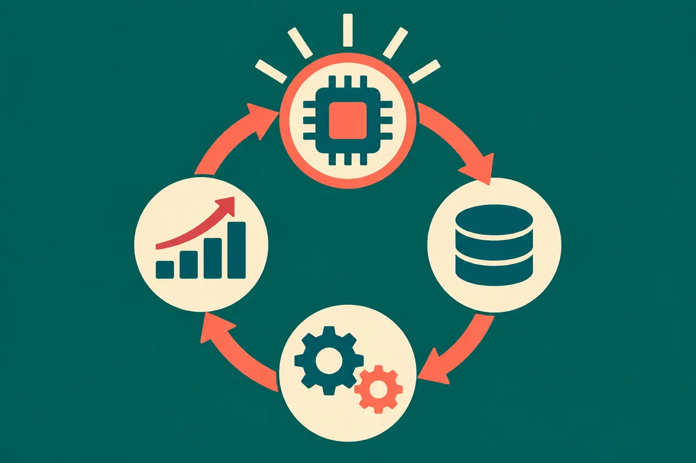
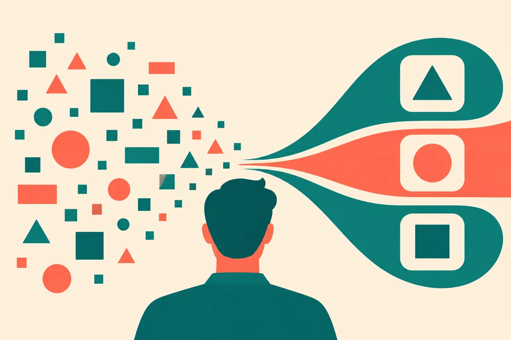
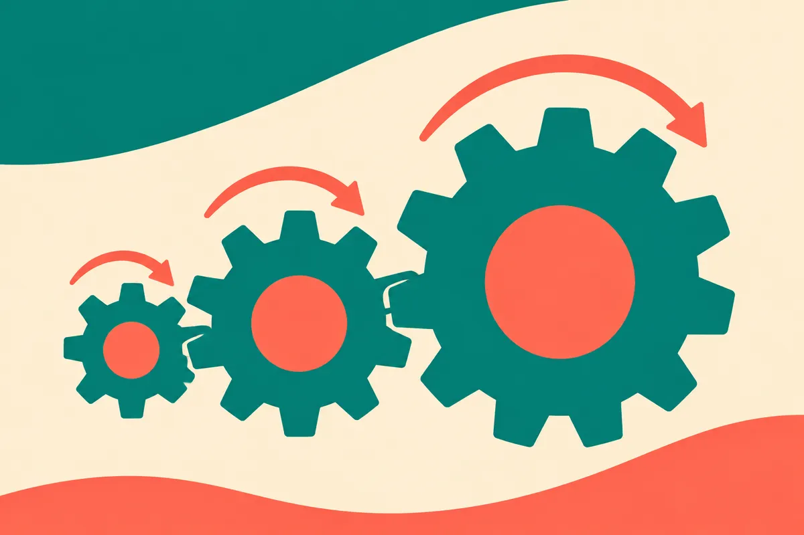

TL;DR: OpenAI's case study on Amplitude's Wave agent is less about a single feature and more about a loop worth copying: detect what to build, draft the change, ship it, measure the result, with the detection step running before any human files a ticket.

Most agent demos you see are single-shot. Ask a question, get an answer. Paste an error, get a fix. Useful, but it is the agent equivalent of a calculator. The interesting claim in OpenAI's writeup on Amplitude is structural, not cosmetic. According to the OpenAI blog post "How Amplitude ships product improvements in 1–2 days with OpenAI," the Wave agent closes a loop that product teams normally run as four separate jobs held together by meetings and spreadsheets.

I want to pull that loop apart, because the headline number (1 to 2 days to ship) is the least interesting part. The sequencing is the thing.

## What does Amplitude's Wave agent actually do?

Per OpenAI, Wave is a "proactive product agent" built primarily on OpenAI models. The word that matters there is proactive. OpenAI describes Wave as doing three things: it identifies what to build, it helps teams ship changes with coding agents, and it measures the impact.

Read that as a chain. Detection feeds a build step. The build step uses coding agents to produce an actual change. Then a measurement step checks whether the change moved anything. The output of the last step should, in a healthy loop, become input to the next detection pass.

That is a different shape from how product work usually happens. Normally a human notices a problem (or doesn't), writes it up, a different human estimates it, a third ships it, and weeks later someone maybe checks if it worked. Four handoffs, four chances for the thread to drop. Amplitude's pitch, as OpenAI frames it, is that the agent carries the thread across all four.

A caveat up front: this is a vendor case study on OpenAI's own blog about a customer running OpenAI models. The specific claims about what Wave does, how fast it ships, and how it measures impact come from that post, not from independent testing. Treat the mechanics as reported by OpenAI and Amplitude, not as benchmarked fact. I have not seen Wave run.

## Why is "proactive detection" the hard part?

Everyone wants to talk about the coding-agent step because that is the flashy one. An agent writes the diff, opens the PR, you merge. We have watched that mature all year with Codex and Claude and the rest. It works well enough that it is no longer the bottleneck.

The bottleneck is knowing what to build. That is where most of the waste lives. Teams ship the wrong thing fast, or ship the right thing six weeks late because nobody surfaced it. Amplitude sits on product analytics, which means it has the raw material to spot friction (drop-offs, dead clicks, funnels leaking) without a human staring at a dashboard. OpenAI's framing is that Wave turns that signal into a candidate change automatically.

If that works even half as well as described, it is the valuable half of the loop. Code generation is a commodity now. Problem detection grounded in real usage data is not.

The honest skeptic's question: how good is the detection, really? OpenAI's post does not give me a precision number, a false-positive rate, or how often Wave's "what to build" suggestions get thrown out by Amplitude's own product managers. Without that, "proactive" could mean genuinely useful prioritization or it could mean a firehose of low-value suggestions that humans still have to triage. The case study does not settle it, and I am not going to pretend it does.

## How would a builder copy this loop without buying Wave?

You do not need Amplitude's product to steal the architecture. The pattern is portable, and that is the real takeaway.

Start with the detection source. You need a signal that fires without a human asking. Analytics events, error logs, support ticket clusters, review sentiment, failed searches on your own site. Something that reflects real user friction and updates on its own. Pick one. This is the part most teams skip, and it is why their "AI workflow" is just a chatbot bolted to a repo.

Then wire the three steps as explicit stages, not one mega-prompt:

- Detection: an agent that reads the signal on a schedule and proposes a small, specific change with the evidence attached. The evidence matters. A suggestion with no "here is the funnel that is leaking" is noise.
- Build: hand the proposal to a coding agent (Codex, Claude Code, whatever you run) with enough context to draft a real diff, not a sketch.
- Measurement: close the loop. After the change ships, the same system checks whether the metric it flagged actually moved. If it did not, that becomes a new detection signal.

The measurement step is the one everyone drops, and dropping it is what turns a loop into a line. Without it you have no idea whether the agent is shipping improvements or just shipping. OpenAI putting "measures the impact" as a named stage is the part of this case study I would actually lift.

One warning for anyone building the detection stage against their own website data: friction signals and SEO signals are not the same thing, and an agent that optimizes for one can quietly wreck the other. I run Lucky Domains, where we do white-hat SEO (luckydomains.io/services.html#seo), and the pattern I see is teams A/B-testing their way into layouts that convert slightly better and rank noticeably worse. If your detection agent touches pages that need to rank, put search visibility in the measurement step too, not just the conversion metric.

## The part most readers will miss

The number OpenAI leads with, 1 to 2 days to ship, is a result, not a method. Chasing that number directly gets you fast shipping of unvalidated changes, which is how you move metrics in the wrong direction quickly.

The method is the loop closing on itself. Detection informed by measurement from the last cycle. That is what separates this from a faster conveyor belt. A conveyor belt moves things fast in one direction. A loop learns.

Practitioner's take: build the measurement stage first, before the flashy parts. Pick one metric you already trust, one friction signal that updates on its own, and wire a dead-simple version: signal in, proposed change out, did-the-metric-move check after. Run it manually for two weeks with a human approving every step, logging how often the detection suggestion was actually worth building. That hit rate is your real benchmark, and it is the number OpenAI's case study does not give you. If detection is garbage, a faster coding agent just helps you ship garbage faster. Get the "what to build" right, and the rest of the loop is wiring you already have.
