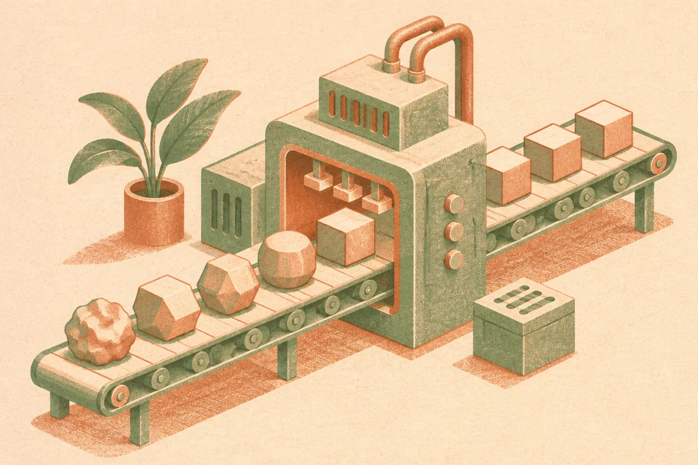

TL;DR: Fine-tuning 3D generation models is most useful when you treat it as a controlled production pipeline, not a magic button for making perfect 3D assets from prompts.

## What is the real use case for fine-tuning 3D generation?

Hugging Face’s Blog post, “The Definitive Fine-Tuning Guide for 3D Generation Models,” lands in a category that is getting more practical fast: adapting generative models for 3D asset creation.

The important word is “fine-tuning.” Not “generate anything.” Not “replace every 3D artist.” Fine-tuning means narrowing the model toward a target. A product style. A creature family. A furniture line. A game asset language. A specific kind of mesh or texture output that a team needs again and again.

That is where 3D generation starts to make operational sense.

Generic text-to-3D demos are fun, but they often hide the annoying parts: topology cleanup, texture consistency, scale, licensing, export formats, game engine import, review loops, and whether the thing can survive in an actual production environment. A pretty render is not the same as a usable asset.

Fine-tuning changes the question. Instead of asking, “Can this model make a dragon?” the useful question is, “Can this model make 200 objects that fit our dragon game’s art direction closely enough that artists spend time polishing instead of starting from scratch?”

That is a much better bar.

## Why is 3D harder than image generation?

Images are forgiving. A weird hand can still pass in a mood board. A 3D asset has to exist from multiple angles. It has geometry. It has surfaces. It may need to be rigged, animated, lit, compressed, rendered in real time, or manufactured.

That makes “looks good once” a weak benchmark.

For builders, the hard parts are usually consistency and fit. Does the model keep the same design language across outputs? Does it produce geometry that downstream tools can use? Does it understand the difference between concept art and production art? Can the team inspect failure modes instead of just cherry-picking the best samples?

This is why I like the direction implied by Hugging Face’s guide. Fine-tuning puts pressure on dataset quality, evaluation, and workflow integration. Those are boring words, but they are where most AI systems either become useful or stay demos.

The dataset matters more than the prompt. If the training examples are inconsistent, the model learns inconsistency. If the target assets have messy metadata, unclear categories, or uneven quality, the fine-tune inherits that mess. In 3D, that can mean broken normals, odd proportions, unusable meshes, or textures that look fine in one view and fail in another.

## What should builders test before betting on it?

I would test 3D fine-tuning with a narrow asset class first. Not “all props for our game.” Something like chairs, helmets, toy vehicles, sci-fi crates, sneaker variants, product mockups, or stylized plants.

Then judge the system on the real workflow, not the gallery.

How many generated assets are usable without major repair? How often do they match the target style? How much time does an artist save after cleanup? Can the outputs be exported into Blender, Unity, Unreal, or the team’s existing pipeline without strange surprises? Does the fine-tune produce variety, or does it collapse into near-duplicates?

The other thing to watch is rights. 3D datasets can contain commercial models, scanned objects, branded products, and marketplace assets with different licenses. Fine-tuning on a folder of “cool stuff we found” is not a strategy. It is a liability waiting for a calendar reminder.

The practical move: pick one repeatable asset type, build a clean training set, define what “usable” means before training, and measure artist time saved after cleanup. The catch most readers miss is that the model is not the product. The product is the loop: curated examples, fine-tune, generate, inspect, repair, feed learnings back into the next run. That loop is where 3D generation becomes useful.
