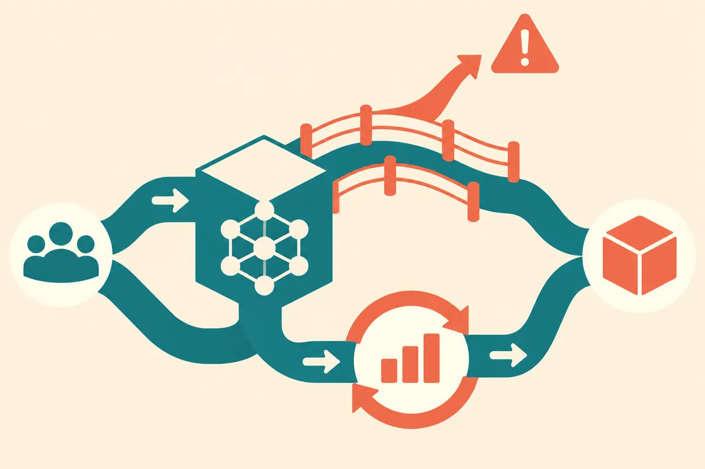

TL;DR: OpenAI’s $2 million commitment to AI and children’s safety matters most if it produces shared, usable measurement tools that builders can test against before kids encounter the failure modes in the wild.

## What did OpenAI actually commit to?

OpenAI’s blog post, “Supporting research on AI and children’s safety,” says the company is committing $2 million to research on AI and children’s safety. OpenAI frames the work around shared tools for measuring both risks and opportunities for young people.

That second part is the important part.

A funding number by itself does not tell us much. Two million dollars is meaningful for academic and nonprofit research teams. It is tiny next to frontier model development, infrastructure, distribution, and the cost of fixing safety problems after deployment. So I would not read this as “the children’s AI problem is now funded.”

I read it as a signal about where the bottleneck is: measurement.

Child safety in AI is not one problem. It is a bundle. Age-inappropriate content. Over-trust in chatbot advice. Emotional dependency. Manipulation. Privacy leakage. Help with schoolwork that crosses into cheating. Useful tutoring that should not be blocked. Creative play that is harmless in one context and risky in another. The same model behavior can be benign for a 17-year-old and unacceptable for a 9-year-old.

If OpenAI’s funding helps create shared ways to test those differences, that is useful. If it turns into broad principles and panel language, less so.

## Why is child safety measurement so hard?

Most AI evals are built around adult assumptions. They ask whether a model refuses a bad request, answers accurately, follows instructions, or avoids toxic output. Those are necessary checks, but they are not enough for young users.

Children change the evaluation target. A safe answer may need to be age-aware, emotionally careful, privacy-preserving, and educationally appropriate at the same time. That is harder than a binary pass/fail refusal test.

There is also a product reality here. Kids do not only use “kids’ AI products.” They use general chatbots, search boxes, writing tools, image generators, homework apps, game companions, and whatever is embedded in the software adults already bought. Safety systems have to work across messy surfaces, not only inside a clean demo.

The phrase “shared tools” is doing a lot of work in OpenAI’s post. Shared tools could mean benchmarks, red-team protocols, taxonomies, model behavior tests, reporting templates, or evaluation datasets. OpenAI’s short announcement does not spell out which ones, at least from the material provided here. That matters, because each has a different path to real adoption.

A benchmark can be gamed. A taxonomy can be ignored. A red-team protocol can be useful but expensive. A dataset can become stale as kids adapt and products change. The practical win would be a set of tests that product teams can run repeatedly, compare across models, and update as new failure modes appear.

## What should builders watch for next?

The test is not whether OpenAI funds research. The test is whether the funded work changes pre-launch behavior.

For builders, the useful output would look boring: sample prompts by age band, evaluation rubrics, severity levels, privacy checks, adversarial scenarios, and guidance on when a model should answer, redirect, escalate, or refuse. That is the stuff product teams can wire into QA, eval pipelines, policy reviews, and incident response.

There is also a governance angle. If shared measurement tools become credible, regulators and schools may start asking vendors to show their work. Not with vague “we care about safety” copy, but with evidence: what did you test, which age groups did you account for, what failure modes did you find, what did you change?

My bias: child safety will not be solved by one lab’s policy page or one universal benchmark. It will be improved by repeated measurement, narrower claims, and products that admit when they are not designed for younger users.

If you are building an AI product that could be used by kids, do not wait for the perfect standard. Start a small child-safety eval suite now. Include age-sensitive prompts, emotional reliance scenarios, privacy traps, and homework misuse cases. The catch most readers miss: the hard part is not blocking obviously bad content. It is preserving the genuinely useful cases, tutoring, creativity, accessibility, while detecting when the same interaction becomes unsafe for a younger person.
