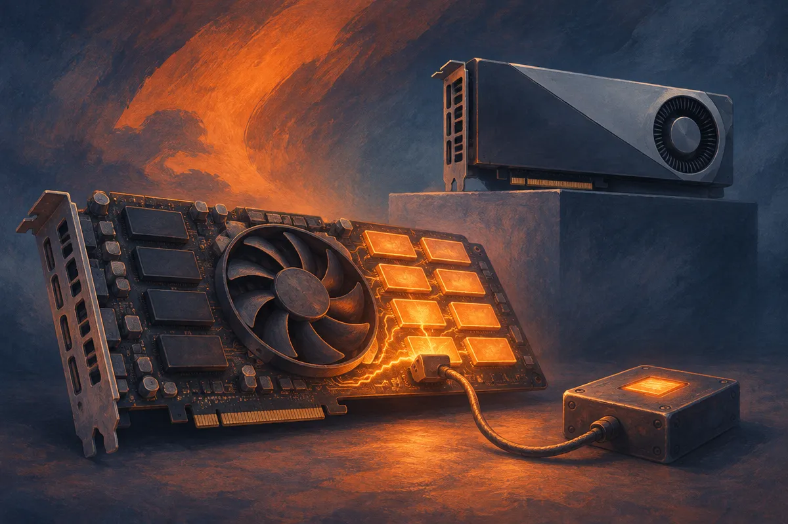

TL;DR: Kate’s CMP 170HX voltage-glitch turns a locked-down mining card into something close to, and in some ways faster than, an A100 80GB, but this is a hard hardware exploit, not a repeatable procurement strategy yet.

## What actually got unlocked?

The primary source here is Kate’s writeup, “Using voltage glitching to unlock the A100” by Kate, posted at blog.kate.land. The Reddit threads around it framed the work as turning a Nvidia CMP 170HX cryptomining GPU into a “full-fat” A100 80GB. That framing is loud, but the underlying technical claim is the interesting part.

The CMP 170HX was sold as an 8GB mining card. According to Kate’s reported work, the board can contain far more HBM than that, with much of the memory and compute disabled by fuse locks. Earlier software work reportedly got some cards to 64GB. Kate used voltage fault injection, with a custom STM32 glitcher and board-level wiring, to bypass the fuse lock path and expose the rest.

The numbers being passed around are not small. Kate reported full 80GB usable for inference on successful cards, FP16 performance around 85.9 TFLOP/s versus 72.5 TFLOP/s on a retail A100, and more enabled SMs than Nvidia ships on an A100. One Reddit summary says 120 to 126 SMs were enabled, compared with 108 on retail A100. NVLink and PCIe Gen4 reportedly come back too.

That is the fun part. The less fun part matters more: this took 1 to 48 hours of glitching per card, required physical board work, and one of ten cards reportedly only had 64GB intact. That is not “flash this BIOS and run Llama.” It is silicon archaeology with a soldering iron.

## Is this a cheap A100 path for local AI?

Not for most people.

The r/LocalLLaMA posts naturally focused on the price contrast, with one title comparing a $2,500 mining GPU to a $20,000 A100. I would treat those as community-reported price anchors, not a stable bill of materials. Hardware markets move, supply is weird, and once a hack becomes famous the cheap parts usually stop being cheap.

The real value is not “go buy CMP cards.” The real value is proof that AI infrastructure constraints are often packaging, segmentation, firmware, and yield decisions, not just raw silicon capability. Nvidia did not accidentally leave a consumer-friendly bargain lying around. The CMP 170HX existed for a specific crypto mining market, then the market changed, and now builders are finding odd remnants in the hardware stack.

For local AI, 80GB of VRAM is a magic number because it opens models and batch sizes that are painful on 24GB cards. It can make inference experiments less contorted. Bigger context, larger quantized models, fewer offload tricks. But a lab-grade unlock with unknown reliability is different from a production accelerator. If the card wedges mid-run, lacks normal support paths, or has partial HBM defects, the headline TFLOPs will not save your weekend.

## What should operators learn from this?

First, weird hardware matters again. The AI boom made GPUs feel like a clean cloud abstraction, but the real world is messier: HBM stacks, disabled modules, board straps, firmware locks, PCIe quirks, and power behavior. People willing to understand those layers can find capacity others miss.

Second, the edge cases are not the platform. A one-person or small-team hardware exploit can be valuable without being operationally sane. Kate’s work is impressive because it is careful and empirical. It does not mean every AI builder should become a voltage glitching shop.

Third, supply chains have memory. Crypto mining hardware, workstation cards, cloud castoffs, export-limited parts, and failed product lines all become the substrate for local AI tinkering. Some of that will be junk. Some will be gold. Most will require more debugging than the savings imply.

My practical read: if you run local inference, watch this class of work, but do not plan around it unless you already have hardware repair skills, spare time, and tolerance for dead boards. The builder move is to test workloads across memory tiers: 24GB, 48GB, 80GB, cloud rental, and weird surplus hardware when available. The catch most readers miss is yield. One successful unlock is a hack. Ten repeatable cards with known failure modes starts to look like infrastructure.
