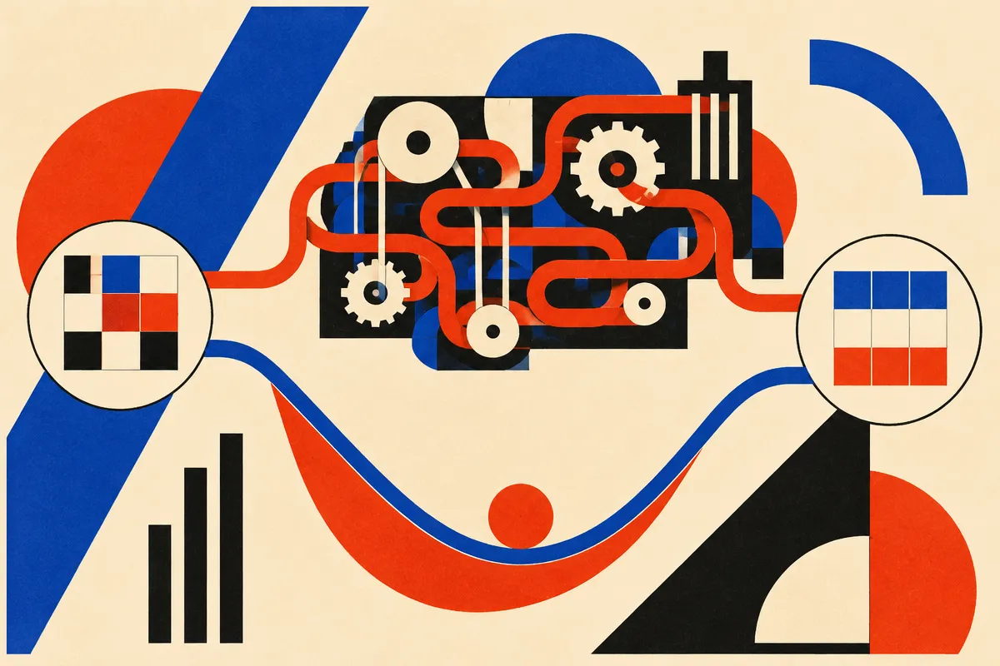

TL;DR: CRAM’s big win is not “classical methods beat neural reasoning,” it is that Sudoku and maze benchmarks may be too easy to tell us much about scalable reasoning.

## What did CRAM actually show?

The primary source here is the arXiv cs.AI/cs.LG paper titled “Classical Energies Learn to Reason 1,000x Faster than Looped Models.” It introduces CRAM, a learned version of Hopfield and Tank’s 1980s energy approach, and compares it against looped models on Sudoku-Extreme and Maze-Unique.

The headline number is hard to ignore. CRAM reportedly solves 99.996% of Sudoku-Extreme and 100% of Maze-Unique test puzzles after 42 ms and 132 ms of training on one GPU. The paper says that is at least 1,000x faster than looped models on these tasks. It also reports that CRAM matches the best Sudoku-Extreme accuracy of baseline looped models while using at least 282x fewer inference FLOPs.

That is a serious result. But it is not magic. Energy descent is a good fit for puzzles where the goal is to satisfy explicit constraints. Sudoku has rows, columns, boxes, and digits. Mazes have connectivity and path constraints. If a model can learn those constraints as an energy, then solving becomes a matter of moving downhill until violations disappear.

Looped models take a different route. They run repeated neural computation, often hoping that iteration produces something like reasoning. That can work, but it can also be slow, unstable, and expensive. CRAM’s pitch is cleaner for this class of problem: define a learnable energy, descend it, stop early when the answer is done.

## Is this really “reasoning,” or just the right solver for the toy?

This is where I think the paper is most useful. Not because it crowns a winner, but because it calls the test into question.

The paper itself warns against using “trivially solvable benchmarks like Sudoku and Maze” to test the scalability of looped reasoning techniques. That matters. If a method from the 1980s, updated with learned parameters, can crush modern looped models on these tasks, maybe the tasks are not measuring the thing people want to claim.

Sudoku is not easy for humans at the “Extreme” level, but it is structurally tidy. The rules are fixed. The answer space is constrained. There is no ambiguity, no shifting goal, no tool failure, no adversarial user, no missing data, no long-running plan with side effects.

Real AI reasoning work usually has messier edges. A coding agent has to inspect a repo, infer conventions, change files, run tests, recover from bad assumptions, and avoid breaking unrelated behavior. A research agent has to decide what evidence counts. A business workflow agent has to ask for clarification when the task is underspecified. That is a different beast from constraint satisfaction on a clean puzzle.

So I would not read CRAM as proof that energy-based systems are the future of all reasoning. I would read it as proof that benchmark choice can flatter the wrong architecture.

## Why should builders care?

Because compute is part of product quality. If a task can be solved by a smaller, clearer method, using a giant looped reasoning model is not sophistication. It is waste.

CRAM has traits builders should want: adaptive compute, early stopping, faster training, and interpretable weights that learn puzzle constraints. Those ideas generalize even if the exact Sudoku result does not. Many production AI systems contain subproblems that look less like open-ended language and more like constraint solving: scheduling, routing, validation, form completion, data cleaning, policy checks, configuration repair.

The practical mistake is forcing every one of those jobs through a general language model because the demo feels smarter. Sometimes the right answer is a hybrid system. Let the language model understand the request, plan the workflow, and explain the result. Let a constraint solver, energy method, search routine, or typed validator do the part where correctness has structure.

My practical read: if you are building agents, audit your workflow for hidden puzzle pieces. Anywhere the rules are explicit and success is checkable, try a specialized solver beside your model loop. Measure accuracy, latency, and cost separately. The catch most readers miss is that “reasoning benchmark” does not mean “reasoning product.” CRAM looks great here partly because the world it operates in has clean rules. Your product probably does not.
