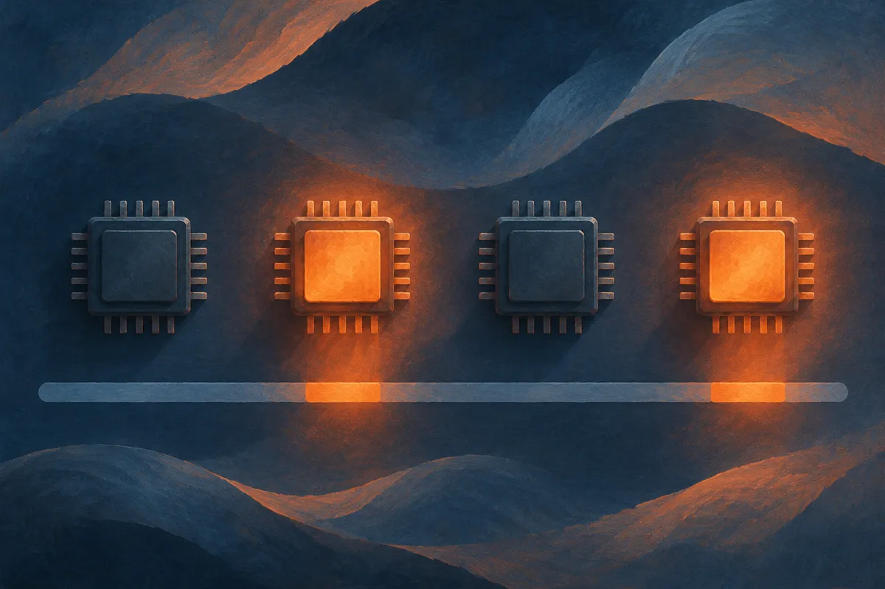
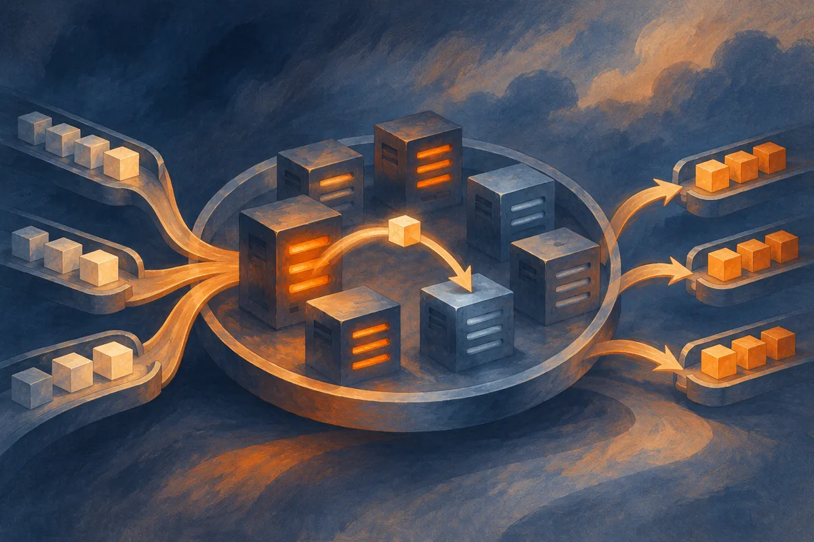

TL;DR: A GPU coding agent spends most of a rollout not using the GPU, and Metal Sandbox recovers that idle time by scheduling commands across a small cluster of Macs, yielding roughly 2x throughput on four Mac mini M4 nodes.

The paper is "Metal Sandbox: Isolated Execution and Command Scheduling for GPU Coding Agents on Apple Silicon," posted to arXiv across cs.AI, cs.CL, and cs.LG. The code and its Harbor integration are open-source on GitHub, per the authors. It is a plumbing paper, not a model paper, and that is exactly why it is worth your time. The interesting bottleneck in agent work right now is rarely the model. It is everything around the model.

## Why does a GPU coding agent leave the GPU idle?

Think about what a single agent session actually does when its job is to write Apple Metal kernels. It asks the model for code. It waits. It runs a build or a lint or a test. It waits. Then, and only then, it runs something on the GPU. Then it loops back to the model with the results.

Three phases, one after another: model request, development command, GPU execution. During the first two, the accelerator is sitting there doing nothing. The authors frame this plainly: these sessions "leave GPU capacity idle for much of a rollout." If you are training or evaluating a model that generates GPU kernels, that idle time is the whole ballgame, because you are paying for the hardware whether it computes or waits.

This is a generalizable observation, not a Metal-specific one. Any agent loop that alternates between a remote model call, local tooling, and a scarce compute resource has the same shape. The scarce resource is starved by the serial structure of the loop. You can buy a faster GPU and it will still be idle most of the time, because the thing holding it back is the waiting, not the computing.

## What does Metal Sandbox actually change?

Three things, and they stack.

First, isolation. Each agent gets restricted per-instance file access and a private development environment, so parallel sessions do not step on each other. This is table stakes for running many agents on shared hardware, and it is the part most homegrown setups get wrong, which is how one agent's `rm` ends up deleting another's workspace.

Second, native execution on macOS instead of a Linux container shim. If the target is Apple Silicon kernels, you want the agent running real `xcrun` and real Metal tooling on real hardware, not an emulation layer that lies to you about performance. There is no honest way to evaluate a Metal kernel except on Metal.

Third, and this is the actual contribution, command-level scheduling across interconnected Macs. Parallel commands run concurrently. Serial commands share one execution slot per node. And here is the clever bit: eligible waiting commands can migrate to a different Mac that has a free slot, run there, and return the result to the original agent. The agent does not know or care which physical machine ran its build. The scheduler treats a small cluster of Mac minis as one elastic pool of execution slots.

The integration with Harbor matters more than it sounds. Harbor handles task execution, automatic verification, and rollout collection through one workflow. For reinforcement learning on code generation, rollout collection and verification are the loop. If your sandbox and your RL harness do not share a workflow, you spend your life gluing them together and debugging the glue. Making that one path is the difference between a research prototype and something a team can run every day.

## How much faster is it, and what are the caveats?

Here is where you read carefully, because the authors are honest about which numbers are measured and which are estimated.

Measured: on four Mac mini M4 nodes, command throughput improved 1.68x to 2.05x under concentrated demand. That is a real controlled experiment, and it is the number I would anchor on.

Measured, by replay: replaying sixteen recorded agent traces under dynamic scheduling cut mean tool waiting by 18.8% and batch elapsed time by 22.3%. The caveat the authors state themselves is that this assumes unchanged phase durations. In other words, the model-call time and GPU-run time stay fixed, and only the scheduling of commands changes.

Estimated, not measured: the headline 2.14x sustained-throughput figure for four sessions per node versus one. The authors label it an estimate and spell out the assumptions, continuously replenished sessions and unchanged mean durations. That is a best-case ceiling under ideal load, not a promise you will see it on your workload.

I appreciate that the paper draws that line. Too many infra results blur measured and projected numbers until you cannot tell what actually happened on the bench. Here the strong claim, around 2x command throughput, is the one they measured, and the softer claims are flagged as softer. That is how you want receipts presented.

The honest limitation: four Mac mini M4s is a small cluster, and the gains come from concentrated, bursty demand. If your sessions are not bursty, if they do not replenish, or if a single command dominates the wall clock, the migration trick has less to recover. Scheduling only helps when there is idle capacity somewhere to migrate into.

## Who should care about this?

Anyone training or evaluating small models for on-device inference on Apple hardware, directly. The target use case, generating Metal kernels for local accelerators, is narrow and real. If that is your work, this is close to drop-in, and it is open-source.

But the broader lesson is for anyone running agent fleets on any scarce resource. The pattern is: isolate per-agent state, run tooling natively against the real target, and schedule commands across a pool so no node sits idle while another is slammed. Swap Metal for CUDA, swap Mac minis for whatever boxes you have, and the architecture holds. The win is not a model trick. It is treating a rack of machines as one scheduler-managed pool instead of a bunch of independent lanes.

Practitioner's Take: if you run coding agents at any scale, profile where a rollout actually spends its wall-clock before you buy more compute. My bet is you will find the same shape the paper describes, a GPU or a CPU idle most of the time while the loop waits on model calls and tooling. The cheap fix is not a bigger machine, it is overlapping work: run several isolated sessions per node and let a scheduler migrate queued commands to whatever node is free. Start by borrowing Metal Sandbox's structure even if you are not on Apple Silicon, per-instance isolation plus a shared execution pool plus one workflow that handles verification and rollout collection. The catch most readers will miss is in the fine print: the 2x command-throughput number is measured, but the 2.14x sustained figure is an estimate that assumes your sessions stay bursty and keep refilling. Measure your own load first. If your agents run long, lonely, single-threaded commands, scheduling has nothing to overlap and you will not see these gains.
