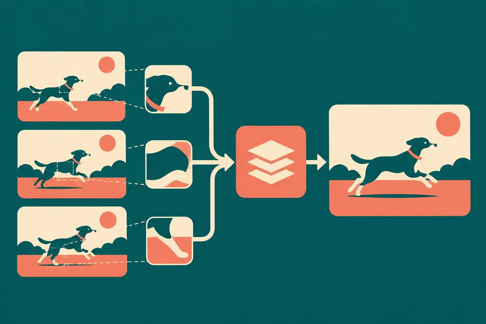

TL;DR: vid2vid-long treats video consistency as a retrieval problem, matching current input patches to past output patches so real-time video models can remember what matters beyond a short context window.

## What problem does vid2vid-long actually solve?

The arXiv cs.AI and cs.LG listings for “Consistent Video-to-Video Translation via Explicit Correspondences” focus on a very specific failure mode in interactive video generation: long-range temporal consistency.

That sounds abstract until you have tried to use video-to-video tools for anything more than a demo. A jacket changes texture when someone turns around. A face style drifts after a camera cut. A logo is sharp in one frame and mushy ten seconds later. The model is not “forgetful” in the human sense. It is often working inside a fixed-length causal window because the system needs to run in real time.

That tradeoff is common. Keep the window short, and latency stays usable. Keep it long, and compute climbs. But if the relevant visual history falls outside the window, the model may have no clean way to know that this sleeve, wheel, wall, or character is the same thing it rendered before.

The useful move in “Consistent Video-to-Video Translation via Explicit Correspondences” is not just “add more memory.” It is more targeted: use the input video as the anchor. If two regions match in the input video, the translated output should match too.

## Why are explicit correspondences better than just adding context?

Bigger context is the obvious answer. It is also expensive, blunt, and often wasteful.

vid2vid-long computes patch-level correspondences in the input video. Those correspondences guide retrieval of previously generated output regions. Then the model conditions on those retrieved patches through correspondence cross-attention.

In plain English: when the model sees a region now, it looks for the matching region from earlier input frames, pulls the corresponding generated output patch, and uses that as visual evidence for what this area should look like.

That is a different shape of memory. Instead of asking the model to carry everything forward through a rolling window, the system keeps a searchable set of prior outputs tied to visible structure in the source video.

This matters because video-to-video translation has something text generation usually does not: a reference stream. The input frames provide explicit cross-frame clues. A red backpack, a sidewalk crack, a person’s hand, or a car door can be tracked visually. The paper’s claim is that matching input regions should produce matching output regions, and that this can improve long-range consistency while preserving generation quality and real-time performance.

I like this because it is not a grand claim about “world models.” It is an operator’s claim. Use the structure you already have. Don’t make the model infer identity from vibes when the input video gives you correspondences for free, or close to free.

## Where does this matter for builders?

The obvious use cases are stylization, live filters, video editing, game capture translation, and creator tools where users expect an object to stay itself across time. Interactive is the key word. Offline video models can spend more time smoothing, re-rendering, or doing global passes. Real-time systems do not have that luxury.

There is also a broader pattern here for AI product design: make memory addressable by the thing that matters. For video, that can be patch correspondence. For code agents, it might be file paths and symbols. For customer support, account events and prior tickets. For robotics, poses and objects. The principle is the same. Memory works better when retrieval is tied to stable structure, not just recency.

The catch is that correspondence is only as good as the matching signal. Occlusion, motion blur, reflections, lighting shifts, repeated textures, and scene cuts can confuse patch matching. If the input region cannot be reliably matched, retrieved patches may reinforce the wrong visual identity. That means vid2vid-long is not a magic fix for all video drift. It is a strong fit when the input video contains trackable regions and the output should preserve those relationships.

Another catch: the abstract reports consistent improvement across recent video models, while preserving quality and real-time performance, but the provided arXiv listing does not give the specific benchmark numbers here. So I would treat this as a promising architecture pattern, not a proven universal replacement for longer-context video generation.

For a builder, the practical next step is to prototype this as a memory layer around an existing video-to-video model: compute patch matches in the source stream, store generated patches with those matches, and condition future frames on retrieved regions instead of only prior frames in a short window. The catch most people miss is retrieval quality. The model is not just generating video. It is trusting the memory you feed it. If your correspondence system is noisy, the output will be consistently wrong, which is worse than occasionally drifting.
