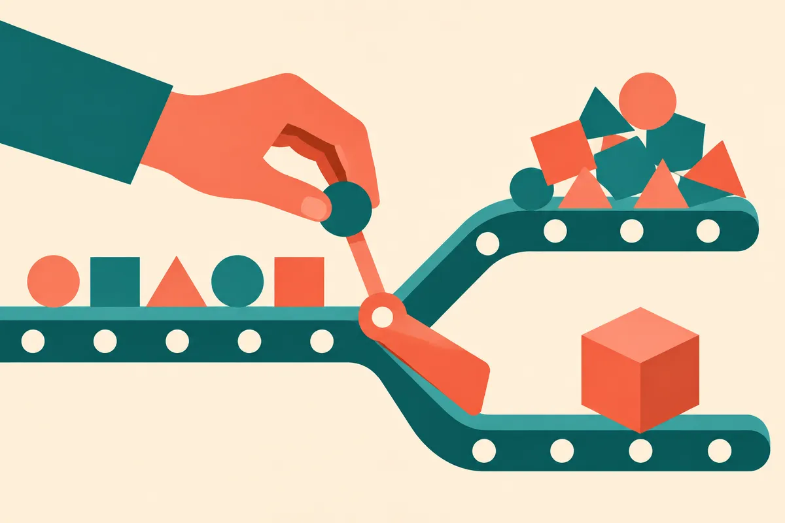

TL;DR: “No AI slop” should mean accountable AI work, not anti-AI purity.

## What does “AI slop” actually describe?

Hacker News surfaced **“No AI Slop: A Manifesto”**, and even from the title alone, the phrase lands because everyone has seen the thing it points at.

A page that reads like filler. A support answer that confidently misses the question. A LinkedIn post with the emotional texture of packing foam. A generated image with no reason to exist except that a tool made it cheap to make. That is slop.

But I do not think “AI slop” should mean “made with AI.”

That definition is too easy, and it lets humans off the hook. Bad work existed before transformers. The difference now is volume, speed, and plausible surface quality. The cost of producing mediocre artifacts has collapsed, so the internet gets flooded with work that was never really selected, edited, or owned.

Slop is not a model category. It is an accountability category.

If a team cannot say who checked the claim, why the piece exists, who it serves, what was removed, and what would make it unacceptable, they are not publishing. They are spraying.

## Where does the line get drawn?

The cleanest line I use is this: did AI replace effort, or did it change where the effort went?

There is nothing wrong with using a model to draft, compress, classify, translate, brainstorm, rewrite, search, or generate variants. Those are good uses when a human brings context and taste. In many workflows, the model is the intern that never sleeps, not the editor-in-chief.

The problem starts when teams confuse output with judgment.

A good AI-assisted article still needs reporting, examples, exclusions, structure, and a reason to exist. A good AI-assisted product feature still needs user research, test cases, failure handling, and a clear boundary for when the system should not answer. A good AI-assisted sales workflow still needs targeting, relevance, and restraint.

Slop tends to have the same fingerprints. It avoids specifics. It uses generic claims. It repeats the prompt back in polished language. It pads. It says everything and commits to nothing. It feels optimized for “looks complete” instead of “helps someone do a thing.”

That is why “No AI Slop” is less interesting as a moral stance and more useful as an operating rule. Do not ship work that nobody would defend by name.

## What should builders change?

The practical move is to build anti-slop checkpoints into the workflow before scale.

For content, that means every AI-assisted piece needs a human owner, a real angle, named sources when claims are specific, and deletion as part of the process. If the model produces ten paragraphs and the human keeps all ten, that is a smell.

For agents and product automation, it means logging decisions, testing failure modes, and designing escape hatches. If the system can act, not just answer, the standard goes up. Slop in a blog post wastes attention. Slop in an agent workflow can send the wrong email, update the wrong record, or give a customer false confidence.

For internal ops, it means measuring usefulness instead of production count. “We generated 500 assets” is not a win by itself. How many were used? How many saved time after review? How many created cleanup work? The cleanup cost is where a lot of AI ROI stories quietly die.

The catch is that anti-slop work feels slower at first. It adds review, style rules, source discipline, and judgment. But that is also the moat. The teams that win with AI will not be the ones producing the most. They will be the ones with the tightest loop between machine output and human taste.

Use AI aggressively, but make someone responsible for the result. Start with one workflow this week, writing, support, research, QA, whatever hurts. Add a clear owner, a rejection standard, and a review step that removes weak output instead of polishing it. The catch most readers miss: quality control is not the thing you add after automation. It is the thing that makes automation worth doing.
