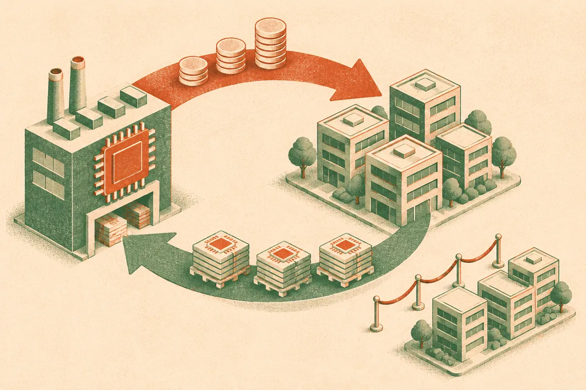

TL;DR: Treat the Nvidia scarcity allegation as unproven, but take the underlying lesson seriously: AI compute access is a capital structure problem as much as a hardware problem.

## Did Nvidia actually engineer GPU scarcity?

The primary item here is the Hacker News (AI) post titled “Nvidia allegedly engineered scarcity by funding AI startups to buy its GPUs.” That wording matters. “Allegedly” is doing a lot of work.

With only that claim in front of us, I would not state that Nvidia engineered scarcity as fact. There is no first-party Nvidia statement here, no named startup list, no funding terms, no purchase agreements, no timelines, and no hard numbers. A forum headline is a pointer to a debate, not proof of market manipulation.

But the allegation lands because the AI infrastructure market already feels circular. Nvidia sells the most desired accelerators. Startups need those accelerators to train or serve models. Investors fund startups partly because they can get compute. Cloud providers and data center operators reserve capacity. Everyone points at “demand” as the explanation, while the cash, chips, and cloud commitments can sometimes move through overlapping relationships.

That does not automatically make it fake demand. It does mean simple supply-and-demand stories are too clean.

If Nvidia invests in an AI company, and that company spends heavily on Nvidia-based infrastructure, there are at least three separate questions. Was the investment strategic and disclosed? Were the purchases economically rational for the startup? Did the arrangement restrict supply or distort pricing for other buyers? Those are different claims. People often mash them into one spicy sentence.

## Why does circular compute financing matter?

Because compute is no longer just an operating expense. For frontier labs and serious AI startups, it is product capacity, distribution, hiring signal, and fundraising collateral.

A company with guaranteed access to GPUs can ship faster, promise lower latency, run bigger experiments, and attract researchers who do not want to wait three weeks for a training slot. A company without access may have better ideas and still lose because its iteration loop is slower.

That is where strategic financing gets interesting. If a chip company, cloud provider, or data center partner funds the customer, the customer may look stronger. If the customer then buys from the funder’s ecosystem, the funder’s revenue can look stronger too. This can be perfectly normal business development. It can also make the market harder to read from the outside.

The mistake is treating every GPU order as the same kind of demand. Some demand comes from profitable inference workloads. Some comes from speculative training runs. Some comes from cloud capacity being reserved before there is enough customer usage to fill it. Some comes from companies racing to show they belong in the “frontier” category.

Those differences matter if you are buying capacity, building on top of model APIs, or deciding whether to run local infrastructure.

## What should builders watch instead of the drama?

I would watch contract shape more than headlines.

Who owns the hardware? Who has priority access? Is the capacity prepaid, reserved, burstable, or spot? Can the buyer switch clouds or chip vendors? Are model margins improving, or is the business still subsidized by capital flowing through the stack?

For an operator, the practical risk is not “Nvidia bad” or “scarcity fake.” The risk is building a product whose unit economics depend on temporary distortions. Cheap API calls, generous startup credits, unusually available GPUs, or subsidized inference prices can disappear. If your product only works under those conditions, you do not have an AI business. You have an arbitrage window.

The opposite mistake is waiting for the market to become pure and transparent. It will not. Strategic capital has always shaped infrastructure markets. Railroads, telecom, cloud, energy, chips. AI is not special there. It is just compressed into a much shorter cycle, with far more public attention.

If you are building with AI, test your stack under boring assumptions. Price the same workflow across two model providers. Know which features actually require the biggest model. Cache aggressively. Keep a fallback path for inference. Avoid signing long commitments until usage is real. And when you hear a claim about engineered scarcity, ask for the receipts, then still update your planning: compute access is a competitive advantage, and the catch most readers miss is that financing terms can shape that access as much as technical merit.
