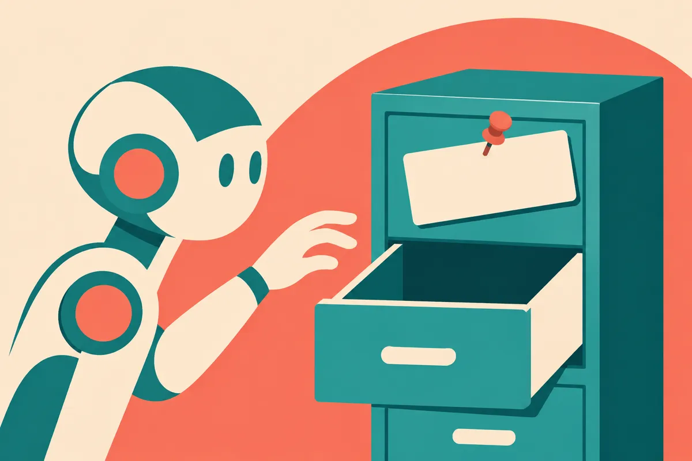

TL;DR: When a company says its AI is "private," the word now usually means "we process your data under rules we wrote," not "your data stays with you," and knowing the difference changes which tools you trust and which ones you ship.

I want to be careful here. The primary source is a Hacker News discussion pointing to a piece titled "Tech Companies Are Trying to Shift the Concept of Privacy (Again)." I do not have the full article text in front of me, only the framing. So I am going to treat the headline as the claim it is and reason about it from what I know of how AI products actually handle data, rather than pretend I read every paragraph. Where I am inferring, I will say so.

The core claim is simple and, in my experience shipping with these tools, correct: privacy as a word is being quietly rewritten to fit what large models need. Models are hungry. They want context, history, your files, your calendar, your chats. The honest version of that is "we need your data to make this useful." The marketed version is "private AI." Those are not the same sentence.

## What does "private" actually mean when a company says it?

There are at least four meanings hiding under one word, and products blur them on purpose.

The first is on-device. Your data never leaves your phone or laptop. Apple's Neural Engine stuff and small local models fall here. This is the strongest claim and the rarest for anything capable.

The second is encrypted in transit and at rest. Your data moves to a server but is scrambled on the way. This is table stakes, not privacy. Every competent service does it, and it says nothing about who reads your data once it is decrypted for processing.

The third is "we do not train on your data." This is the claim enterprise buyers care most about, and it is real when contractually committed. But it is narrow. Not training on your data is not the same as not storing it, not logging it, not letting a support engineer see it, and not handing it to a subprocessor.

The fourth is "processed in a secure enclave" or confidential computing, where even the provider claims it cannot see the plaintext during inference. Apple has pushed this with Private Cloud Compute. It is the most interesting technically and the hardest to verify from outside.

The shift the headline points at is the slide from meaning one toward meanings two through four, while keeping the warm word "private" on the label. On-device is genuinely private. "We encrypt it and promise not to train on it" is a policy, and policies change with a terms-of-service update.

## Why is AI driving this redefinition now?

Because the capability people want requires the thing privacy used to forbid.

A useful assistant needs to know your stuff. An agent that books travel needs your calendar, your card, your preferences. A coding agent that is actually good needs your whole repo, not a snippet. Memory features, the ones every major lab shipped over the last year, are explicitly about retaining your history across sessions. Retention is the product.

So the pitch cannot be "we never see your data." The data is the point. Instead the pitch becomes "we see your data, but trust how we handle it." That is a reasonable trade in many cases. The problem is calling that trade "privacy" without defining the terms, because the old meaning of the word did real work: it told you the data was not somewhere it could leak, be subpoenaed, be repurposed, or be read by a human you never met.

There is also a quieter driver: training data is getting scarce and expensive, and your interactions are fresh, labeled, in-domain signal. The incentive to retain and reuse is structural, not a bug one company will fix. I am not claiming any specific provider is secretly training on opted-out data. I am saying the pressure runs one direction, so the burden of proof should sit with the claim, not the skeptic.

## How should a builder read a privacy claim?

Stop reading the adjective and read the mechanism. "Private" tells you nothing. The questions that tell you something:

Where is inference happening? On device, in a provider cloud, or in a confidential enclave. Each has a different threat model.

Is data retained, and for how long? Zero retention is a real setting on some enterprise API tiers. If it is not offered, assume retention.

Who or what can access plaintext? Support staff, abuse-detection systems, subprocessors, government requests. "We do not train on it" answers none of these.

Is the claim contractual or marketing? A data processing addendum you can hold them to is worth more than a landing page. If the strong claim only lives in the blog post, it is a vibe.

Can it be verified? Confidential computing with attestation is the rare case where you can check rather than trust. Most claims are not verifiable, which is fine as long as you price that in.

For anything regulated, HIPAA, financial, legal, children's data, treat the default as: the data leaves, is retained, and could be seen by a human under some process. Then make the vendor prove otherwise in writing. That is not cynicism. That is just reading the actual contract instead of the actual marketing.

## Does on-device AI fix this?

Partly, and it is the most honest version of the word. A model running locally with no network call is private in the sense people originally meant. Small models got good enough this year that real tasks, summarization, classification, drafting, basic agents, run on a laptop or phone. If the task fits a small local model, that is the cleanest privacy story you can ship.

The catch: the frontier is not local. The most capable models live in data centers, and the gap between a 7B local model and a frontier model is still wide for hard reasoning, long context, and tool use. So the privacy-capability tradeoff is real and will stay real. You pick per task. Sensitive and simple goes local. Complex and less sensitive goes to the cloud with contractual guardrails. The mistake is pretending one tool clears both bars and calling the whole thing "private."

This is where language matters beyond semantics. If buyers accept a redefined "private," regulators and defaults drift with it, and the strong meaning erodes for everyone, including the people who actually needed it.

Practitioner's take: build a one-page data map for every AI feature you ship before you write a line of marketing. For each model call, write down where inference runs, what gets sent, how long it is retained, who can read plaintext, and whether the strong claim is contractual or just copy. Then let that map, not the vendor's word, decide what you call it to your own users. Route genuinely sensitive tasks to on-device or zero-retention tiers and say so specifically ("runs on your device," "deleted within 30 days," "covered under our DPA"), because specific beats "private" every time and it is the claim you can actually defend. The catch most people miss: your own product inherits every privacy promise of every vendor underneath it, so a weak subprocessor quietly makes your strong claim a lie.
