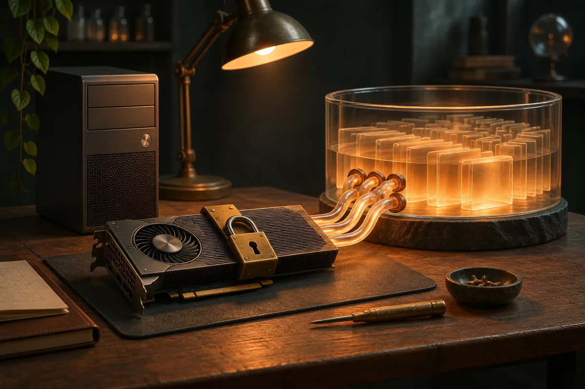

TL;DR: The CMP 170HX unlock is interesting because 80GB of local VRAM is genuinely useful, but a voltage-glitch mod is a hack, not an infrastructure strategy.

## What actually happened with the CMP 170HX?

The primary source here is the r/LocalLLaMA post titled “I finally succeed the CMP 170HX voltage glitch and get 80GB VRAM + 126sm! !” by /u/Yarukiless-cat. The claim is simple and wild: after about 15 hours of work, they say they used a voltage glitch on an NVIDIA CMP 170HX and ended up with 80GB of VRAM plus 126 SMs.

They also say the restricted write-access portion was scripted with help from Astra, that it could be executed using “pico,” and that they plan to handle a second CMP later.

That is all we can responsibly say from the provided material. This is a Reddit claim, not a vendor announcement, not a lab paper, and not a reproducible build guide with independent verification in the source set. I would not treat the numbers as settled until other people reproduce them, post diagnostics, and show workloads running without weird failure modes.

Still, the post caught attention for a reason. Local AI builders are starved for VRAM. Not FLOPS in the abstract. VRAM. The difference between a 24GB card and an 80GB card is the difference between constant quantization tradeoffs and having room to run larger models, longer context, bigger batches, or less compromised experiments.

## Why does 80GB of local VRAM matter?

For inference, 80GB changes what feels normal. A lot of local AI work today is shaped by scarcity: 4-bit quantization, offloading to CPU RAM, painful context limits, split-GPU setups, and model choices dictated less by quality than by what fits.

An 80GB local card opens up a different class of tinkering. You can test larger open-weight models with fewer contortions. You can compare quantization levels without rebuilding your whole workflow. You can run agent stacks, retrieval experiments, multi-model pipelines, and long-context tests with less babysitting.

That does not mean this specific CMP 170HX path is sane for most people. It means the market demand is obvious. Builders want workstation-grade memory without workstation-grade pricing, cloud lock-in, or datacenter procurement drama.

The funny part is that local AI keeps making old and weird hardware newly relevant. Mining cards. Datacenter pulls. Mac Studios. Used RTX 3090s. Tiny boxes running llama.cpp. People are assembling compute out of whatever the supply chain leaves behind.

That is not romantic. It is what happens when the useful frontier sits just beyond normal consumer hardware.

## Is this useful for builders, or just a stunt?

Both. But the order matters.

As a stunt, it is excellent. Hardware people love forbidden capacity. AI people love cheap memory. A crypto-mining card allegedly turning into something closer to a high-memory AI accelerator is exactly the kind of story that spreads.

As a builder strategy, it is fragile. Voltage glitching is not operations. A one-off card that boots is not the same as a reliable box that survives weeks of inference, heat, driver updates, kernel changes, and model load spikes. If you are building a product, you need boring hardware. Boring is underrated.

The more useful lesson is about where the constraint sits. Model quality is not the only bottleneck. Tooling is not the only bottleneck. For local AI, memory capacity is still one of the hardest walls. That wall decides which models you can run, how much context you can keep, how many concurrent requests you can serve, and whether your workflow feels fluid or constantly patched together.

I would watch for replication before taking this CMP 170HX claim too seriously. If other r/LocalLLaMA users reproduce the 80GB and 126 SM result, then it becomes more than a curiosity. It becomes a signal that some stranded accelerator hardware has more practical value than the market priced in. If not, it remains a neat lab-bench story.

For a builder, the practical move is not “go voltage-glitch a mining card.” It is to audit your own local AI work by VRAM need, not model hype. List the models you actually run, the context lengths you actually need, and the latency you can tolerate. Then decide whether you need a used high-memory setup, a multi-GPU box, a Mac, cloud burst capacity, or smaller models with better workflows. The catch most readers miss: the winning local AI setup is rarely the weirdest machine that can boot. It is the least annoying machine that can run your real workload every day.
