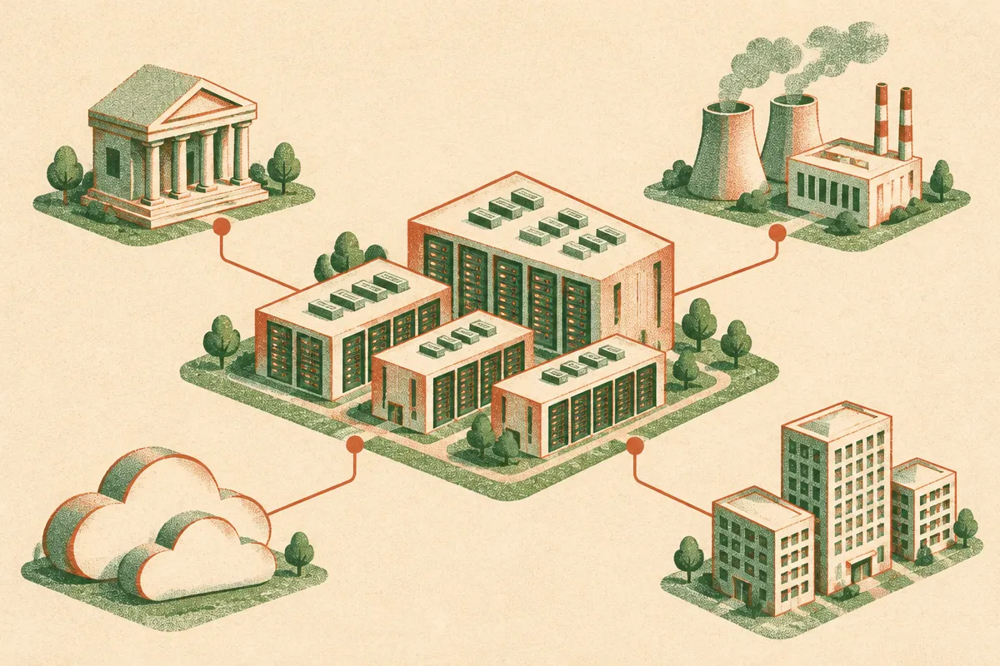

TL;DR: AI risk has moved from model behavior to balance sheets, because the infrastructure buildout now touches lenders, leases, guarantees, debt, and market expectations.

## What did the Fed survey signal?

The primary source available here is The Defiant’s reporting, “AI Tops Financial Stability Risks Cited in Fed Survey.” The key number: AI was cited by 87% of market contacts as a financial stability risk, up from 50% in the spring.

That is a big move in a short window. It does not mean AI is “the next crisis.” It means the people the Fed asks are now watching AI like they watch commercial real estate, bank funding, Treasury market plumbing, private credit, or geopolitical shocks.

The important part is not that AI is popular. Everyone knows that. The important part is that AI is becoming financially entangled.

The Defiant also reported that the Fed separately traced how leases, guarantees, and debt link the infrastructure buildout to lenders. That is the real story. Data centers are not just GPUs in warehouses. They are land, power contracts, cooling, construction, chip orders, cloud commitments, financing structures, and long-duration demand assumptions.

If demand keeps rising, the system may absorb it. If demand disappoints, pricing compresses, or model efficiency changes the compute curve, some of those assumptions get tested.

That is not an AI model risk. It is a capital cycle risk.

## Why does AI infrastructure create financial risk?

Because the buildout is front-loaded.

AI companies and cloud providers need capacity before they can sell all of it. Data-center developers need commitments before they build. Lenders want collateral and predictable cash flows. Power providers need planning certainty. Chip supply chains want large orders. Each party tries to reduce its own risk with contracts, leases, guarantees, or debt.

That can make the whole system look safer at the deal level while creating more correlation at the system level.

If many players are depending on the same assumption, that AI compute demand will keep growing fast enough to justify today’s capacity plans, then the weak point is not one company. It is the shared forecast.

The catch is that AI demand is real and hard to measure at the same time. There is obvious usage growth in coding, search, customer support, analytics, media production, and internal enterprise tools. But not every pilot turns into durable spend. Not every agent saves enough labor to justify premium inference. Not every enterprise wants to send sensitive workflows to external systems. And model efficiency can cut both ways: cheaper inference can expand demand, but it can also reduce revenue per unit of output.

This is why I think the Fed survey signal matters. It is not anti-AI. It is anti-handwaving.

Builders should want this scrutiny. Cheap capital plus fuzzy demand can produce bad products, bad contracts, and bad incentives. Clear financing pressure can force the useful question: what workload is actually worth paying for?

## What should operators watch?

I would watch three things.

First, who is taking demand risk. If a cloud provider signs long-term capacity deals, a data-center developer signs leases, and an AI startup commits to spend it cannot yet monetize, the risk did not disappear. It moved.

Second, whether AI revenue is matching infrastructure commitments. Not press-release revenue. Actual recurring usage, paid seats, metered API consumption, renewals, and gross margins after inference cost.

Third, whether efficiency gains reduce pressure or expose overbuilding. Better models, distillation, caching, smaller specialized systems, and local inference can make AI more useful. They can also change what kind of compute customers need.

The market often talks like more GPUs automatically means more intelligence, and more intelligence automatically means more revenue. That chain has weak links. Hardware has to become usable capacity. Capacity has to become reliable products. Products have to become budget-line items. Budget-line items have to survive renewal season.

My practitioner’s take: if you are building with AI, do not treat infrastructure headlines as proof that demand is settled. Treat them as a reminder to design for unit economics now. Measure inference cost per completed task, not per token. Compare big-model workflows against smaller models, retrieval, caching, and human review. The catch most teams miss: the winning AI product may be the one that uses less compute than expected, not the one that sounds most ambitious.
