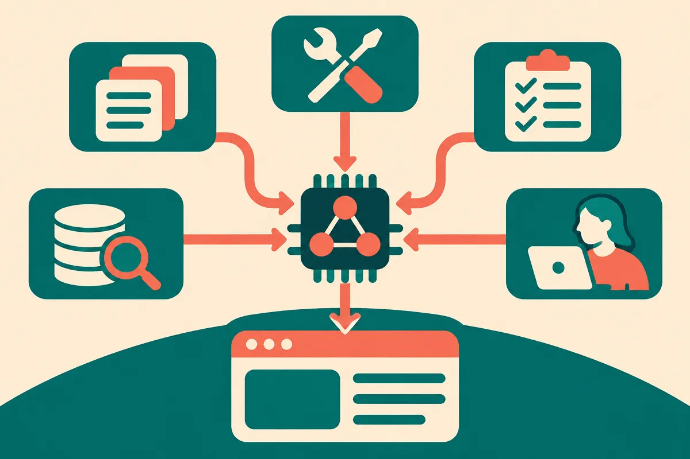

TL;DR: If your AI system improves after a model swap, do not assume the model got much smarter, the harness may be doing most of the work.

## Are frontier models getting smarter, or just easier to use?

The primary source here is the r/LocalLLaMA post “Hot take: frontier models haven’t actually become much smarter” by /u/Reasonable_Goat. The claim is not that frontier models are stagnant. It is narrower and more useful: LLMs have become much more useful, but the gain may be coming from better tool use, longer context, lower hallucination rates, stronger defaults, and production harnesses, not a huge jump in “raw intelligence.”

That matches a lot of what I see in applied work.

A model that can call tools cleanly, stay inside a schema, read a long thread, and avoid making up facts will feel dramatically better. But that is not the same thing as suddenly becoming a much more efficient reasoner under tight limits. It may just be better behaved inside the system we built around it.

The r/LocalLLaMA post defines “raw intelligence” as using the information given to solve a problem efficiently, especially when tools, time, and extra context are limited. That is a practical definition. Not philosophical. Not benchmark theater. If the relevant data is already supplied, can the model use it well without requiring a bigger scaffold?

That question matters because most real systems are scaffolds now.

## Why does the harness matter so much?

/u/Reasonable_Goat describes production systems where swapping in newer frontier models rarely moved the score much once a model plus harness already worked against a golden dataset. The failures were usually context engineering or tool problems. Better retrieval. Better prompts. Better structured access to relational data. Better code execution paths. Better constraints.

That is the unsexy work, which is why it gets undercounted.

In software engineering, the poster sees more model-to-model improvement, but still says the same model can perform very differently across harnesses. That is the part builders should underline. Coding agents are not just models. They are repo indexing, diff generation, test running, command execution, memory, policy, review loops, and UX. A weaker model in a better coding loop can beat a stronger model in a sloppy one.

This also explains why local models keep surprising people. Smaller models are not catching frontier systems across every dimension. They usually lack the same breadth, nuance, embedded product knowledge, and safety tuning. But if the task is narrow, the context is clean, and the tools are explicit, the gap can shrink fast.

That does not prove small models are “as smart.” It proves many deployed tasks do not require the full surface area of frontier capability.

## What should builders measure instead?

The wrong measurement is: “Did the new model feel better?”

The better measurement is: “Where did the system fail, and did the model swap fix that specific failure without adding cost, latency, or weird behavior?”

If the failure is missing context, a smarter model may hallucinate a smoother wrong answer. If the failure is poor tool design, a smarter model may invent a clever workaround that is too slow or brittle for production. If the failure is ambiguity in the task, a smarter model may produce a prettier guess.

The r/LocalLLaMA post is useful because it pushes against both hype and doom. Frontier models have improved. Tool calling is better. Long context helps. Hallucinations are lower in many workflows. Coding has improved in visible ways. But the claim of an exponential jump in general problem solving should be tested against boring operational evidence: golden sets, regression tests, latency budgets, review burden, and failure logs.

My read: model progress is real, but product progress is often an ensemble effect. Model plus context plus tools plus evals plus human review. When people credit all of that to “the model,” they learn the wrong lesson.

A builder should try this before upgrading blindly: freeze the model, improve retrieval and tool interfaces, run the same golden set, then swap models only after you know the remaining failure modes. The catch most readers miss is that a better model can hide a bad system for a while. That feels like progress until the edge cases arrive.
