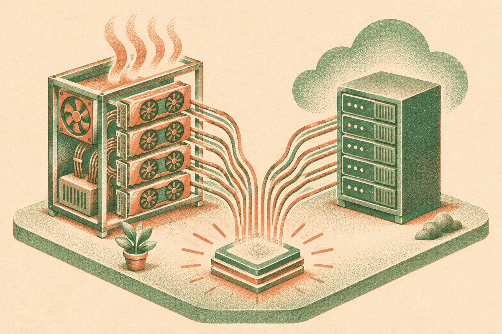

TL;DR: Local AI hardware can make sense again when you need lots of VRAM and steady parallel inference, but the hidden costs are power, heat, drivers, and your own tolerance for weird systems work.

## What did this 8x3090 build actually prove?

The primary source here is the r/LocalLLaMA post titled “Ai Rig finally done and stable, perfect winter heater” by /u/dazzou5ouh. It is not a lab benchmark. It is a builder report. That matters, because the value is not a polished score. It is the shape of the tradeoff.

The build uses eight Gigabyte Gaming OC RTX 3090 cards on an ASRock Rack ROMED8-2T motherboard. The poster says all GPUs run at PCIe 4.0 x16 except two that share a slot at x8 each. Power comes from two PSUs, a Corsair AX1600i and HX1500i, with each GPU power-limited to 270W. The rig idles around 300W, according to /u/dazzou5ouh.

The interesting number is memory. Eight RTX 3090s means 192GB of total VRAM, assuming the standard 24GB per card. That is why older consumer GPUs keep showing up in local AI builds. Not because they are elegant. Because VRAM is still the wall.

The poster reports using modified Nvidia drivers to enable peer-to-peer traffic between GPUs, measuring about 22GB/s except on the x8 cards. They also report testing a quant of Qwen Flash Next on vLLM and OpenCode, with one agent around 60 tokens per second generation and 10 parallel agents peaking at 370 aggregate tokens per second.

Those are useful operator numbers. Not universal. Not clean-room. But useful.

## Why not just rent the GPUs?

For most people, renting still wins. You avoid heat, noise, driver hacks, power wiring, risers, failed fans, and the very real joy of debugging eight GPUs that all have opinions.

But the home-rig argument gets stronger when a workload is steady, private, memory-hungry, and parallel. Think local coding agents. Batch document processing. Experiments with smaller model fine-tuning. Internal tools where latency and data locality matter more than access to the newest frontier model.

The economics are messy. /u/dazzou5ouh says the GPUs were bought by early 2026 at an average of roughly £600 to £700 each, before prices “went crazy.” That puts the GPU spend alone somewhere around £4,800 to £5,600, before motherboard, CPU, memory, risers, PSUs, cooling, case or frame, storage, power, and time.

That last one is the catch. Time is the real tax.

Cloud pricing is annoying, but it buys you a boring machine. A local 8x3090 box buys you control and a lot of VRAM, then hands you a second job as infrastructure admin. If you enjoy that work, great. If you do not, the bargain disappears fast.

## What should builders copy from this?

Do not copy the whole rig by default. Copy the workload-first thinking.

The smart part is not “eight GPUs.” It is matching hardware to the bottleneck. If your bottleneck is VRAM, older 24GB cards can still be compelling. If your bottleneck is single-request latency on frontier models, this is the wrong machine. If your bottleneck is running many agent workers at once on open models, this starts to look more interesting.

I would also separate “local AI” into two categories. The first is convenience local: one GPU, small models, private drafts, coding help, search, and experiments. The second is serious local: multi-GPU inference, vLLM, quantization, parallel workers, cooling, power limits, and driver risk. This r/LocalLLaMA build is clearly the second kind.

The modified-driver detail is the warning label. Peer-to-peer bandwidth matters for multi-GPU setups, but anything that depends on unofficial driver behavior can break. That is fine for a hobby lab. It is a different conversation for a business workflow.

A builder should start smaller: run the target model, measure tokens per second, measure concurrency, measure wall power, then price the pain honestly. If your daily workload can keep the machine busy, local inference may pay back in control and throughput. If it will sit idle most of the day, you probably built a very expensive space heater with a tokenizer attached.
