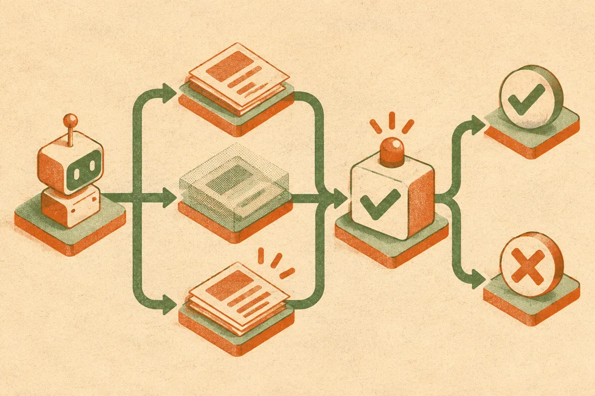

TL;DR: If an LLM judge evaluates agent work, test whether its verdict survives abstraction, because the same execution can look different once tools, delegation, or compressed histories hide the evidence.

## What is “verification transport”?

The primary source here is the arXiv cs.AI/cs.CL paper titled “Do Verifier Judgments Survive Abstraction? Measuring Verification Transport for LLM Agent Evaluation.” Its core question is simple and useful: does a verifier make the same correct judgment when the underlying agent execution is identical, but the view of that execution changes?

That sounds narrow. It is not.

Agent systems rarely expose perfect raw traces forever. A tool call may be wrapped by another tool. A sub-agent may do work behind a delegation boundary. A long history may be compacted so the main model can keep going. In each case, the task, trajectory, outcome, ground truth, evaluation criterion, and verifier can stay fixed, while the visible evidence changes.

The paper calls this reliability test “Verification Transport.” It compares matched views of frozen executions: native, abstracted, and restored. Same run. Different observability.

That is the right frame. A lot of agent evaluation today assumes the judge sees the important parts. In production, that is often false. The judge sees the receipt, not the kitchen.

## How bad is the failure mode?

The paper reports substantial transport failure across four agent-evaluation benchmarks, seven verifier backbones, four verification protocols, and three abstraction boundaries. The headline number: transport failure reaches about 31% under macro abstraction and delegation.

That is not a tiny formatting sensitivity. That is a systems problem.

The most interesting part is the protocol split. Direct verification more often gives incorrect verdicts. Evidence-grounded and deliberative protocols tend to abstain when observability is limited.

This matters because a lower apparent failure rate can be misleading. If a verifier abstains instead of being wrong, that may be safer in some workflows. But it is not the same as reliability. It can still mean the evaluation system cannot certify the run once the trace has crossed an abstraction boundary.

The paper also reports that restoring corresponding execution provenance recovers 85.5% of transport failures. That is the practical result. The fix is not only “use a stronger model as judge.” The fix is to preserve the evidence needed for the judge to reason about what actually happened.

This cuts against a common agent architecture habit: compress aggressively, hide internals, and let a judge inspect the final story. That works until the final story omits the step that matters.

## What should builders change in agent evals?

Treat verifier input as part of the evaluated system, not as a neutral window into it.

If you run agents with tool composition, sub-agents, or memory compaction, your eval should include at least three views of the same execution: the raw trace, the abstracted trace your production system actually exposes, and a restored trace with provenance attached. Then compare verdict stability. Do not only track pass or fail. Track wrong verdicts, abstentions, and reversals.

This also changes logging. Provenance is not just for debugging after a bad run. It is evaluation infrastructure. Tool inputs, tool outputs, delegated decisions, retrieved documents, intermediate claims, and transformation steps need durable links back to the original execution. If those links are lossy, expect lower recovery. The paper says as much: recovery is lower when provenance is lossy or unavailable.

I would be careful about overreading the 31% number as universal. The paper’s exact rate depends on its benchmarks, verifier backbones, protocols, and abstraction boundaries. But the shape of the result matches what operators see in real systems: judges get shaky when the audit trail turns into a summary.

The practical move is boring and valuable. Before trusting an LLM verifier, freeze a batch of real agent runs and replay them through the views your product creates in production. Raw trace. Compacted trace. Delegated trace. Restored trace. If the verdict changes, do not just tune the judge prompt. Fix the trace contract. The catch most teams miss is that an eval can pass in the lab while the production abstraction layer quietly removes the evidence the evaluator needed.
