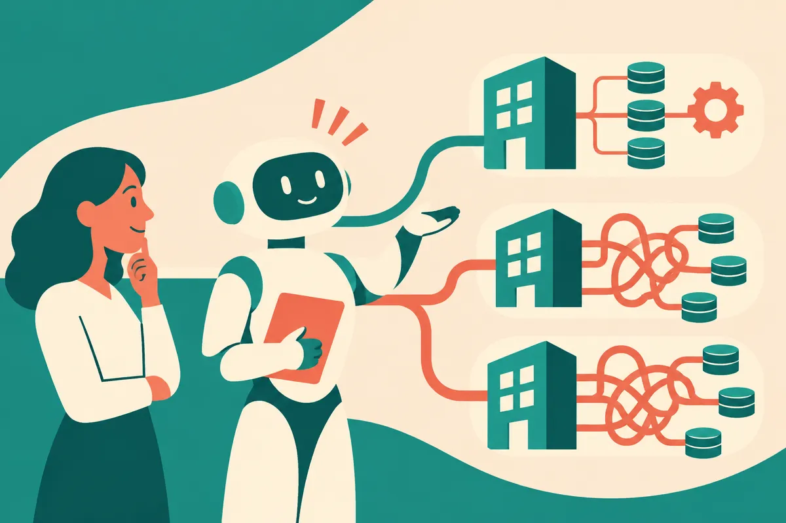

TL;DR: AI agent readiness is not a chatbot project, it is a marketing ops and customer experience plumbing problem.

## Are brands actually ready for buying agents?

SAP’s **AI in Customer Experience Report** says the confidence is way ahead of the infrastructure. More than 90% of CX leaders think they are ready for AI agents, while SAP reported that only 6% of U.S. companies and 3% of German companies have the connected systems needed to support them.

That gap matters because buyers are already using AI before they reach your site, your rep, or your carefully tuned landing page. SAP found that 51% of U.S. consumers and 58% of German consumers use AI to research and compare options before owned channels. In B2B, the numbers are much higher: 95% in the U.S. and 99% in Germany.

That changes the job of marketing ops.

The old website-first model assumed the buyer would eventually land somewhere you controlled. The newer path is messier. A buyer may ask an AI assistant for options, compare summarized specs, check reputation signals, ask for pricing, then arrive with a half-formed decision. If your product data, availability, service terms, media, and policies are not machine-readable and current, the agent either guesses, ignores you, or compresses your offer into the same commodity bucket as everyone else.

This is not “AI content strategy.” It is data hygiene with revenue consequences.

## What does marketing ops have to fix first?

The unglamorous stuff.

SAP reported that nearly 80% of CX decision makers say customers still have to repeat information across channels or hit stalled handoffs. That is a bad human experience. It is also bad agent infrastructure. Agents need continuity: customer intent, product context, eligibility, inventory, pricing, account status, service history, and the next best action.

A marketing team using AI for content, campaigns, and lead generation can still fail here. SAP said roughly three-quarters of marketing teams already use AI in those areas, but very few organizations have connected systems across the full journey. That is the pattern I keep seeing: AI sprinkled on tasks, not wired into workflows.

The second MarTech analysis makes the sharper point: AI-powered buying agents may make customer experience an acquisition factor, not just a retention metric. If an assistant can compare real-world service quality, complaints, billing friction, delivery reliability, and issue resolution, then brand perception has less room to float above operational reality.

Not zero room. Agents are not objective judges from the sky. They inherit the limits of their data, design, incentives, and retrieval stack. They can be gamed. They can miss context. But the direction is clear enough: claims get checked against evidence more often.

## Why accuracy beats personalization here

One detail from SAP’s report should redirect a lot of AI roadmaps. CX leaders’ top priority is AI-powered personalized recommendations. Consumers, according to SAP, care more about accurate pricing and availability, correct discount handling, and issue resolution.

That tracks. Personalization is nice when the basics work. It is creepy or useless when they do not.

SAP also found that 87% of U.S. consumers and 83% of German consumers still want final approval before an AI completes a purchase. So the near-term win is not fully autonomous checkout. It is assisted buying: research, comparison, configuration, quote prep, policy explanation, and handoff to a human or owned flow without making the customer restate everything.

The catch for marketing leaders is political. The fixes sit across marketing, sales, service, commerce, product, ERP, billing, and operations. Marketing ops can identify the gaps, but it needs authority to push beyond campaign tooling.

Start by auditing the questions a buying agent would ask about your product, then trace where the answer lives and whether it is current, structured, and consistent. Test handoffs from an external assistant-style query into your site, chat, sales form, and service flow. The catch most teams miss: agents will not reward your best message, they will reward the most trustworthy path from claim to proof to fulfillment.
