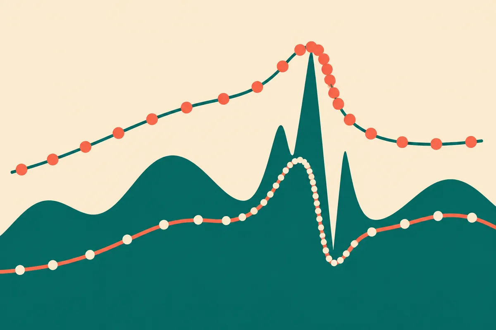

TL;DR: Elliptic sampling is a math-heavy reminder that generative model speed is not only about smaller networks, it is also about choosing the right path and step pattern for the sampler.

## What problem is elliptic sampling actually solving?

The primary source here is the arXiv cs.AI and cs.LG paper titled “Elliptic Sampling: Optimal Interpolant Schedules for Gaussians and Beyond.” It targets a quiet but important part of generative modeling: the schedule that moves a sample from an easy initial distribution to the target distribution, and the discretization used to solve the resulting probability-flow ODE.

That sounds abstract. The practical version is simpler: if a sampler takes bad steps, you need more of them. More steps mean slower image generation, slower simulation, more compute, and more places where numerical error can creep in.

The paper’s claim is that schedule design and discretization should not be handled separately. It introduces a framework based on the analyticity of complexified ODE trajectories, then solves the schedule design problem using conformal mapping. The result is a family of variance-preserving elliptic schedules built from Jacobi elliptic functions.

The paired sampling algorithm is called Zoloflow, connected to Zolotarev’s optimal rational function approximants. That connection matters because the paper is not just proposing a prettier curve through probability space. It is trying to make a statement about optimal step placement.

## Why does κ matter for sampling?

The paper explicitly builds the condition number, κ, into both the elliptic schedule and Zoloflow. In plain terms, κ is a way to describe how stretched or uneven the target distribution is. A well-conditioned distribution is easier to traverse. A poorly conditioned one has directions that behave very differently, which makes fixed, naive schedules wasteful or unstable.

That is the core engineering instinct here. The sampler should know whether it is walking across a smooth bowl or a long, skinny ravine.

For Gaussian targets, “Elliptic Sampling: Optimal Interpolant Schedules for Gaussians and Beyond” reports that Zoloflow achieves minimax optimality among oblivious score-span algorithms. The stated query complexity is Θ(logκ log(√d/ε)) exact score queries to reach total-variation error ε. For log-concave targets, the paper reports ε 2-Wasserstein-error with roughly Õ(√d polylog(κ, 1/ε)) score evaluations.

Those are theory claims, not a direct product benchmark. The word “exact” is doing work in the Gaussian result, since real learned score models are not exact. Still, the direction is useful: harder distributions should change the sampler’s geometry, not just the number of brute-force steps.

The paper also says the elliptic schedule reduces to the classical trigonometric schedule when κ approaches 1. That is a nice sanity check. If the target is already well-conditioned, the fancy machinery collapses back toward the familiar case instead of adding complexity for its own sake.

## What should builders take from Zoloflow now?

I would not read this as “replace your production diffusion sampler tomorrow.” The source reports empirical evaluations on synthetic benchmarks and existing image generation datasets, including comparisons with alternative schedules, but the provided material does not give the concrete model names, speedups, image metrics, or implementation details needed for an operator-level go/no-go call.

The useful takeaway is more general. Sampling is part of the model stack. It is not plumbing. If you are working on diffusion-style generation, stochastic interpolants, or simulation workflows, schedule choice can be a first-class optimization target alongside architecture, distillation, quantization, and caching.

This also fits a broader pattern in AI systems work. A lot of performance is hiding in the “boring” numerical layer. Better step placement, better ODE solvers, better conditioning assumptions, better error accounting. None of that demos well on social media. It can still cut real cost if it survives contact with learned scores and messy data.

For a builder, I would try this first in a controlled evaluation harness, not a customer-facing pipeline. Take a known sampler, hold the model fixed, vary only the schedule and discretization, and measure sample quality versus score evaluations. The catch most readers miss: if your score model is the weak link, an optimal schedule for exact scores may expose model error faster rather than magically fix it.
