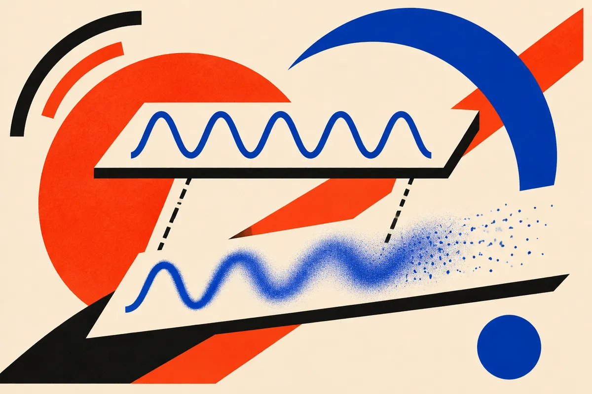
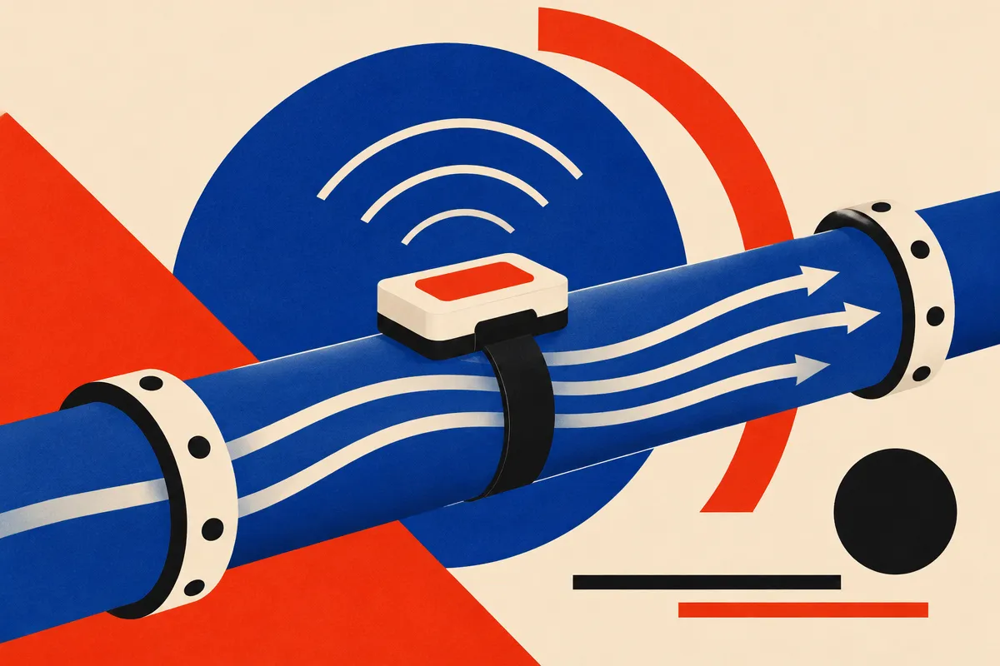

TL;DR: You can train a cheap linear probe to predict, before the model writes a single token, whether a web agent is about to hallucinate a button that is not on the page, and you can steer it away 85% of the time, but the probe breaks when you change how actions are formatted, which tells you the underlying cause is still not understood.

The paper is "Can Mechanistic Interpretability Help Explain LLM Agent Failures? A Case Study on Web Element Hallucination," posted to arXiv under both cs.AI and cs.CL. It takes a failure mode anyone who has built a web agent knows well and runs it through the mechanistic interpretability toolkit to see what holds up. The honest answer: some of it works, more of it than I expected, and the parts that break are the interesting part.

## What is web element hallucination, and why does it matter?

A web agent reads a page, gets a list of elements it can act on (links, buttons, form fields), and then decides what to click or type. Element hallucination is when the agent confidently picks an action that does not exist on the page. It tries to click a "Submit Order" button that was never rendered. It types into a field that is not there.

This is not a cosmetic bug. It is one of the main reasons agentic web workflows stall out or go off the rails. The agent is not confused about the task. It is confused about the state of the world in front of it, and it proceeds anyway. For anyone running agents against live sites, that gap between what the page contains and what the model thinks it contains is where most of your retries and dead ends live.

The authors study this on Qwen2.5-7B-Instruct interacting with live websites. Not a toy benchmark, actual pages. That matters, because real DOM clutter and inconsistent formatting are part of the problem, not noise to be scrubbed away.

## Can you catch a hallucination before the model speaks?

Yes, and this is the result worth sitting with. A linear probe trained on the last prompt token, meaning the model's internal state right before it starts generating, predicts hallucinations at 0.80 AUC. The signal is present in the activations before a single output token exists.

Think about what that enables operationally. You do not have to wait for the agent to emit a bad action, run it, fail, and recover. You can read a cheap internal signal at decision time and intervene first. A probe like this is tiny, fast, and sits alongside inference without much cost. For reliability engineering, "predict the failure before it happens" is a much better position than "detect the failure after it fired."

Then they go a step further. They steer the model's activations along the probe direction and correct 85% of hallucinations. That is a real intervention, not just a detector. Push the internal representation in the right direction and most of the invented actions disappear.

If the post stopped here it would read like a clean win: cheap probe, high catch rate, direct fix. It does not stop here, and that is why I trust it.

## Where does the fix fall apart?

Three catches, and each one undercuts a comfortable assumption.

First, steering disrupts 7% of valid actions. You correct most of the bad behavior, but you also break a slice of the good behavior. That is the tax you pay for a blunt intervention. Whether 7% collateral is acceptable depends entirely on your workflow. For a low-stakes scraping task, probably fine. For anything that submits forms or moves money, 7% of correct actions silently broken is not a rounding error.

Second, and this is the big one, the probe direction is sensitive to prompt formatting. Change how actions are represented in the prompt, even a minor change, and much of the steering effect disappears. The thing you found is not a stable "hallucination feature" baked into the model. It is partly an artifact of the exact way you laid out the input. Reformat your action list and your carefully validated fix quietly stops working.

Third, circuit identification was hard. The computation behind the hallucination is distributed across multiple components and positions, and the information the agent relies on varies from example to example. There was no clean circuit to point at and say "here is the bug." The mechanism is smeared out, and it moves.

## What does this say about mechanistic interpretability for agents?

This is where the paper earns its title. Mechanistic interpretability has racked up real wins explaining the internals of base LLMs: features, circuits, clean directions in activation space. The authors are testing whether those same tools transfer to explaining why an agent fails in a realistic loop. The verdict is a qualified no.

The standard MI playbook assumes you can find a localized circuit and a stable feature direction. On this agentic failure, the direction was formatting-dependent and the circuit was distributed and example-specific. Those are not small caveats. They challenge the core assumptions the methods rest on. You can get a probe that predicts and a direction that steers, which is genuinely useful, but you do not get the thing MI promises, which is a mechanistic explanation of why.

I read this as a healthy correction. There has been a quiet assumption that interpretability progress on models would hand us interpretability of agents more or less for free. This says the agentic setting, with live inputs, variable formatting, and multi-step decisions, is harder in kind, not just in degree. The tools need to be rebuilt for distributed, input-sensitive computation, not just pointed at a bigger target.

It also lines up with something practitioners already feel: agents are brittle in ways that do not localize cleanly to "the model is bad." A lot of what looks like reasoning failure is really the model's representation of the input state being fragile, and that fragility is downstream of how you fed it the page.

## Practitioner's take

If you run web agents in production, do not wait for a perfect mechanistic explanation. Steal the cheap part now. A last-prompt-token linear probe is small and fast enough to run inline, and 0.80 AUC at predicting a hallucination before generation is a usable early-warning signal. Use it as a gate: when the probe fires high, re-fetch the element list, re-ground the prompt, or hand off to a verification step before you let the agent commit an action. That is a reliability win you can ship without touching the model.

But respect the two catches that most readers will skim past. The 7% disruption of valid actions means steering is not a free fix; validate it on your own task before you trust it, especially anywhere an action is irreversible. And the formatting sensitivity means your probe is coupled to your exact prompt layout. The day someone refactors how the action list gets rendered, your detector's calibration can silently drift. Version your prompt format and your probe together, and re-measure AUC whenever either changes. The lesson underneath all of it: for agents, how you represent the world to the model is not plumbing, it is part of the behavior.

Primary source: "Can Mechanistic Interpretability Help Explain LLM Agent Failures? A Case Study on Web Element Hallucination," arXiv (cs.AI, cs.CL).

