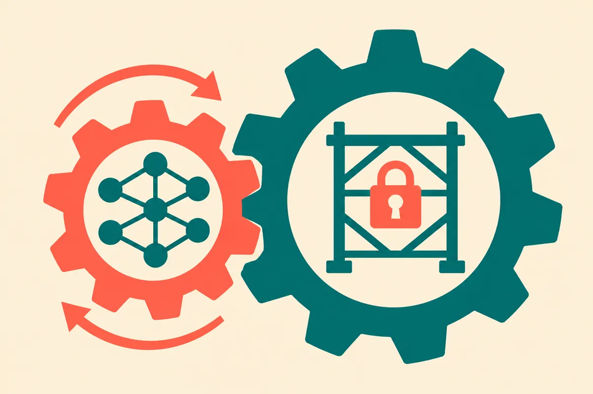
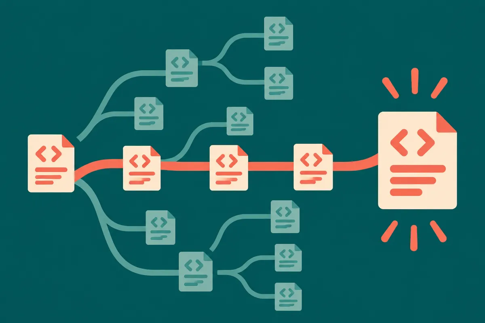

TL;DR: ModHarness-RL treats the agent's scaffold (context compression, mid-task steering) as a program that gets learned and rewritten as the model trains, and that beats a fixed, hand-written harness on held-out tasks in most of the setups tested.

Most people building agents right now obsess over the model and treat everything around it as plumbing. The system prompt, the context window packing, the little "you seem stuck, try X" nudges you inject when a run goes sideways. That plumbing has a name in the research world: the harness. And the paper I want to walk through, **ModHarness-RL: Recasting Harnesses as Learnable and Evolving Programs for Agentic RL** (posted across arXiv cs.AI, cs.CL, and cs.LG), makes a simple argument that lands hard if you have shipped agents. The harness is not fixed infrastructure. It is a variable you should be tuning, and ideally one the training loop tunes for you.

## What is an agent harness, and why does it matter?

When an agent runs a task, the raw interaction is messy: tool calls, long outputs, errors, retries, partial progress. The model does not see all of that directly. Something sits between the model and the environment, deciding what gets packed into the context window and what guidance gets added. That something is the harness.

Two jobs matter most. First, compression: you cannot stuff every tool output and every failed attempt into context, so you summarize, truncate, and reorganize. Second, steering: when the agent starts looping or drifting, you inject guidance to pull it back on track. Anyone who has built a coding agent has written both of these by hand, usually as a pile of string formatting and if-statements that grew by accident.

The paper's claim is that this hand-written scaffold is quietly doing a lot of the work, and that most RL training keeps it frozen while the model underneath changes. That is the mismatch. You train the model, its behavior shifts, but the harness is still assuming the model behaves the way it did on day one.

## What does ModHarness-RL actually change?

The core move is to stop writing the harness by hand and start learning it. The authors record each interaction as structured State: a set of typed blocks rather than one undifferentiated text blob. Think of it as giving the history a schema instead of a transcript.

Then the two key harness jobs become programs over those blocks. A Compression program decides how the accumulated history gets assembled into the model's context. A Steering program decides when and how to supply guidance when behavior deviates. Crucially, these are programs, not weights. They are discrete, executable, inspectable.

Here is the loop that makes it interesting. During RL training, candidate programs are proposed from recent trajectories, verified by execution, and replayed over past trajectories. So the system watches how the model is actually behaving now, drafts a new compression or steering rule, checks that it runs, and tests it against history before adopting it. As the model's behavior shifts during training, the harness tracks that shift instead of lagging behind it. The scaffold evolves alongside the thing it scaffolds.

That co-evolution is the whole point. The authors frame an effective harness as something that depends on the domain, the data, and the model, and keeps changing as the model trains. If all three of those move, a static harness is wrong by construction after the first few steps.

## Does it actually work, or is this just a clean idea?

This is where I want to be honest about what the paper shows and what it does not. The results are reported as improvements over a fixed-harness baseline in most settings, not all. "Most settings" is the operative phrase, and I would read it as a real but uneven effect rather than a clean sweep.

They study CodeSearch in depth, with additional analysis on ALFWorld and BIRD SQL, using models from 1.5B to 8B. A few things stand out. These are small to mid-size models, which is exactly where harness quality should matter most, because a weaker model leans harder on good scaffolding to stay coherent. The task mix is also sensible: code search, an embodied text environment, and text-to-SQL cover different failure modes. The Compression and Steering mechanisms improving held-out performance is the claim that matters, since held-out is the only number worth trusting.

What I do not see in the abstract is how big the gains are, how much compute the propose-verify-replay loop adds, or whether the learned programs generalize past the task they were trained on. Those are the questions that decide whether this is a technique you adopt or a paper you cite. Treat the headline as "the direction is validated on three benchmarks at small scale," not "this is a drop-in win for your 70B production agent."

## What should a builder take from this today?

Even if you never touch RL, the framing is useful. Most teams I talk to tune the model and the prompt, then let the harness ossify. The paper's real contribution, for practitioners, is naming the harness as a first-class, changeable object with two separable jobs you can measure independently.

So separate them. Treat compression (what the model sees) and steering (when you intervene) as two distinct systems with their own metrics, not one tangled prompt template. The moment they are separate, you can ask sharper questions: is my agent failing because it lost context, or because it never got nudged off a bad path? Those have completely different fixes, and a monolithic harness hides which one you are hitting.

The structured State idea is also borrowable without any training. Stop concatenating your agent's history into one string. Give it typed blocks: tool outputs here, errors there, user intent pinned separately. Once the history has structure, your compression logic becomes a function over typed fields instead of regex on a transcript, and you can swap compression strategies without rewriting everything downstream.

The catch most readers will miss: the propose-verify-replay loop is only as good as your ability to replay past trajectories and score them. ModHarness-RL leans on execution-based verification, which works because CodeSearch, ALFWorld, and SQL all have checkable outcomes. If your agent operates in a domain where you cannot cheaply replay and grade a past run, you cannot evolve the harness automatically, and you are back to hand-tuning with better structure. So before you chase the learnable harness, build the thing underneath it: logged, replayable, scoreable trajectories. That is the real prerequisite, and it is the part nobody puts in the abstract.
