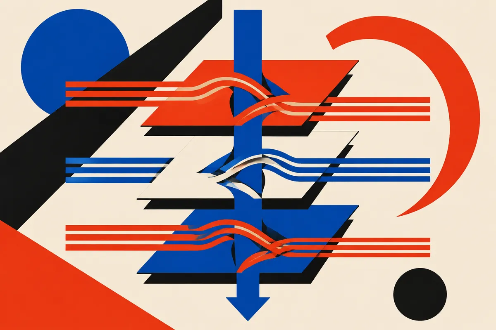

TL;DR: The "Latent Lattice Language Models" paper (arXiv, posted across cs.AI, cs.CL, and cs.LG) proposes a new scaling axis for language models, giving each layer its own recurrent memory stream that persists across tokens, and it delivers consistent perplexity drops at 406M parameters, which is promising but still small-scale and unproven at frontier size.

Most architecture work pushes on two levers everyone already knows. Make the model deeper. Make it think longer per token. Latent Lattice Language Models argues there is a third lever hiding in plain sight: the number of active computational states a model keeps around while it reads a sequence. That reframing is the interesting part, more than any single perplexity number.

## What does the Lattice of Latents actually add?

The standard picture of a Transformer is vertical. Information flows down through depth via the residual stream, one layer handing off to the next. The paper introduces a horizontal companion to that stream. Each layer gets its own latent state that runs recurrently along time, token after token, alongside the vertical flow. The authors call it the Lattice of Latents.

The clever bit is not that these latents exist. Hybrid Transformer-SSM designs already carry recurrent state. The difference is what the state is allowed to touch. In most hybrids, the recurrent state mostly serves sequence mixing, an internal memory for attention-like operations. Here the per-layer latents directly condition the vertical stream's attention, its KV-cache writes, the MLP computation, and the decoding step. So the horizontal memory is not off in a corner. It is wired into the parts of the model that actually produce the next token.

That framing matters because it separates two things people usually conflate. More computation per token is one axis. More persistent state carried across tokens is another. The paper's claim is that the second axis is underexplored and gives you something the first does not.

## How much does it actually improve things?

On the headline experiment, a 406M-parameter Lattice model trained on 20B FineWeb-Edu tokens drops validation perplexity from 15.41 to 14.40 against a parameter-matched Transformer. That is roughly a one-point improvement, and the comparison is parameter-matched, which is the honest way to run it. You are not just winning because you added weights.

The more convincing result is composition. The Lattice stacks with existing residual-stream tricks. With hyper-connections and input residuals already in place, the baseline Transformer at 15.41 improves to 14.22, and adding the Lattice on top takes it to 13.61. So it is not competing with prior enhancements, it is adding on top of them. That is the kind of result that makes an architecture idea stick around, because it does not force you to choose.

It also travels. The authors tested on Gated DeltaNet, Mamba-2, Triadic GDN, and GDN-Mamba-2 hybrids, and report improved perplexity at every native state size they tried. The sharpest claim: Lattice-GDN and Lattice-Triadic-GDN variants beat pure baselines that carry 4x larger native states. If that holds up, it says the Lattice is a more efficient way to spend your state budget than simply making the recurrent state bigger. That is the finding I would want replicated first, because it is the one with real engineering consequences.

## Why should a builder care about a perplexity paper?

Be honest about what this is and is not. Perplexity on FineWeb-Edu is a research signal, not a product benchmark. There are no downstream task evals here, no reasoning scores, no long-context stress tests, no instruction-following numbers. A one-point perplexity drop at 406M does not automatically become a better coding agent or a better summarizer. The gap between "lower validation perplexity" and "users notice" is wide and littered with architectures that looked great at small scale and flattened out.

The other open question is cost. Persistent per-layer state is not free. You are maintaining extra recurrent streams across the whole sequence, and the paper's framing is about adding computational capacity, not reducing it. The interesting trade is the one hinted at in the hybrid results: if Lattice state replaces a larger native state more efficiently, you might come out neutral or ahead on compute for the same quality. But the sources here do not give throughput numbers, memory overhead at inference, or scaling curves past 406M. So treat the efficiency story as a hypothesis the paper gestures at, not a measured result.

For anyone building on top of models rather than training them, the practical read is simpler. This is an architecture-research signal, not something you integrate this quarter. The people who should care right now are the labs deciding where to spend their next pretraining run, and the small-model community, where a one-point perplexity edge that composes with existing tricks is genuinely worth testing.

## Where does this fit in the broader architecture race?

The through-line of the last two years of architecture work is the search for cheaper computation that still scales. Mixture-of-experts spread capacity across parameters you do not all activate. State-space models like Mamba-2 chased linear-time sequence handling. Hyper-connections and value residuals reworked how information moves through depth. The Lattice of Latents slots into that lineage by naming a dimension the others largely left alone: horizontal, persistent, per-layer state that feeds the decode path directly.

What I like is the framing discipline. The authors do not claim to replace anything. They position the Lattice as complementary, show it composing with prior work, and test it across both pure Transformers and several SSM hybrids. That is the right way to introduce an axis rather than a gadget. What I am withholding judgment on is whether the gains survive scale, because small-model perplexity wins have a long history of evaporating, and nothing in these three arXiv listings tells us what happens at 7B or 70B.

Practitioner's take: if you train or fine-tune small models, this is worth a real experiment, not a read-and-forget. The actionable version is the composition result: take your current best small-model recipe, the one that already uses hyper-connections or an SSM hybrid, and test whether adding per-layer persistent state buys you the reported edge on your own data, measured against a parameter-matched control so you are not fooling yourself. Then check the thing the paper underreports: inference-time memory and throughput, because a perplexity win that doubles your KV footprint is not a win in production. The catch most readers will miss is that "lower perplexity at 406M" is the start of the story, not the end. The claim that actually matters, Lattice state beating 4x larger native states, is an efficiency bet that needs independent replication before anyone reorganizes a pretraining budget around it.
