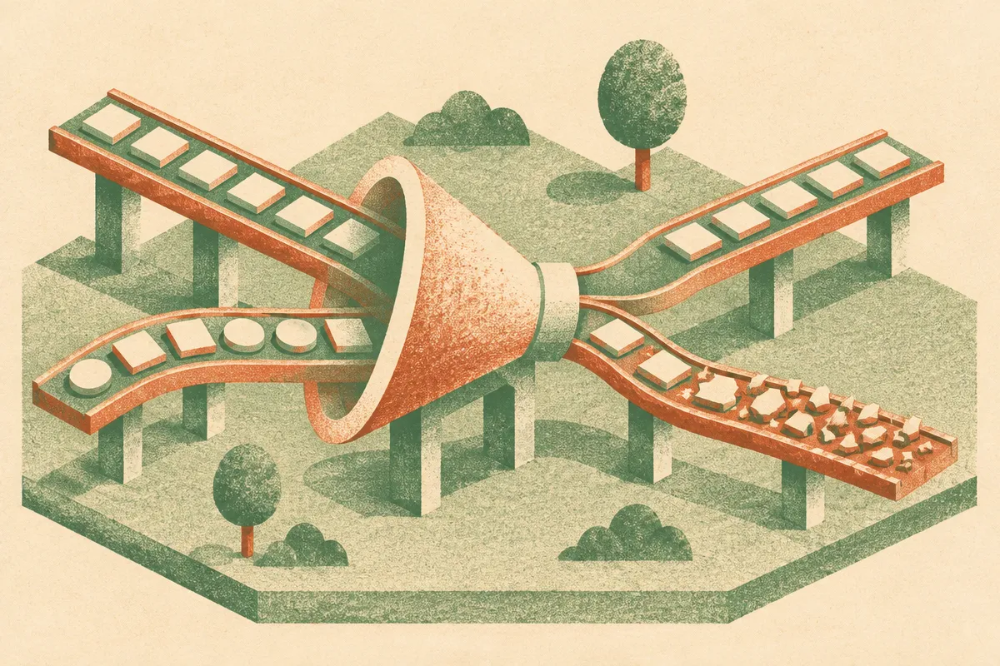

TL;DR: For frozen time-series foundation models, statistical shift severity is not a reliable proxy for forecast risk, so teams need direct stress tests against model degradation.

## What should count as a dangerous shift?

The primary source here is the arXiv paper *Severe but Harmless: Stress-Testing Shift Severity for Frozen Time-Series Forecasters*, listed under cs.AI and cs.LG. Its target is a real production temptation: using a distribution-shift score as an early warning system for zero-shot time-series foundation models.

That temptation makes sense. Time-series foundation models are appealing because they can be dropped onto many downstream series without per-series training. Forecasting. Anomaly detection. Traffic data. Maybe demand planning, infrastructure load, sensor streams. The pitch is less custom modeling, more reuse.

But time series drift. Regimes change. Weekday patterns break. Traffic flow changes after construction, weather, holidays, or policy shifts. So teams often reach for statistical measures of dissimilarity between regimes. Wasserstein-1 is one example. Higher score, more severe shift. More severe shift, more model risk.

The paper tests that assumption directly. Across three established severity measures, nine regime shifts, and three standard traffic datasets, the reported pattern is not reassuring: the regimes rated most severe were not reliably the regimes that hurt model performance most.

The sharpest number: degradation reached 29% in the lowest-scoring regime. That is the part builders should underline. The quiet-looking shift was not quiet for the model.

## Why can a severe shift be harmless?

The key phrase in the paper is “instance-normalized TSFMs.” If a model normalizes each input instance, then some changes that look large under a distribution metric may get washed out before the model makes its forecast.

That does not mean the metric is bad in the abstract. It means the metric may be measuring a change the model is designed to ignore.

A simple version: if one regime has values scaled up or shifted, a statistical distance can call that a serious distribution move. But if the forecaster normalizes the instance, the model may see nearly the same shape after preprocessing. The shift is severe to the metric, harmless to the model.

The reverse is worse. A shift can look mild under a broad statistical measure while changing exactly the structure the model depends on. Timing. Local patterns. Shape. Dependencies. The metric shrugs. The forecast falls apart.

That is why the paper’s equivariance-based stress-testing analysis matters. It gives a mechanism, not just a leaderboard complaint. Some transformations preserve the model’s behavior because of how the model and preprocessing treat the input. Others do not. Severity only matters if it lines up with the model’s sensitivities.

## What should teams test instead?

I would not read this as “stop monitoring distribution shift.” That is too blunt. Shift measures still describe something useful about the data stream. They can help with dashboards, incident triage, and data quality checks.

But I would stop treating them as a stand-in for model impact.

For frozen time-series models, the eval should ask a narrower question: when this regime changes, does this model’s error get worse on the decisions we care about? That means keeping held-out slices by regime, not just random validation splits. It means testing transformations the model may or may not be invariant to. It means pairing shift metrics with direct degradation metrics, then checking whether the relationship actually exists for your model family.

The uncomfortable part is that zero-shot does not remove evaluation work. It moves it. You may skip per-series training, but you still need per-domain stress testing. Especially when the model is frozen and you cannot assume it will adapt.

Practitioner’s take: if you are deploying a time-series foundation model, build a small regime-shift harness before you trust the dashboard. Take known slices from different operating conditions, score both distribution shift and forecast degradation, then look for mismatches. The catch most teams miss is that the scariest-looking data shift may be harmless after normalization, while the shift that breaks the forecast may barely light up a generic severity metric.
