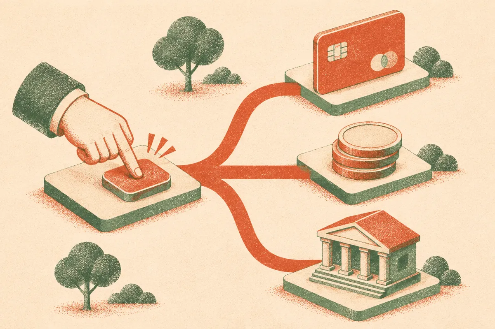

TL;DR: The fight over who clears an AI agent's payments is now a three-way contest between card networks, crypto rails, and central banks, and none of them has won, so build on the layer that gives a human a kill switch today.

There is a loud claim floating around right now. Coinbase CEO Brian Armstrong told CoinDesk that AI agents will account for "99.9%" of transactions within a decade, and that Coinbase is building payment tools for those agents. That number is a prediction, not a measurement, and I want to treat it as exactly that. But the fact that a public-company CEO is staking a decade-long thesis on it tells you the question has moved from "will agents pay for things" to "whose rails will they pay on." That second question is the one worth your time.

Because the answer is genuinely unsettled. In the same week Armstrong made his claim, U.S. Federal Reserve Governor Christopher Waller pitched keeping the central bank at the center of tokenization, and billionaire investor Stanley Druckenmiller said he is rotating his AI exposure from infrastructure to applications. Three signals, three different bets on where the value and the control will sit. This post maps the actual terrain so you can tell the measured from the hyped.

## What are AI agent payments, and why does the rail matter?

An agent payment is any transaction initiated by software acting on your behalf rather than by you clicking "buy" yourself. The agent books the flight, reorders the supplies, pays the API bill, settles with another agent for a piece of data. Simple to describe. Hard to build safely.

The rail is the settlement layer underneath that action: the card network, the bank transfer, the stablecoin, the tokenized deposit. It matters because the rail decides three things that a demo never shows you. Who authorizes the payment. Who can reverse it when the agent gets something wrong. And who holds the liability when it does.

I keep coming back to this because the exciting part of agent payments (autonomy) is in direct tension with the boring part (control). An agent that can spend without a human in the loop is powerful and dangerous in the same breath. The rail is where you resolve that tension, which is why I have argued for a while that [agent payments are a product problem before they are a currency problem](/blog/2026-08-29-agent-payments-are-a-product-problem-before-they-are-a-currency-problem/). Pick the wrong rail and you inherit its failure modes.

## What is Coinbase actually claiming, and how much of it is real?

Two things from Armstrong, and they deserve separate treatment because their evidence bases are completely different.

The first is the "99.9% of transactions within a decade" line. Per CoinDesk, Armstrong said Coinbase is building payment tools for AI agents and believes agents will dominate transaction volume on that timeline. Read it as a vision statement from someone whose company profits if it comes true. There is no dataset behind 99.9%. Treat the number the way you would treat any founder's ten-year TAM slide: directionally interesting, precisely meaningless.

The second thing is more concrete: Coinbase is building the tooling. That is verifiable behavior, and it is consistent with a longer pattern. I have written before that [Coinbase's AI agent bet is payments plumbing, not an AI pivot](/blog/2026-07-27-coinbases-ai-agent-bet-is-payments-plumbing-not-an-ai-pivot/). They are not becoming a model lab. They are trying to be the clearing layer when an agent needs to move value, and crypto rails are the asset they already own. That is a rational bet whether or not the 99.9% ever lands.

The same CoinDesk piece notes Armstrong believes bitcoin "has hit bottom despite the selloff." I will not touch the price call. I do not do price predictions, and neither should you. What is worth noting is that the payments thesis and the price thesis are being bundled together in one interview, and they should not be. The usefulness of agent payment rails does not depend on where bitcoin trades next quarter. Separate the two in your own head.

## Why does the Fed want to be in the middle of this?

This is the part most agent-payment coverage skips, and it is the most important development in the sources. Per CoinDesk, Fed Governor Christopher Waller suggested the Federal Reserve could provide trusted rails for innovation tied to tokenized assets and agentic AI, with the central bank staying at the center of tokenization.

Read that carefully. A Fed governor is publicly connecting agentic AI to tokenization and positioning the central bank as the trust anchor. That is not a crypto-native pitch and it is not a card-network pitch. It is a third model entirely: the idea that when agents settle at scale, the settlement should touch central-bank money or central-bank-blessed rails.

Why would the Fed care? Because settlement finality and systemic risk are its job. If agents really do move a meaningful share of transaction volume, the plumbing underneath becomes systemically important, and central banks do not like systemically important infrastructure they do not oversee. Waller's framing is the institutional counterweight to Armstrong's crypto-rail vision. One wants the clearing layer to be open crypto networks. The other wants it anchored to the central bank. Both cannot be fully right.

This tension is exactly what I flagged when [Marc van der Chijs's AI banking warning needed plumbing details](/blog/2026-09-19-marc-van-der-chijss-ai-banking-warning-needs-plumbing-details/). The interesting questions are all at the settlement and oversight layer, not at the "wow, agents can pay" layer. Waller just made that explicit from inside the Fed.

## So whose rails win: cards, crypto, or central banks?

Honest answer: unsettled, and probably not winner-take-all. Here is how I read the three contenders right now.

Card rails have the lead by default. They already handle authorization, dispute resolution, and chargebacks, which are precisely the controls agent payments need. When OpenAI shipped ChatGPT Wallet, it put agent payments on card rails, not crypto rails, which I covered in [ChatGPT Wallet puts agent payments on card rails, not crypto rails](/blog/2026-11-14-chatgpt-wallet-puts-agent-payments-on-card-rails-not-crypto-rails/). That is the tell. The company with the most-used consumer AI product reached for Visa and Mastercard infrastructure, not a token. For the near term, cards are the path of least resistance because the consumer protection machinery already exists.

Crypto rails have a real structural argument for the agent-to-agent case: programmable, near-instant, available without a human opening a bank account, and global by default. If two agents need to settle a micro-payment for a piece of data at 3am with no human present, card rails are clumsy and crypto rails are natural. This is the scenario where Armstrong's bet has teeth. I made a version of this argument in [AI agents need payment rails before they need crypto hype](/blog/2026-09-23-ai-agents-need-payment-rails-before-they-need-crypto-hype/): the rail is the point, the token speculation is noise.

Central-bank rails are the wildcard Waller just put on the table. They lose on speed and openness but win on trust and finality, and if regulation tightens around agent payments, that trust becomes decisive. The exchanges already see this coming. [Binance's Agent OS put trading agents behind user-controlled gates](/blog/2026-08-21-binance-agent-os-puts-trading-agents-behind-user-controlled-gates/), which is the private-sector version of the same instinct Waller is expressing: autonomy only works with a controllable boundary around it.

My read: cards win consumer agent payments first because the controls already exist, crypto wins agent-to-agent and cross-border settlement where no human is present, and central-bank rails become the arbiter if and when the volume gets systemically large. The 99.9% world, if it ever arrives, is almost certainly all three stacked, not one of them victorious.

## Why is a billionaire rotating out of AI infrastructure right now?

Druckenmiller's move is the quiet signal in this batch, and it reframes everything above. Per CoinDesk, he said he is short copper, warned of economic weakness in 2027, is prioritizing capital preservation, and is shifting his AI focus from infrastructure to applications.

Strip out the macro and the asset calls, which I will not opine on, and the AI-relevant piece is the rotation: from infrastructure to applications. That is one investor's positioning, not a verdict on the sector, so weight it accordingly. But the logic is worth sitting with. The infrastructure build-out (compute, data centers, the picks and shovels) has been the obvious trade for years. A move toward applications is a bet that the next value capture happens at the layer where AI actually does something useful for an end user.

Agent payments sit squarely in the application layer. An agent that can transact is only valuable because of what it accomplishes: the flight booked, the bill paid, the settlement cleared. If Druckenmiller's rotation reflects a broader read, then the payment rail itself is infrastructure and the agent products built on top are the application. Which maps cleanly onto my standing view that [agentic AI needs payment controls before altcoin narratives](/blog/2026-07-23-agentic-ai-needs-payment-controls-before-altcoin-narratives/). The money follows the useful product, not the speculative token.

I would not over-read one investor's book. But the throughline across all three sources is consistent: Armstrong is building application-layer payment tools, Waller is defining the infrastructure trust layer underneath, and Druckenmiller is betting value accrues to applications. They are describing the same stack from three positions.

## What should a practitioner do about agent payments right now?

Here is where I land after reading all three sources together.

First, separate the prediction from the plumbing. Armstrong's 99.9% is marketing for a real build. The build is what matters. Do not plan your product around the ten-year number, but do take seriously that serious capital is being spent on the rails.

Second, assume multi-rail. Anyone telling you crypto wins everything or cards win everything is selling you something. Build your agent-payment logic so the settlement rail is an abstraction, not a hardcoded dependency. The winner is unsettled and Waller just added a third contender; do not bet your architecture on a resolution that has not happened.

Third, put the control layer first. Across every source and every past post, the pattern repeats: authorization, reversibility, and liability are the hard problems, not the ability to move value. A human kill switch, spending caps, and a clear audit trail are not nice-to-haves. They are the product. Autonomy without a boundary is a liability event waiting to happen.

Fourth, watch the regulatory layer more than the token layer. Waller's comments mean a central bank is now publicly thinking about agentic AI settlement. That is where the rules that constrain your architecture will come from. The token narratives are noise by comparison.

## What to watch next

Three things, in order of how much they will move your decisions.

Watch whether the Fed turns Waller's framing into actual policy or a pilot. A governor's speech is a trial balloon. A pilot program for tokenized settlement tied to agentic AI would be the real signal, and it would reshape what "safe" agent payments means for everyone building on top.

Watch where the big consumer AI products put their rails. ChatGPT Wallet chose cards. If the next wave of agent products does the same, cards consolidate the consumer layer and crypto gets pushed toward the agent-to-agent and cross-border niche where it is genuinely stronger.

Watch whether the application-layer bet shows revenue. Druckenmiller's rotation is a thesis. If agent-payment products start producing real transaction revenue rather than demos and decks, the thesis holds and the infrastructure-to-application rotation becomes the consensus trade. If they do not, the money rotates back and the whole 99.9% story cools.

Practitioner's take: if you are building anything that lets an agent spend money, start from the control layer and make the settlement rail swappable, because the three forces in these sources (Coinbase's crypto-rail push, OpenAI's card-rail choice, and Waller's central-bank framing) guarantee the answer is still being decided and you do not want to be rewired when it resolves. Ship on card rails for consumer use because the dispute and chargeback machinery already exists, prototype crypto rails for the agent-to-agent case where no human is in the loop, and treat every regulatory signal from the Fed as more load-bearing than any token announcement. The catch most readers miss: the 99.9% headline is bait, and the real story is three institutions quietly agreeing that whoever controls the clearing layer controls agent commerce, with none of them having won it yet.
