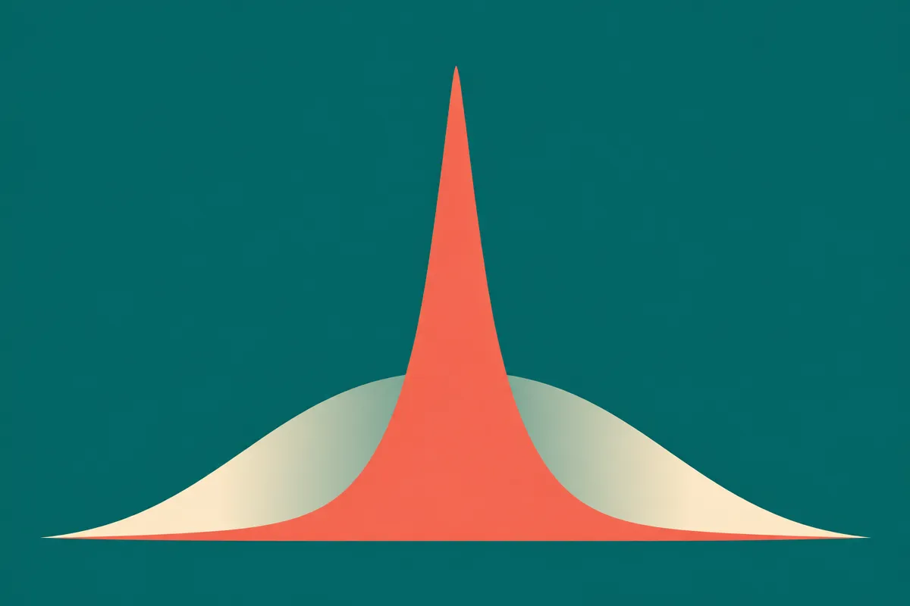

TL;DR: Ambient SFT fine-tunes a model while forcing its blurry, high-temperature predictions to stay close to the original base model's, which keeps the tails of the distribution intact and reports up to 21% average relative improvement over standard supervised fine-tuning.

The problem it attacks is one anyone who has fine-tuned a small model already knows in their gut. You have a few thousand good examples. You run SFT. The model gets sharp on your task and dumber everywhere else. That trade is so common people treat it as a law of physics. The paper I'm covering, "Ambient LLMs: Data-Efficient Supervised Fine-tuning via Temperature Matching" (posted to arXiv cs.AI, cs.CL, and cs.LG), argues it isn't a law. It's a side effect of throwing away information you already paid for.

## Why does normal SFT forget so much?

Pre-training sees trillions of tokens. SFT sees a rounding error by comparison. When you push a model hard on a small set, it overfits the examples in front of it and the rare patterns, the tails of the distribution, get crushed. That's catastrophic forgetting. The model can still recite your fine-tuning data beautifully while quietly losing the long-tail knowledge that made the base model useful in the first place.

The usual fixes are blunt. Lower the learning rate. Freeze layers. Mix in replay data from pre-training, which you often don't have access to. Use LoRA to limit how much can move. All of these are ways of saying "please don't change too much," and all of them trade task performance for stability without a principled knob to tune the balance.

## What is Ambient SFT actually doing differently?

Here's the move. The authors keep a frozen copy of the pre-trained model around during fine-tuning and treat it as a teacher. But not a confident teacher. A noisy one. The constraint is specific: the high-temperature version of the fine-tuned model's next-token distribution should match the high-temperature version of the frozen model's distribution.

Temperature is the dial that controls how peaked or flat a probability distribution is. Low temperature sharpens it toward the single most likely token. High temperature flattens it, exposing the broad shape across many tokens, including the rare ones. By matching at high temperature, you're telling the new model: get the coarse shape right, agree with the base model about what's plausible in general, but you're free to sharpen on the specifics your fine-tuning data cares about.

That's the elegant part. The temperature hyperparameter isn't just a detail, it's the whole trust knob. The authors note two limits. As temperature goes to infinity, the constraint vanishes and you're back to plain SFT. At temperature equal to one, you're doing standard knowledge distillation from the frozen model. Ambient SFT lives in between, and that middle ground is where the reported gains come from. You're using the base model's imperfect predictions to augment a thin fine-tuning set, borrowing its sense of the full distribution without copying its exact answers.

I like this framing because it reframes a familiar tool. We already use the base model's distribution all the time, we just usually throw away everything except the top token. Ambient SFT says the blurry tail of that distribution is signal, not noise, and worth preserving on purpose.

## How big is the gain, and where does it show up?

The paper reports up to 21% average relative improvement over standard SFT, and importantly it spreads that claim across three different task types: domain adaptation, instruction-tuning, and reasoning. That breadth matters more than the headline number. A method that only helps on one narrow benchmark is a trick. A method that helps across adaptation, instruction following, and reasoning is closer to a general property of how fine-tuning should be regularized.

Two cautions before anyone treats 21% as a promise. First, "up to" is doing work in that sentence. It's the best case across their setups, not the expected case on yours. Second, as of writing, the sources I have are the arXiv abstract across three categories, which means I'm reading the claim, not independent reproductions. The method is principled and the limits check out mathematically, but the magnitude of the win is the kind of thing that moves once other people run it on their own data. Treat the number as a reported result, not a settled one.

What's underspecified in the abstract: the compute cost. You're running a frozen teacher alongside the student during training, which means extra forward passes and extra memory to hold a second copy of the model. For a small model that's cheap. For a large one that's a real bill. The paper's own framing is "data-efficient," not "compute-efficient," and those are different budgets.

## Should a builder try this now?

If you fine-tune small or mid-size models on limited data, this is worth testing the moment code is available. The setup maps cleanly onto what you already do: take your SFT run, add a frozen copy of the starting checkpoint, add the temperature-matching term to the loss, sweep the temperature. The appealing thing is that the temperature gives you a continuous dial between "trust my data" and "trust the base model," so you can actually tune the forgetting trade instead of praying your learning rate was low enough.

The catch most people will miss is that Ambient SFT only helps if the base model's tail knowledge is worth keeping. If you're adapting to a domain the base model genuinely never saw, like a private codebase or a niche internal ontology, matching the frozen model's distribution can anchor you to ignorance. The method assumes the pre-trained model is a useful, if noisy, teacher. When that assumption fails, high-temperature matching becomes a leash to the wrong field. So the first question before you reach for this isn't "how do I tune the temperature," it's "does my base model actually know anything true about this task." If yes, preserving its tail is a gift. If no, you want it to forget, and plain SFT might be the honest choice.

Practitioner's take: start with a small sweep of temperature on a held-out eval that measures both your target task and general capability, because the whole point here is the second axis, the one standard SFT quietly degrades. Log general-knowledge probes alongside your task metric so you can see the forgetting you're trying to prevent. Budget for the frozen teacher's memory and extra forward passes up front, since that cost is the thing the "data-efficient" label doesn't mention. And don't chase 21%. Chase the shape of the curve: if adding the temperature term buys you most of your task gain while holding general capability flat, that's the real win, whatever the exact number turns out to be on your data.
