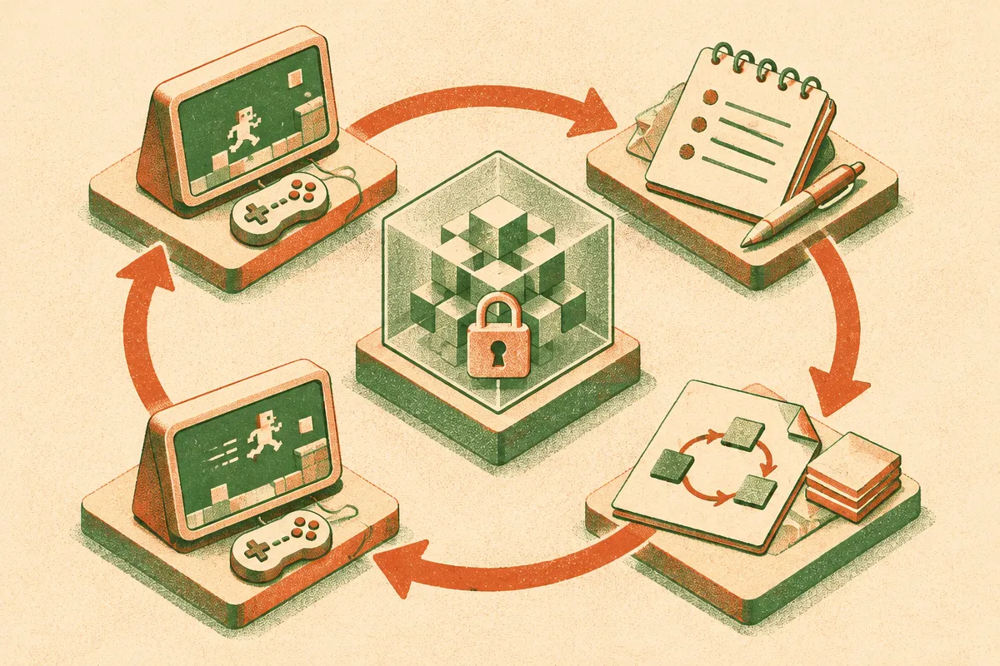

TL;DR: The useful version of “self-improving agents” is not a model rewriting itself, it is a frozen model learning how to keep better notes, run better trials, and reuse what worked.

## What actually improved?

My primary source here is the arXiv paper “Do LLM Agents Still Need to Be Told How to Self-Improve?” The setup is narrower, and more interesting, than the usual self-improvement pitch.

A frozen LLM agent gets a goal, a compute budget, and tools. It can collect gameplay experience. It can update text documents. It does not get a hand-coded learning loop. It does not get real-world data. It is allowed to experiment.

That matters because the model weights do not change. The improvement comes from context-based optimization: the agent creates and edits artifacts it can read later. Think strategy notes, rules of thumb, mini-curricula, reflections, and task-specific plans. Less “I trained myself into a new model.” More “I built my own playbook.”

The paper reports that sufficiently capable models do improve under these conditions. It also reports that the learned text artifacts transfer beyond the original setting, with gains across different game horizons, mechanics, and 3D navigation. That is the receipt worth paying attention to.

Not because games are the same as business workflows. They are not. But games give researchers a clean loop: act, observe, revise, test again. That is exactly the loop most agent products talk about, but often do not measure cleanly.

## Does this mean agents can train themselves?

Not in the strong sense.

This paper is about agents constructing self-learning algorithms from primitives. That is impressive. It is also not the same as open-ended autonomous model training. No weights are updated. No new external dataset is pulled in. The environment is constrained. The objective is bounded enough to score.

That distinction is the whole point.

A lot of agent hype smuggles in the word “learn” without saying what changes. In production, something has to change if you want improvement: the prompt, the memory, the tool policy, the retrieved examples, the planner, the eval set, the code, or the model weights. Here, the changing object is text.

Text is underrated as a control surface. It is inspectable. It is cheap to edit. It can be versioned. It can be evaluated before and after. It can also rot, bloat, and encode bad lessons from lucky runs. So the interesting question is not “can agents self-improve?” It is “can agents maintain useful working memory without poisoning themselves?”

The paper’s answer is cautiously positive inside gameplay. The agents discovered patterns that line up with classic self-regulated learning: try, monitor, revise, build a curriculum. They also resembled machine learning ideas around self-generated curricula. That is a good sign. It suggests capable models can invent parts of the learning loop when the tools are simple and the feedback is tight.

## What should builders copy from this?

Do not start by giving an agent permission to rewrite your whole workflow. Start with a narrow sandbox and one editable artifact.

For a coding agent, that artifact might be a repo-specific debugging journal. For a support agent, it might be a living escalation guide. For a research agent, it might be a claim ledger with evidence and failed searches. The agent should be allowed to propose edits, but the system should track which edits improve future performance.

The missing piece in many agent stacks is not autonomy. It is accounting.

If an agent updates its own memory, you need to know what changed, why it changed, and whether the next run got better. Otherwise self-improvement becomes self-confident drift. The paper’s game setting makes the score visible. Most real workflows do not. Builders need evals before they need grand theories of agent learning.

My practitioner's take: try this as a lightweight pattern, not a platform rewrite. Pick one repeatable task, give the agent a scratchpad it can revise between runs, and score outcomes against a fixed eval set. Keep the model frozen. Keep the tools boring. The catch most readers miss is that the “learning” lives in the artifact, so your real product surface is memory management, not the chat box.
