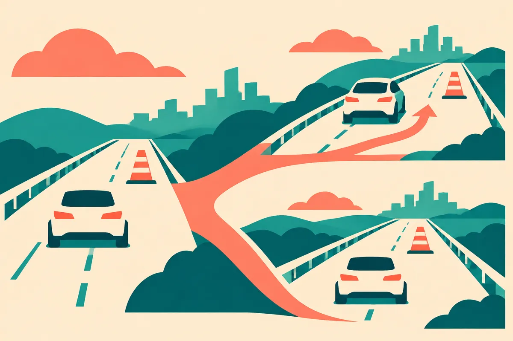

TL;DR: If a world model is supposed to predict what happens after an action, you need to test whether changing the action actually changes the forecast.

## Does the action actually matter?

The primary source here is the arXiv cs.AI and cs.LG paper titled “Does the Action Matter? Probing Action-Conditioned Semantic Forecasting as a World Model for Autonomous Driving.” The paper looks at a simple but important failure mode in autonomous driving world models: a model may accept an ego action as input, produce good-looking future scene predictions, and still rely mostly on scene history rather than the action.

That matters because “world model” is not just a fancy word for video prediction. In driving, the point is counterfactual reasoning. What happens if the car brakes? What happens if it turns? What if it keeps going? If the forecast does not respond meaningfully to those action changes, the planner is reasoning over a painted backdrop, not a controllable model of the world.

The paper studies action-conditioned semantic forecasting, where the model predicts future semantic segmentation from past segmentations and an ego action. It compares action-conditioned models against an otherwise identical model with no action input. Then it does the test I want to see more often: test-time action interventions. Give the model the executed action, then give it the wrong action, then measure what changes.

## What did the test show?

The headline is not that actions are useless. They help. But the size and meaning of that help are easy to overread.

On Cityscapes, the executed action improved mid-term mIoU by at most 2.5 points. On BDD100K, it improved mIoU by at most 0.6 points. That says the model is getting some signal from action, but not much in standard accuracy terms.

The sharper result comes from wrong-action tests. When the paper fed the model an incorrect action, performance dropped by up to 23.2 points on Cityscapes and 7.0 points on BDD100K, even below the model with no action input. That is the useful diagnostic. It shows the model can be action-sensitive, but also that action conditioning can hurt badly when the action channel is wrong or mismatched.

The paper also compares two conditioning styles. Feature-wise conditioning depended 1.6 times more on the action than input-level conditioning on real data at similar accuracy. In the synthetic environment, where history does not determine the action, both depended on action equally. That split is the tell. Real driving datasets contain strong correlations between scene history and driver action. If the car is already centered in a lane and traffic is moving forward, a model can often guess the future from the past. It may not need the explicit action very much.

So an accuracy bump is not enough. The paper says that directly: an accuracy gain indicates that a driving world model uses its action, but not how strongly its forecasts depend on it. Code is listed at https://github.com/binayksingh/does-action-matter.

## Why should builders outside autonomy care?

This is not only a self-driving car problem. It is a general agent-evaluation problem.

Any time we build an AI system that claims to simulate outcomes under different actions, we should ask the same question: does the action matter? In a coding agent, does the predicted test result change when the patch changes? In a marketing simulator, does the forecast change because the campaign changed, or because the audience history dominated everything? In a robotics policy, is the model conditioning on the command, or inferring the most common next frame?

The clean lesson is to separate prediction quality from controllability. A model can be accurate because the world is predictable. That is useful, but it is not the same as being a good counterfactual model. Planning needs the second thing.

If I were building with this, I would add action-intervention evals before trusting any model-based planner. Keep the normal accuracy metrics, but pair them with wrong-action, swapped-action, and no-action baselines. Look for two failures: forecasts that barely move when actions change, and forecasts that collapse when the action distribution shifts. The catch most readers miss is that “uses the action” is not binary. The real question is how much the model depends on action when history already gives it an easy shortcut.
