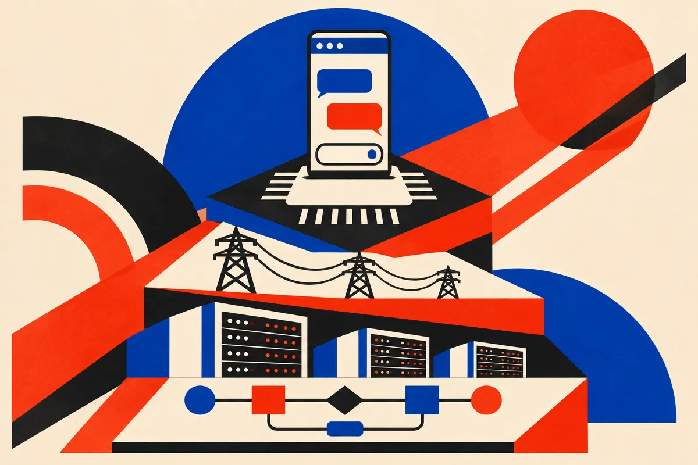

TL;DR: Anthropic’s reported IPO pop is not a clean read on AI product quality, it is a market bet on Claude, enterprise distribution, and the compute supply chain needed to keep frontier models improving.

## What actually got reported?

The cleanest deal terms in the supplied reporting come from CoinDesk’s “Anthropic’s $107 billion sale set to top SpaceX’s IPO as tokenized stocks gain traction.” CoinDesk reported that Anthropic priced its Nasdaq debut at $83 a share, implying a $1.5 trillion fully diluted valuation, while the Nasdaq 100 was down 14% from record highs.

CoinTelegraph then reported that Anthropic opened at $111.50 under the ticker ANT, 34.3% above the $83 IPO price, putting valuation around $2 trillion at the opening price. Decrypt framed the same move slightly earlier, saying shares could debut at $110 and that enthusiasm around the offering was lifting the broader technology sector.

Those numbers are wild, even by AI-cycle standards. They also show why the details matter. One outlet had pricing and valuation at IPO. Another had opening trade. Another was looking ahead to the likely open. Those are not the same event, and they should not be blended into one fuzzy “Anthropic is worth $2 trillion” sentence.

This is not investment advice, and I am not making a call on the stock. The useful question is operational: what would have to be true about Anthropic for public markets to support numbers like these?

## Why would markets pay this much for Claude?

Claude is the visible product. The valuation argument is probably about the machine behind it.

Anthropic has a recognizable consumer and developer brand, a serious enterprise story, and a reputation for safety-oriented model work. But in 2026, frontier AI companies are not just software companies. They are compute buyers, model trainers, API platforms, enterprise vendors, safety labs, and distribution businesses all at once.

That makes the public-market read tricky. A chatbot subscription business can be valued like software. A frontier lab consuming huge amounts of compute looks more like infrastructure plus R&D plus platform risk. Margins depend on inference costs. Growth depends on model quality and sales execution. Defensibility depends on data, post-training, agent workflows, brand trust, and access to chips and power.

The market may be treating Anthropic less like a single app and more like a control point in the AI stack. If Claude becomes a default model for enterprise assistants, coding agents, customer support systems, document workflows, and internal knowledge tools, revenue can spread across many categories. If model performance stalls or enterprise adoption proves narrower than expected, the premium gets harder to justify.

That is the non-hype version. The upside story is big because AI systems are becoming embedded in work. The risk is also big because model labs burn capital, face pricing pressure, and compete against OpenAI, Google DeepMind, Meta, xAI, Mistral, Qwen, and others.

## What does tokenized stock change?

CoinDesk’s headline also points to tokenized stocks gaining traction. That is a separate story from Anthropic’s model quality, but it matters because it changes how exposure to hot private or newly public tech names gets packaged and circulated.

Tokenized stock products can make access feel more continuous, global, and crypto-native. They can also blur the line between owning a regulated equity, holding a synthetic instrument, and trading something whose rights depend on the issuer, venue, custody setup, and local rules. For AI operators, that is not the main event. For market structure, it is.

The danger is that tokenization turns an already overheated AI equity story into a meme wrapper. Better rails do not make the underlying asset safer. Faster access does not answer whether the company can train better models, acquire customers profitably, or keep inference costs under control.

If I were building with Claude, I would treat the IPO pop as a signal about ecosystem confidence, not as proof that any one workflow is durable. Test Claude where it has clear strengths: long-context analysis, writing quality, coding support, tool use, and enterprise knowledge work. Track cost per completed task, failure modes, and switching costs against other models. The catch most readers miss: market excitement can help Anthropic recruit, raise, partner, and buy compute, but your product still needs boring evals before you depend on any model in production.
