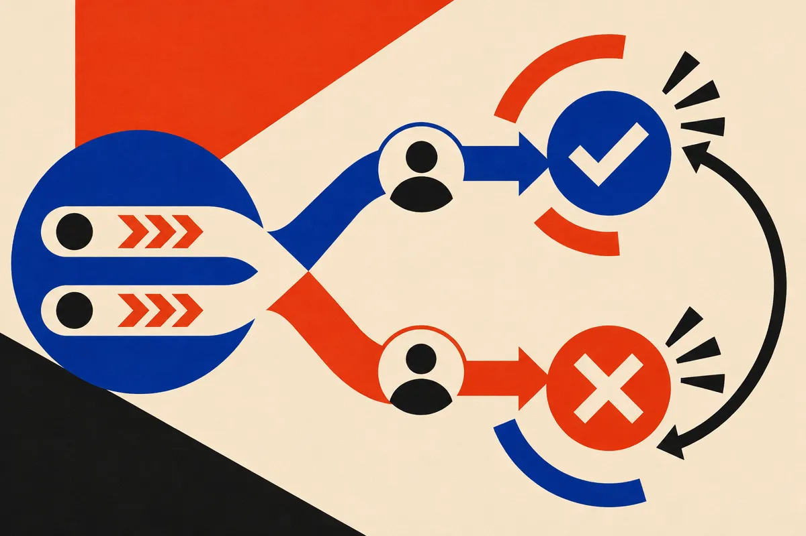

TL;DR: In AI review workflows, the human who adds value is not the busiest or fastest reviewer, but the one whose confidence reliably matches being right.

## What makes a human reviewer valuable when the model is already good?

The arXiv cs.AI/cs.LG paper, "Knowing What You Know: A Trait Theory of Reviewer Value in Human-AI Cognitive Systems," puts a clean frame around a messy operating problem: when a capable model and a human both touch the same decision, which human still helps?

Its answer is metacognitive calibration. Plain English: do you know when you are likely right, and do you know when you should slow down?

That sounds obvious until you look at how most AI review systems are managed. Teams often track activity, speed, agreement with the model, tenure, or how often someone edits an output. Those are easy to instrument. They also make weak proxies for judgment.

The paper grounds the argument in a six-month production window from an AI-assisted accounting system, covering 541,621 reviewer events across 483 reviewers. That is the useful part here. This is not a toy task with volunteers rating trivia. It is closer to the boring, high-volume work where AI review actually gets deployed.

The sharpest finding: a purely behavioral expertise profile inverted the ground truth. It scored an overconfident cohort higher than genuine experts, even though the overconfident group had 5.2 percent correction survival versus 99.2 percent for the genuine experts. In other words, the dashboard could make the wrong people look elite.

That should make every ops leader nervous.

## Why do activity metrics fail?

Because the same surface behavior can mean opposite things.

A calibrated expert may move fast and revise little because the item is easy and they know it. A confident novice may move fast and revise little because they do not see the problem. Telemetry alone cannot tell those apart. You need outcomes.

That is the paper’s best practical point. Behavioral traces are real, but non-diagnostic on their own. Clicks, dwell time, edit distance, and agreement rates become meaningful only when gated by correctness.

The tenure result is also worth sitting with. Reviewer quality was flat across tenure in the accounting window. The paper’s claim is not that people cannot learn. It is narrower: this trait was not simply acquired by being around longer. If your staffing model assumes seniority equals reliable review, you may be buying comfort instead of accuracy.

I like this because it pushes against a lazy version of human-in-the-loop design. Adding a person is not a safety layer by default. Adding the right person, at the right moment, with measured calibration, might be.

## Should the system defer to the human or the model?

The paper argues that human calibration and a model’s self-knowledge are the same kind of construct. The system should defer to whichever agent is better calibrated on each item.

That is a much better target than “human approval required” as a blanket policy. If the model is well calibrated on a routine case and the reviewer is poorly calibrated in that slice, human review can add noise. If the model is uncertain in a region where a reviewer has demonstrated accurate confidence, route it to that reviewer.

The accounting result is concrete: applying the same calibration logic to the model concentrated 92.5 percent of human effort on genuine errors. That is the review workflow everyone says they want. Less rubber-stamping. More human attention where it changes the answer.

There is a boundary. The paper says individual causal value becomes unidentifiable under majority-vote aggregation. That matters. If five people vote and the system only records the final majority, you may not be able to tell who actually improved the decision. More reviewers can produce less attribution.

A builder should treat this as a design spec, not a research curiosity. Log reviewer confidence, behavior, item type, model confidence, outcome, and later corrections. Do not rank reviewers on speed or agreement alone. Start with one workflow where correctness can be checked after the fact, then build routing rules around calibrated confidence. The catch most teams miss: you cannot discover reviewer quality from telemetry unless you connect it to outcomes. Without that loop, your “expert reviewer” score may just be measuring confidence with better posture.
