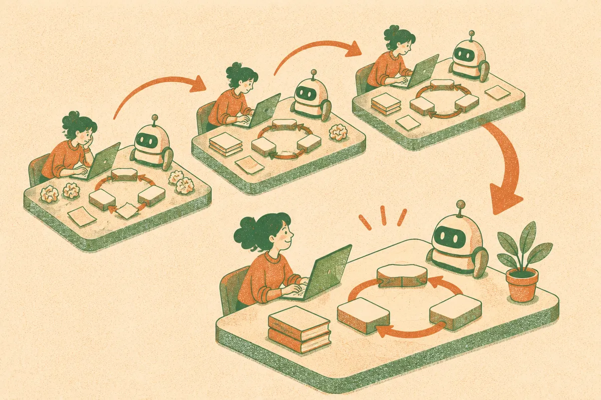

TL;DR: The useful lesson from this marketing agent case is not that agents magically save time, it is that a narrow workflow got valuable after three tries.

## What actually changed in the workflow?

Marketing AI Institute’s “Five Sins to Avoid While Building a Marketing Agent” reports that Sandy Carter cut podcast prep time from nine hours to three, and reduced guest booking time from four weeks to two hours, using an AI agent.

Those are meaningful numbers. Not vague productivity fog. Nine to three hours is a two-thirds reduction in prep time. Four weeks to two hours is the kind of scheduling compression that changes how a small team operates.

But the most important number is not the time saved. It is three.

It took Carter three tries to get there.

That matters because most agent demos hide the rebuild. They show the final workflow after the human has already clarified the goal, cleaned up the inputs, decided what quality means, and learned where the agent breaks. The polished version looks like automation. The real work looks like operations.

Podcast prep and guest booking are good agent targets because they are recurring, structured enough to define, and annoying enough to be worth fixing. There is research. There are guest profiles. There are outreach steps. There are reminders, confirmations, and handoffs. A general chatbot can help with pieces of that. An agent, if designed well, can carry more of the workflow across steps.

The catch is that “more steps” also means more places to fail.

## Why did it probably take three tries?

We do not get the full build log from Marketing AI Institute’s report, so I would not overread the mechanics. But the pattern is familiar.

First attempts usually fail because the scope is too broad. “Help me produce a podcast” is not a workflow. It is a pile of jobs. Research the guest. Find angles. Draft questions. Check for conflicts. Write outreach. Track replies. Schedule. Prepare the host. Follow up. Each subtask has different inputs, different quality standards, and different failure costs.

Second attempts often fail because the agent is under-instructed. Builders assume the model understands the taste of the business. It does not. It needs examples. It needs exclusions. It needs a clear handoff when confidence is low. It needs to know when “good enough” means polished prose, accurate research, or simply moving the scheduling ball forward.

Third attempts get better because the builder stops treating the agent like an oracle and starts treating it like a junior operator with a checklist, tools, and review gates.

That is the real marketing ops lesson here. Agents are not just prompts with ambition. They are process design. The work is deciding what the agent may do alone, what it drafts for approval, what it must never do, and what evidence it needs before taking the next step.

## What should marketers copy from this?

Copy the constraint, not the headline.

Pick one workflow that happens every week. Make it concrete enough that you can measure before and after. Podcast prep is a good example because the output can be judged: did the host get better notes, faster, with fewer missing facts? Guest booking is also measurable: did the system reduce back-and-forth, shorten cycle time, and avoid embarrassing mistakes?

Then build version one as a narrow assistant, not a fully autonomous agent. Let it gather context, draft outputs, and suggest next actions. Keep a human in the approval path. Watch where it wastes time or makes brittle assumptions. Rebuild around those failures.

For a marketer, the practical move is to map one repetitive workflow into stages, attach examples of good output to each stage, and test the agent on five real cases before trusting it on live work. The catch most readers miss: the time savings usually come after you remove ambiguity from the business process, not after you add another AI tool.
