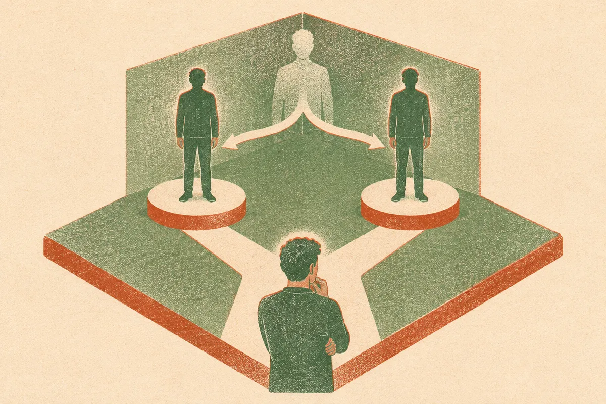
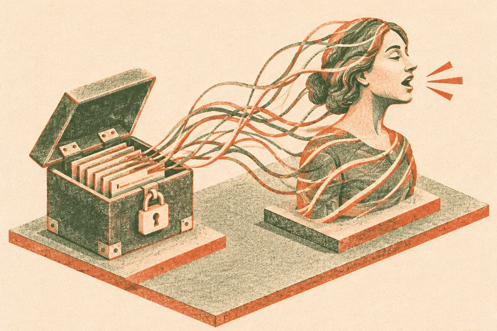

TL;DR: A new paper shows an LLM trained on ten years of one person's messages could pass for that person well enough that interrogators picked it over his real friends in 7 of 10 rounds, which moves the privacy question from "can a model sound human" to "can a model sound like *you*."

The classic Turing test is basically solved, and nobody announced it. Modern LLMs pass the generic Imitation Game routinely. So the interesting question stopped being "can a machine fake a human" a while ago. The paper "Who are you? The Personal Imitation Game," posted to arXiv under both cs.AI and cs.CL, asks the sharper version: can a machine fake *a specific person*. That is a different problem, and the early numbers are the kind that make you sit up.

## What is the Personal Imitation Game?

The original 1950 setup pits an interrogator against two hidden parties, one human and one machine, and asks the interrogator to spot the machine. The Personal Imitation Game keeps the structure but changes the target. Instead of "which one is the human," the question becomes "which one is Dan" (or whoever the real individual is). The machine is not trying to sound broadly human. It is trying to sound like one named person, with that person's turns of phrase, their opinions, their history.

The authors ran two things. First, a baseline study with 30 participants to figure out *what* interrogators actually use to identify someone. Three buckets emerged: stylometric features (how you write, your rhythm, your tics), personality traits, and biographical facts (things only you would know). That taxonomy matters more than the headline result, because it tells you what a convincing clone has to reproduce and what defenders should probe for.

Second, they built a system to impersonate one of the paper's own authors, trained on an autoethnographic dataset: roughly ten years of that author's personal digital communication. Then they ran a 20-person deception study.

## How well did the clone actually do?

Here are the two numbers, and they need to be read together.

In rounds pitting the AI against the author's own friends, interrogators chose the AI as "the real author" in 7 of 10 rounds. Read that slowly. People who knew the author were mistaken for the fake more often than the fake was mistaken for them. In rounds pitting the AI against the author himself, interrogators correctly picked the human in 13 of 20.

The authors are careful, and I want to be too: at this sample size, neither rate is statistically distinguishable from chance. 13 of 20 is a coin flip you cannot rule out. 7 of 10 is a coin flip you cannot rule out. So the honest framing is not "AI beats humans at being you." It is "a clone built from one person's message history performed at roughly chance against both the real person and people who know him, in a small study." That is already a startling result, because the null hypothesis here is "obviously you can tell a bot from your friend." They could not.

This is a single subject, one author, with an unusually rich and cooperative dataset. It is a demonstration, not a population study. Do not generalize it into "anyone can be cloned from their texts" without a lot more subjects. But as a proof of concept, it lands.

## Why does cloning one person matter more than passing Turing?

A generic Turing pass is a parlor trick now. A personal pass is a security and identity problem.

Think about what the three signal buckets imply operationally. Stylometry you can harvest from anyone who has ever posted publicly. Personality you can infer from the same corpus. Biographical facts are the hard part, the thing that used to anchor "prove you're really you." But the author's dataset shows the obvious path: ten years of your own messages contain your biography, your voice, and your personality in one place. Anyone who gets that corpus (a breached email archive, an exported chat history, a cooperative or coerced data grab) has the training material for a passable you.

That reframes a lot of threat models. Voice cloning scams already exist. This is the text equivalent, and text is where most trust lives: Slack, email, DMs, support tickets, "hey it's me, can you wire this." The defense that used to work, asking something only the real person would know, gets weaker when the attacker trained on a decade of things only the real person would know.

It also reframes the privacy stakes of your own archives. Your message history was always sensitive because of *what* it said. Now it is sensitive because of what it *is*: a behavioral fingerprint complete enough to reconstruct how you communicate. That is a different category of asset, and most people hand it to platforms without thinking about it that way.

## What should an operator actually do with this?

The useful read here is not fear, it is specificity. The paper hands you a checklist.

If you are building a personal agent (the benign version of this, an assistant that answers in your voice), the three-bucket taxonomy is your spec. Style, personality, biography. You need all three to be convincing, and biography is the one that generic fine-tuning misses. If you are building *defenses*, the same taxonomy is your attack surface. Biographical challenge questions still help, but pick facts that are *not* in the subject's digital exhaust: something never written down beats something written down a thousand times.

## Practitioner's take

If you run anything where "is this really that person" matters, treat text identity the way you already treat voice identity: assume it can be faked and design around it. Concretely: add an out-of-band verification step for high-stakes requests (money, access, data), and make the shared secret something that lives offline, not in the chat history an attacker could have scraped. Stop using "ask them something only they'd know" as your whole defense, because a decade of messages *is* the things they'd know. For the builders making the friendly version, personal agents in your own voice, the catch most people miss is consent and scope: a clone good enough to help you is good enough to impersonate you, and the dataset that makes it work (your ten years of messages) is exactly the thing you should be most careful about where it lives and who can export it. The capability and the vulnerability are the same artifact. Build accordingly.

One caution on the numbers: this is one subject and a 20-person study, and the authors say plainly that the results sit at chance for this sample size. The right takeaway is directional, not settled. But the direction is clear enough to change how I'd design identity checks today.
