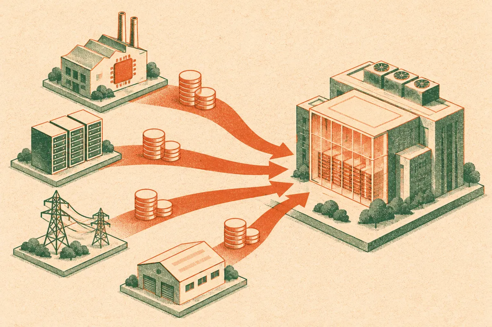

TL;DR: ARK’s reported Anthropic buy matters less as a stock-market call and more as a sign that investors want direct exposure to frontier AI labs instead of only proxy bets like chips, cloud, or crypto.

## What did ARK reportedly buy?

The cleanest primary report here is The Block’s “Ark buys $90 million worth of Anthropic shares on debut, trims Ethereum and Solana staking ETF holdings.” The Block reported that ARK Invest bought nearly 1 million Anthropic shares on the Claude maker’s debut and reduced holdings in its Ethereum and Solana staking ETFs.

Decrypt put the number at 934,968 Anthropic shares across six ETFs, worth about $91 million, while saying ARK trimmed a combined $4.1 million from Ethereum and Solana staking ETFs. CoinDesk also reported about $90 million in Anthropic stock across six funds, and added that ARK offloaded Nvidia shares amid leadership turmoil.

That is the useful shape of the story. Not precision theater. Three outlets are clustered around the same core fact pattern: ARK shifted money toward Anthropic on day one of public trading, while reducing some exposure elsewhere.

What we do not have from these sources is more important than usual. We do not have ARK’s full internal thesis. We do not have a first-party ARK note explaining whether this is a long-term conviction buy, index mechanics, portfolio balancing, or a headline trade. We also do not have Anthropic’s own public comment in these materials about the listing mechanics, proceeds, lockups, or post-IPO operating plan.

So I would not read this as “ARK knows Anthropic wins.” I would read it as “direct frontier AI exposure is now liquid enough for big thematic funds to express the bet openly.”

## Why does a direct Anthropic position change the AI trade?

For the last few years, public-market AI exposure has mostly meant buying around the labs, not the labs.

Nvidia for compute. Hyperscalers for cloud. Data-center power and networking. Enterprise software with AI features. A little bit of crypto-adjacent narrative when markets wanted “AI plus decentralized compute” stories. These are all indirect. Some are very real businesses. Some are branding exercises with better pitch decks than revenue.

A public Anthropic changes the menu. Investors can now buy a frontier model company directly, at least as reported here. That matters because frontier labs are not normal software companies. They sit between research org, infrastructure company, API platform, consumer app maker, enterprise vendor, and safety lab.

That bundle is hard to value. Model quality can change quickly. Inference costs matter. Enterprise adoption can be sticky, but only if the product is reliable inside real workflows. Safety positioning helps with some customers and slows some releases. Partnerships matter. Distribution matters. Compute contracts matter.

This is why I am cautious about treating the reported ARK trade as a clean referendum on Anthropic’s fundamentals. A frontier AI lab can look like a cloud platform one quarter, a consumer subscription business the next, and a capex sink the quarter after that. The public market likes categories. Anthropic does not fit neatly into one.

## What should operators take from this?

The practical read is not “follow ARK.” No buy or sell call here. The practical read is that frontier model companies are becoming first-class market objects, which means their product choices will get watched more closely by customers, partners, regulators, and investors.

That has second-order effects for builders. If you build on Claude, OpenAI, Gemini, Mistral, or open models, you are not just choosing model quality. You are choosing a vendor with capital structure, public scrutiny, margin pressure, safety commitments, and roadmap tradeoffs. Public markets can reward growth, but they can also punish high spend, unclear margins, or slower product velocity.

The crypto trim is also easy to overread. Decrypt and The Block reported reductions in Ethereum and Solana staking ETF holdings, but the reported dollar amount was much smaller than the Anthropic purchase. That looks more like portfolio rotation than a grand statement about crypto. The AI mechanics are the story, not the token angle.

My move as a builder would be simple: keep testing Claude where it is strong, especially writing, coding assistance, analysis, and agentic workflows, but do not let public-market excitement become architecture. Run evals across at least two frontier vendors and one credible open model. Track latency, cost, refusal behavior, tool-use accuracy, and migration pain. The catch most readers miss: when a model company becomes publicly traded, your vendor risk does not disappear. It gets more visible.
