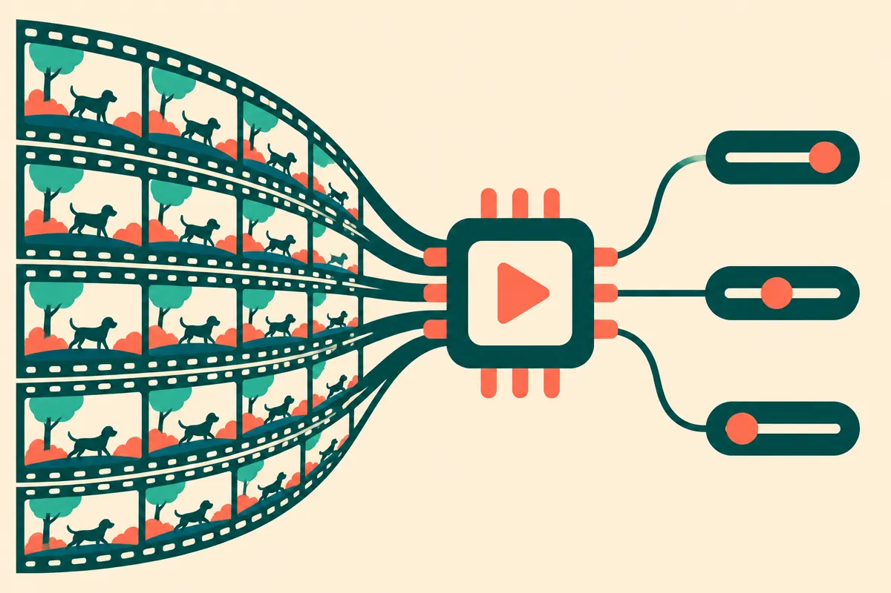
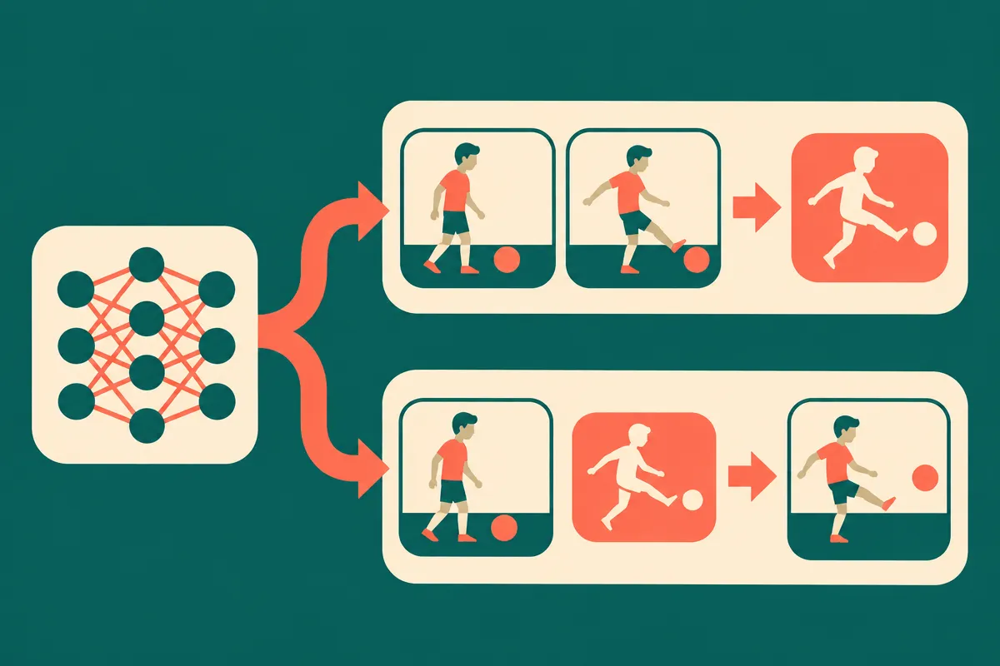
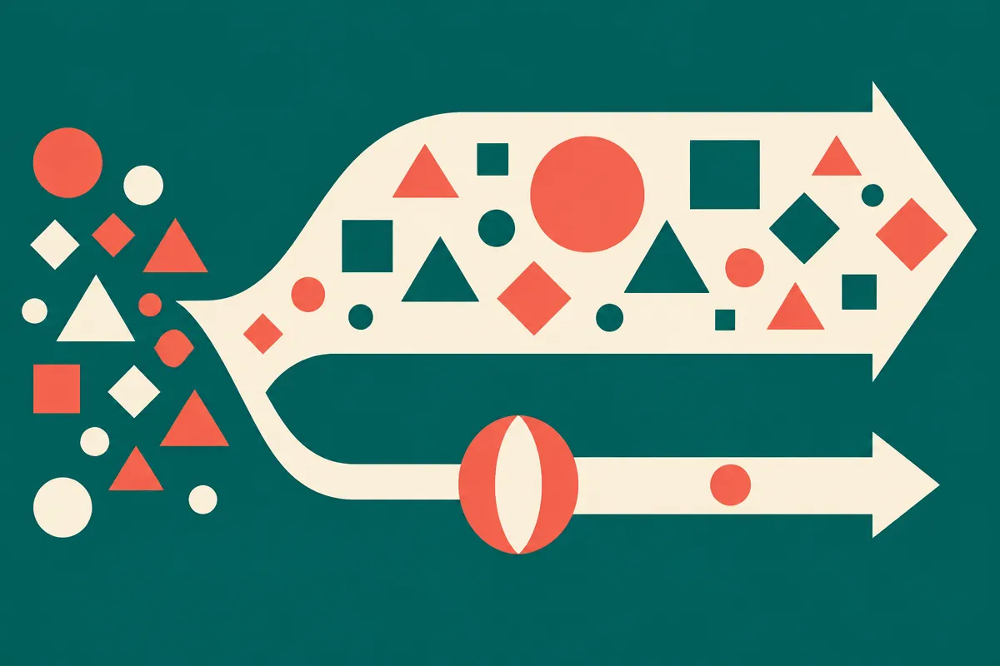

TL;DR: O2LaF shows you can skip learning robot dynamics from scratch by reusing a pretrained video generator as the shared starting point for both reading actions out of video and predicting what those actions do, and it beats prior methods on few-shot action probing and zero-shot transfer.

The paper is "One Prior, Two Dynamics: Repurposing Video Diffusion Transformers for Self-Supervised Latent Action Learning," posted to arXiv under both cs.AI and cs.LG. I am going to call the method O2LaF throughout, which is what the authors call it. The core claim is narrow and worth taking seriously: a video model trained to generate frames already carries a usable prior about how the world moves, and you can bend that prior toward learning actions without any action labels.

That last part is the whole game. Video is everywhere. Labeled robot actions are not.

## What problem is latent action learning actually solving?

Here is the gap. There is an ocean of video online showing the world changing: a hand picking up a cup, a car turning, a drone banking. What you almost never get is the control signal that caused the change. The torque, the joystick input, the motor command. That signal is exactly what a robot policy needs to learn.

Latent action learning tries to recover a stand-in for that missing signal straight from the pixels. You look at two frames, before and after, and you infer a compact "action" that explains the transition. Do that across millions of transitions and you get a vocabulary of actions grounded in what actually happens, not in any single robot's hardware.

The authors' complaint about prior work is pointed: these methods "often learn the underlying dynamics largely from scratch." You throw away the fact that video generators have already spent enormous compute learning how scenes evolve over time. O2LaF's bet is that you should not throw that away.

## How does one prior drive two dynamics?

The structure is cleaner than the name suggests. There are two models a system like this needs.

Inverse dynamics looks at a before-and-after pair and asks: what action happened here? Forward dynamics takes a frame plus an action and asks: what happens next? One reads actions out of video, the other predicts their consequences.

The usual move is to build these two as separate things. O2LaF initializes both from the same pretrained video DiT, a diffusion transformer, and then adapts each to its job. The inverse model becomes a feed-forward transition encoder with learnable action queries. The forward model becomes a causal, action-conditioned video generator. Same genetic material, two specialized roles.

The connective tissue is a "compact bottleneck." The inferred action has to squeeze through a narrow channel before the forward model can use it to reconstruct the next frames. That bottleneck is what forces the representation to be an action rather than a cheat. If you let too much information flow, the forward model just copies the future frame and learns nothing transferable. Narrow it, and the model is pushed to encode only the causal nudge, the thing that distinguishes this transition from a different one. Both dynamics get optimized end to end, so the action representation is shaped by whether it actually helps predict consequences.

That is the part I find elegant. The prior gives you a head start on dynamics. The bottleneck gives you discipline on what counts as an action. The two together are the contribution.

## Does it actually work, and on what?

The authors report results on navigation and robotic manipulation, which are the two settings that matter most for this kind of claim. Two numbers to hold onto, both from the paper and both reported, not independently verified:

First, state of the art on few-shot action probing. Probing means you freeze the learned representation and train a small head on a handful of labeled examples to see whether the actions you learned are linearly readable. Strong few-shot probing is the honest test here. It says the unlabeled pretraining did the heavy lifting and the labels only had to point at structure that was already there.

Second, stronger zero-shot action transfer across visual contexts and embodiments. This is the one worth caring about if you build robots. Transfer across embodiments means an action learned in one body shows up as useful in a different body. That is the holy grail nobody fully has, so read "stronger" as a relative claim against baselines in their evaluation, not as solved.

There is a third result that quietly widens the story. The authors extend the framework beyond generative video priors to predictive representation priors, specifically V-JEPA2, and report competitive performance. V-JEPA2 is Meta's prediction-in-latent-space approach, a very different philosophy from diffusion generation. If O2LaF's recipe works on both a generator and a predictor, the claim shifts from "diffusion transformers are special" to "pretrained video models in general carry a dynamics prior you can repurpose." That is a bigger and more interesting statement, and it is the line I would push the authors to defend hardest in follow-up work.

## What does this change for a robotics builder?

The practical shift is about where your scarce resource goes. Right now, teams burn budget collecting teleoperated demonstrations with clean action labels, because that is what imitation learning eats. A working latent action pipeline changes the ratio. You pretrain on cheap unlabeled video, learn a transferable action space, and spend your expensive labeled data only on the final alignment to your specific robot. Few-shot probing results are the evidence that this ratio can actually swing.

The catch, and it is a real one, is the bottleneck. The entire method lives or dies on choosing how much information the action channel carries. Too wide and the forward model ignores the action. Too narrow and you lose the nuance that distinguishes a gentle push from a hard shove. The paper presents this as a controlled design choice, and in a benchmark it is. In your messy domain, with your camera angles and your lighting, that bottleneck becomes a hyperparameter you will fight. Nobody hands you the right width.

Second catch: "zero-shot transfer across embodiments" is the phrase most likely to get oversold in the retelling. It is a comparative benchmark result, not a deployed robot doing a new job on day one. Treat it as a promising signal about representation quality, not as a shipping capability.

Practitioner's take: if you are building a manipulation or navigation stack, the move is not to adopt O2LaF wholesale, it is to steal the principle. Stop training inverse and forward dynamics from scratch. Initialize both from whatever video model you already trust, whether that is a diffusion generator or a JEPA-style predictor, and wire them through a deliberate information bottleneck so the action representation is forced to be causal. Validate with few-shot probing before you touch deployment, because probing tells you whether the unlabeled stage actually learned something or just memorized frames. The thing most readers will miss: the win here is not a new robot, it is a reallocation of where labeled data has to go. That alone is worth prototyping.
