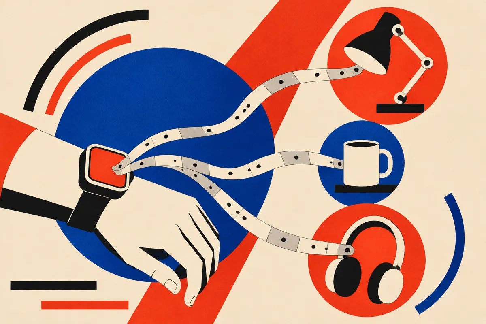

TL;DR: The strange smartwatch arm demo is not important because it makes tea, it is important because it hints at wearables moving from sensing our bodies to physically acting in the world.

## Is this an AI gadget or a robotics clue?

Matt Wolfe reported on a National Taiwan University prototype that puts a small robotic appendage inside a smartwatch-like wearable. The supplied material says the team published a paper, but it does not provide the paper title, authors, link, or arXiv ID, so I am not going to pretend we have those details.

The demo is deliberately weird. The little arm pops out of the side of the watch, holds a tea bag, waits, then pulls it out while the wearer keeps talking. In another example, Wolfe says the device can hang a drink from the wrist so the user can answer a phone.

That sounds like gadget bait. It is also a real design question.

Most wearables today are passive. They measure heart rate, steps, blood oxygen, sleep, location, maybe gestures. Even the more advanced ones mostly observe and notify. This prototype points in the other direction: a wearable that can reach, pull, hold, nudge, or manipulate something nearby.

Not much “AI” is proven here. The supplied description mentions three motors and a Wi-Fi chip, not a learning system. But that is fine. Robotics does not become useful by sprinkling model dust on hardware. It becomes useful when sensing, actuation, control, and human intent line up in a form factor people can tolerate.

A five-ounce wrist device, roughly the weight of a baseball according to Wolfe, is not subtle. But it is small enough to make the idea testable.

## What does a wrist robot actually prove?

The reported mechanical details are the most interesting part. Wolfe says the appendage is coiled under the watch like a tape measure and reaches about 3.5 inches in under a second. That gives it a short workspace, but a meaningful one. A few inches is enough for cups, bags, sleeves, buttons, small tools, cables, and desk objects.

That is the design space: not “robot arm replaces your hand,” but “micro-actuator handles the awkward tiny task at the edge of your hand.”

The tea example is silly, but it is useful because it is constrained. Dip, wait, lift. No complex object recognition. No full autonomy. No humanoid theater. Just a repeatable physical action.

The missing information matters too. Wolfe notes the paper does not say how much weight the device can hold. That is a big omission if you care about real use. Payload, battery life, pinch safety, failure modes, noise, water resistance, and social acceptability all decide whether this is a product or a conference demo.

A wrist-mounted actuator is also a safety problem. Anything strapped to your body needs to fail gently. A robot on a factory floor can have cages and emergency stops. A robot on your wrist has skin, tendons, hot drinks, pets, kids, and subway crowds nearby.

## What would make this useful?

The near-term uses are probably not tea. They are assistive, industrial, and accessibility-adjacent.

Think of a nurse who needs a sterile surface interaction without using both hands. A field technician holding a flashlight, cable, or sensor. A person with limited hand mobility who needs a small reach extension. A cyclist or warehouse worker who needs tactile alerts that do more than buzz. A wearable that can physically point, brace, hook, or retrieve might earn its weight.

The AI layer, if one comes later, should be modest. Gesture recognition. Context detection. Voice command. Simple planning for repeat actions. Maybe vision from a paired phone or glasses. The mistake would be trying to make this “an agent on your wrist” before the hardware is safe and useful.

The better path is boring: define ten tasks, measure success rates, test with real users, publish payload and runtime, then shrink the device. If it only works as a novelty, fine. If it reliably handles one annoying physical task, that is more interesting than another chatbot wrapper.

For builders, the lesson is to separate interface novelty from task value. If you are working on wearables, do not start with “what can we automate?” Start with “what physical action is frequent, annoying, low-risk, and close to the body?” Prototype that. The catch most readers miss: the hard part is not making a wrist robot move. It is finding a task where wearing five extra ounces feels worth it.
