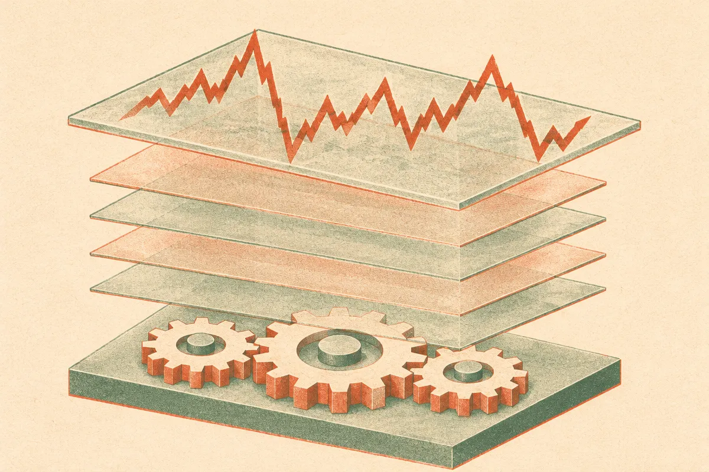

TL;DR: Treat the reported AI market selloff as a financing and expectations reset, not proof that AI demand or practical utility has disappeared.

## Is the AI bubble popping, or just repricing?

Decrypt’s piece, “Is the AI Bubble Finally Popping? Nvidia Crashes 48% as Wall Street Experts Sound the Alarm,” frames the moment as a broad risk-off break: tech stocks under pressure, Nvidia reportedly down 48%, Bitcoin below $60,000, and Wall Street split on whether this is a correction or something closer to the dot-com bust.

That is a useful alarm bell. It is not the same thing as a diagnosis.

A public-market drawdown can mean several different things at once. Investors may think AI revenue will arrive slower than expected. They may think capex got too far ahead of near-term demand. They may be rotating out of risk assets. They may be reacting to company-specific issues, such as the Nvidia leadership crisis Decrypt reported. Those are related, but not identical.

The mistake is to compress all of it into one line: AI is over. That is too clean.

The better read: expectations may have outrun deployment. That matters. If valuations assumed every enterprise would suddenly rebuild around agents, every consumer would pay for AI subscriptions, and every model lab would enjoy software margins while burning data-center money, then yes, some air can come out. A lot of air.

But a market repricing does not erase the fact that developers are using coding agents, support teams are using retrieval workflows, marketers are using generation systems, and enterprises are still trying to automate expensive internal processes. The question is not whether AI is useful. It is whether the useful parts can support the spending, multiples, and timelines investors attached to them.

## What does Nvidia’s reported drop actually change for builders?

Nvidia is the cleanest symbol of this cycle because it sits near the physical bottleneck: GPUs, networking, data-center buildout, and the capital intensity behind frontier models. If Decrypt’s reported 48% crash reflects a real sustained reset, the effects would not stop at a stock chart.

For builders, the second-order questions matter more than the headline. Does cloud GPU capacity get cheaper, or do providers protect margins? Do labs slow frontier training runs, or shift more energy toward post-training, distillation, inference efficiency, and smaller models? Do enterprise buyers keep signing AI deals, or ask harder questions about ROI before renewals?

A weaker Nvidia does not automatically mean cheaper inference next week. Cloud contracts, chip supply, data-center power, and model-provider pricing all have lag. The market can sell first and the operating impact can show up months later, if it shows up at all.

What I would watch is not the share price alone. Watch API pricing, rate limits, enterprise discounting, model release cadence, and the language vendors use around efficiency. If model companies start emphasizing smaller models, routing, caching, and task-specific systems over “biggest model wins,” that tells you the cost curve is starting to bite.

That would be healthy. The industry needs fewer demos that assume infinite tokens and more systems that know when not to call a frontier model.

## Why is Bitcoin in the same story?

Decrypt also reported Bitcoin below $60,000, which makes sense for its audience, but I would be careful about reading too much AI signal from crypto weakness.

Bitcoin can fall for reasons that have little to do with whether AI products work. Liquidity, rates, regulation, ETF flows, leverage, and broad risk appetite can all move crypto. The overlap with AI is mostly financial mood. When investors want risk, AI equities, crypto, and speculative software can all catch a bid. When they do not, they can all fall together.

That correlation is not causation. It does not tell you whether an AI coding tool saves time, whether a support bot lowers ticket volume, or whether a domain-specific model beats a human workflow on cost.

The dot-com analogy is useful only if you keep both halves. The bust destroyed many inflated companies. It did not destroy the internet. Infrastructure kept improving, user behavior kept shifting, and the durable businesses got built after the hype broke. AI may rhyme with that, but the details matter: compute is more expensive, model margins are less proven, and many “AI products” are still wrappers without distribution or data advantage.

For builders, the move is simple: tighten the loop between AI spend and measured output. Audit which workflows actually save labor, increase quality, or create revenue. Replace blanket model calls with routing. Cache repeated work. Use smaller models where they pass evals. Negotiate vendors based on usage, not vibes. Keep an eye on market stress because it affects funding and pricing, but do not let the stock chart become your product roadmap. The catch most readers miss: bubbles can pop while the underlying tool keeps getting more useful.
