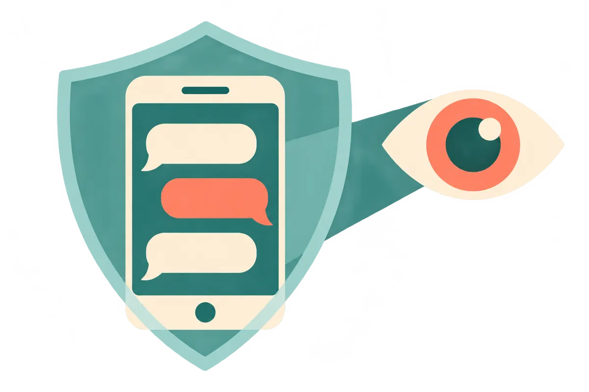

TL;DR: Signal’s reported screenshot restrictions are a warning that privacy apps now have to defend against the operating system itself, not just bad actors outside the phone.

## What changes when AI gets OS-level access?

The primary source here is Decrypt’s report, “Signal Calls OS-Level AI an 'Existential Threat' and Blocks Screenshots to Fight It.” Decrypt reported that Signal will restrict screenshots on iOS 27 and auto-enable screen security on Android when it detects an AI assistant reading a chat.

Treat the implementation details as reported, not fully settled. We do not have Signal’s own technical write-up in the supplied material. But the shape of the conflict is clear enough.

Messaging apps were built around a boundary: the app controls the message experience, the OS supplies the window, keyboard, permissions, notifications, and storage primitives. End-to-end encryption protects the message in transit and at rest, but the plaintext still appears on a screen. That has always been the soft spot.

OS-level AI makes that soft spot bigger. A system assistant that can “see” the screen, summarize conversations, suggest replies, or act across apps is not just another app asking for permission. It sits above the app layer. That means the privacy promise has to account for screenshots, accessibility-style reads, notification previews, clipboard access, and whatever new assistant hooks Apple and Google expose.

Signal’s reported reaction is defensive product design. Not glamorous. Very practical.

## Why would Signal fight screenshots?

Screenshots sound mundane, but they are one of the cleanest ways to turn encrypted communication into plain files. Once a chat becomes an image in a camera roll, all the downstream protections are different. Cloud sync can pick it up. Photo analysis systems can inspect it. Search can index it. An assistant may use it as context.

That is why screenshot blocking matters even if it feels clunky. The threat model has shifted from “can someone intercept the message?” to “what else on this device can observe the message after it is decrypted?”

This is also why the word “existential,” as reported by Decrypt, is not just privacy theater. Signal’s product value is based on a simple claim: your private messages stay private. If a platform assistant can read chats over the user’s shoulder, Signal still has encryption, but the user may not experience privacy.

That is the uncomfortable part for every app developer. The OS vendor can ship a feature that changes the meaning of your own feature without touching your code.

## What should builders take from this?

The easy reaction is to frame this as Signal versus Apple or Signal versus Google. I think the more useful frame is app boundary design.

If your product handles sensitive data, assume that ambient AI will try to observe, summarize, classify, or act on that data. That includes customer support tools, health apps, legal workflows, finance dashboards, internal chat, sales CRMs, and admin panels. The “AI assistant” may be first-party, enterprise-approved, user-installed, or quietly built into the platform.

The questions get concrete fast. Should sensitive screens block screenshots? Should the app hide content in app switchers? Should notifications contain full text? Should copy-paste be limited in some modes? Should sessions display when an assistant or accessibility service is active? Should audit logs show when AI features accessed user content?

None of this is free. Screenshot blocking can break user workflows. Accessibility restrictions can harm real users. Overbroad controls can turn privacy into friction. But ignoring the problem is worse, because users will blame the app whose data leaked into an assistant summary, even if the OS made that possible.

For builders, I would start with a screen-by-screen data exposure review. Identify where decrypted, regulated, confidential, or reputationally sensitive content appears. Then test the boring paths: screenshots, previews, notifications, clipboard, share sheets, screen recording, and assistant visibility. The catch most teams miss is that encryption is not the finish line. The moment private data becomes pixels, your threat model moves from cryptography to product plumbing.
