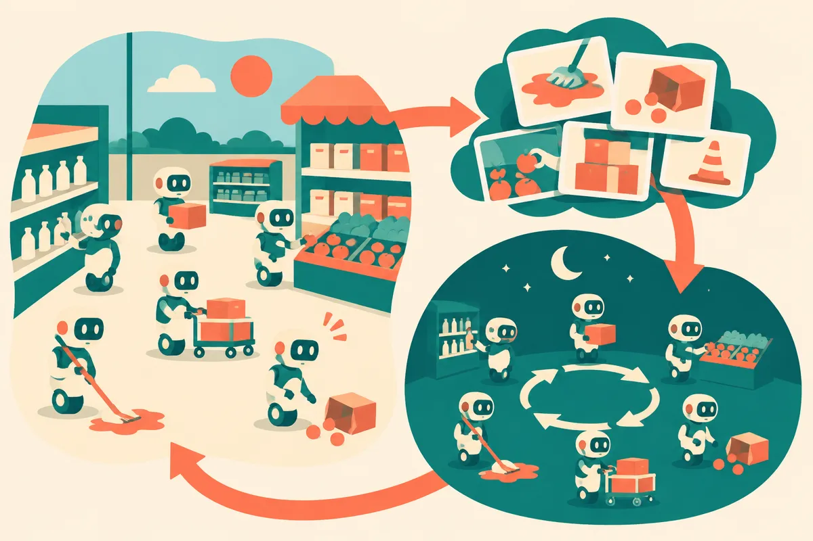

TL;DR: The important part of the Shanghai robot store is not that six robots worked a shift, it is that the store became a physical-world data collection system.

## What actually happened in the Shanghai store?

The primary account here is Matthew Berman’s “Six Robots Worked a 24-Hour Shift at a Shanghai Convenience Store.” Berman reported that a Chinese company put six robots inside a Shanghai convenience store for a 24-hour run, with more than 2 million people watching live.

The reported numbers are fun: 683 customer assists, 147 coffees made, and one robot noticing gaps on a shelf and choosing to restock. The tests were also more practical than flashy. The robots had to tell sugar-free Coke from regular Coke. Gum was scrambled on a shelf. An aisle was blocked by a person and a box. According to Berman, only four of the six robots passed.

That last detail matters. This was not a clean demo where everything worked and everyone clapped. The store produced misses. The misses were visible. Some robots failed.

The strangest reported moment was the cleaning robot finding a full trash can at night, then rolling out of the store to look for another one. That could be read as impressive autonomy or as a reminder that physical agents need boundaries. A robot solving the wrong problem can still look clever while creating a new operational problem.

## Why does the night shift matter more than the coffee?

The coffee count is the hook. The night shift is the story.

Berman said the company claimed that when the store went quiet, the robots got extra practice. Every screw-up was saved, and the fixes that worked became training data. That is the part builders should pay attention to.

A store is an edge-case machine. Products move. People stand in the way. Shelves get messy. Packaging changes. Trash cans fill up. Customers ask vague questions. Lighting changes. The same task is never quite the same twice.

That is exactly where most embodied AI work gets hard. A chatbot can recover from a weird prompt with another sentence. A robot has to move through space, avoid people, manipulate objects, and know when not to act. The cost of being wrong is different.

The useful pattern is not “replace the store staff.” It is “instrument the environment, capture failures, replay them, and turn working corrections into training examples.” That is much closer to how serious AI systems improve than the usual robot hype reel.

Still, I would not treat the reported numbers as settled evidence of general retail automation. The company behind the deployment is not named in the material here, and these claims come through Berman’s account. That does not make them false. It does mean the right stance is interest, not certainty.

## Is this an agent story or a robotics story?

Both, but the agent framing is cleaner.

The robots were not just executing one fixed motion. At least in the reported examples, they were perceiving state, deciding what mattered, and taking action: shelf gap, restock; blocked aisle, route around or fail; full trash, find another bin. That is agent behavior in a physical workspace.

The catch is that robotics exposes all the cheap talk in agent demos. In software, an agent that clicks the wrong button can be reset. In a store, the world keeps moving. A person can block the aisle. A box can be in the wrong place. A robot can leave its assigned zone because its local objective made sense.

That is why I like this story more as an operations pattern than as a labor prediction. If you run a physical business, the first win is probably not a fully autonomous store. It is narrower: inventory gap detection, cleaning checks, shelf condition monitoring, coffee station replenishment, after-hours practice in a controlled environment.

A practitioner should copy the loop, not the spectacle. Pick one physical task with frequent repetition and clear failure labels. Capture the misses. Build a review process. Feed the corrected examples back into the system. The catch most people miss: the robot is only as useful as the error pipeline around it. No pipeline, no compounding. Just an expensive machine making the same mistake tomorrow.
