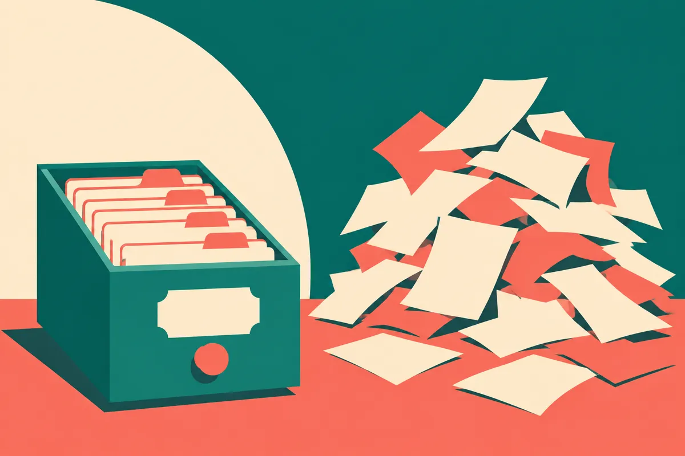

TL;DR: NINLIVE is a hand-built archive of Nine Inch Nails live recordings, and the lesson for anyone shipping AI products is that clean, well-structured data still comes from people who care, not from models.

The source here is thin: a single Hacker News (AI) post pointing to NINLIVE, described as "The Nine Inch Nails live archive." I don't have the site's own documentation in front of me, so I'm not going to invent features, dataset sizes, or technical claims it doesn't state. What I can do is use it as a concrete example of something I keep running into when people try to bolt AI onto a real collection of stuff. The hard part is almost never the model. It's the data underneath.

## Why does a fan archive matter to anyone building with AI?

Live music archives are one of the messiest data problems you can pick. The same show gets taped by five people on five different devices. Dates get mislabeled. Track titles drift. A song called "Wish" on one recording is "wish" or "Wish (live)" or just track 04 on another. Someone has to decide which version is canonical, which are duplicates, and how to name things consistently.

That is the exact work that makes or breaks an AI feature later. A search box, a recommendation, a "find me the 1994 shows" query: all of it depends on whether the date field is actually a date and whether every show has one. A fan archive like NINLIVE, whatever its exact scope, represents thousands of small human judgments about how to label and relate recordings. That structure is the asset. The model is the easy part you add at the end.

I bring this up because the current mood in AI building is "throw it at the model and let it figure out the mess." Sometimes that works. Often it doesn't, and it fails quietly. A language model will happily answer a question about a show that never happened, or merge two different performances because the text looked similar. The archive approach, with explicit records and human-verified fields, is the opposite philosophy. It's slower and it's correct.

## What does good structure actually buy you?

Three things, and they compound.

First, retrieval that works. If you ever want to put a RAG layer or a natural-language search over a collection, structured metadata is what the retrieval step hangs on. Clean fields mean you can filter before you ever ask the model to reason, which is cheaper and far more accurate than dumping everything into a prompt and hoping. The models that embed and rank your content can only be as good as the boundaries you drew around each item.

Second, provenance you can defend. For live recordings, provenance is the whole game: which source tape, what lineage, what generation of copy. That maps directly onto what enterprise teams now ask of any AI system. Where did this answer come from? Can I trace it back to a specific document? An archive that tracks the chain of each recording is doing, by hand and by convention, what a lot of AI products are scrambling to retrofit.

Third, a dataset other people can build on. A well-structured archive is a thing you can hand to a tool, a script, or a model and get predictable results. A folder of inconsistently named files is not. The difference between those two states is entirely human labor applied up front.

## Can't AI just clean the data for me now?

Partly. This is where I want to be honest about both the hype and the real.

Models are genuinely good at the grunt work of normalization now. Point one at a column of inconsistent track titles and it will standardize capitalization, strip junk, and flag likely duplicates faster than you could. That's real, and if you're sitting on a messy collection, it's a legitimate accelerant. I'd use it.

What a model cannot do is make the editorial calls that give an archive its authority. Which of three recordings of the same show is the reference copy? Is this actually a soundcheck or a full performance? When two sources conflict on a date, who's right? Those are judgments rooted in knowing the material. A fan who has listened to every bootleg carries context that doesn't exist in any training set. The model can propose; a person who cares has to decide.

So the honest division of labor looks like this: humans set the schema and make the hard calls, models do the repetitive normalization and surface candidates for review. Anyone who flips that order, letting the model define truth and using humans only to spot-check, ends up with a confident, plausible, subtly wrong archive. I've watched that happen on real projects, and the errors are the worst kind because they look fine.

## What's the catch most people miss?

The catch is that structure is a maintenance commitment, not a one-time cleanup. An archive is only as trustworthy as the rules it keeps enforcing on new entries. The moment you stop applying the schema, drift creeps back in, and six months later your clean dataset is messy again in new ways. AI makes the initial pass cheaper, which tempts people to treat data quality as a project with an end date. It isn't. It's a standing discipline.

Practitioner's take: if you're building any AI feature on top of a real-world collection, spend your first week on the data model, not the model. Define the fields that matter, write down the rules for what's canonical and how provenance is recorded, then use an LLM to do the bulk normalization against that schema and to flag conflicts for a human to resolve. Keep the human in the loop specifically for the judgment calls, and build a lightweight check that enforces the schema on every new item so the cleanliness survives past launch. NINLIVE, whatever its precise internals, is a reminder that the durable value sits in the structure and the care behind it. The model is a tool you point at good data, not a substitute for having any.
