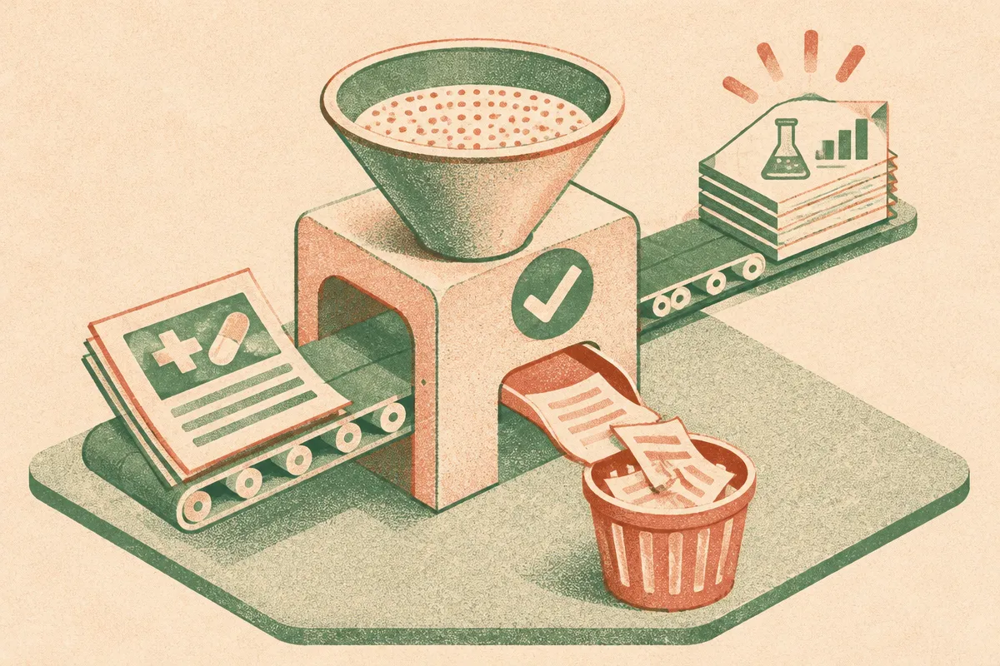

TL;DR: Treat medical breakthrough headlines as triage signals, not evidence, until you have the clinical source, trial details, and first-party claims in hand.

## What can we actually say from the source?

Hacker News (AI) surfaced one claim: “Pill to treat pancreatic cancer hailed as ‘biggest breakthrough in decades.’” That is the full usable source material here.

So the honest answer is: not much.

I do not have the underlying clinical paper, regulator filing, company announcement, hospital release, or trial registry entry in the source packet. I do not know the drug name, indication, trial size, comparator arm, survival endpoint, adverse-event profile, eligibility criteria, stage of disease, approval status, or whether “hailed” came from an investigator, a company, a charity, or a headline writer.

That matters more in medicine than almost anywhere else AI touches.

Pancreatic cancer is an area where even modest gains can be meaningful. It is also an area where hope gets converted into headline compression fast. “Pill” sounds simple. “Breakthrough” sounds settled. “Biggest in decades” sounds like history has already ruled. But a builder cannot turn that into patient-facing advice, clinician support, search content, drug discovery analysis, or care-navigation logic without the receipts.

This is where AI systems are most likely to sound confident while being least useful. A model can produce a polished explanation of mechanism, trial implications, and patient relevance from a headline. That output may read well. It may also be mostly invented.

## How should AI products handle medical breakthrough news?

The right workflow is boring, which is why it works.

First, separate the signal from the claim. The signal is: there may be meaningful news about an oral therapy for pancreatic cancer. The claim is: this is the biggest breakthrough in decades. Those are not the same thing.

Second, require source promotion before summary. An aggregator headline should trigger retrieval, not generation. The system should look for first-party material: trial publication, conference abstract, company release, regulator document, clinical trial record, or hospital statement. If it cannot find those, the product should say so plainly.

Third, make the model extract, not embellish. For a medical note, I want fields like population, intervention, control, endpoint, effect size, follow-up period, harms, conflicts, and approval status. If a field is missing, mark it missing. Do not “helpfully” infer.

Fourth, keep the user type in mind. A researcher may want the trial design. A clinician may want eligibility and safety. A patient may need a careful explanation that does not imply availability or personal suitability. A content team may want search coverage, but the bar should still be higher than “the headline is exciting.”

## The real AI lesson is claim discipline

The most useful AI in health care will not be the one that writes the smoothest paragraph. It will be the one that knows when the evidence chain is too thin.

That sounds less glamorous than drug discovery models or diagnostic copilots. Still, it is a major product capability. In high-stakes domains, refusal is not enough. The system needs graded uncertainty, source requirements, and a clean path from early signal to verified summary.

This also applies outside medicine. Security vulnerabilities, legal rulings, policy changes, market-moving company news, crypto claims, all have the same failure mode. A thin source enters the system. The model fills the gaps. The output looks like analysis. The user mistakes fluent structure for verified knowledge.

I am optimistic about AI in medicine, especially around literature review, trial matching, coding support, imaging workflows, and patient education. But medical AI earns trust by narrowing claims, not expanding them. If the source says only “a pill was hailed,” the responsible system should not pretend it has read the trial.

For a builder, the move is simple: add an evidence gate before any medical-news generation. Require first-party or peer-reviewed sources, extract structured trial facts, show missing fields, and keep patient-facing language conservative. The catch most teams miss is that the dangerous output is not always wrong. It is often half-right, polished, and missing the one caveat that changes the decision.
