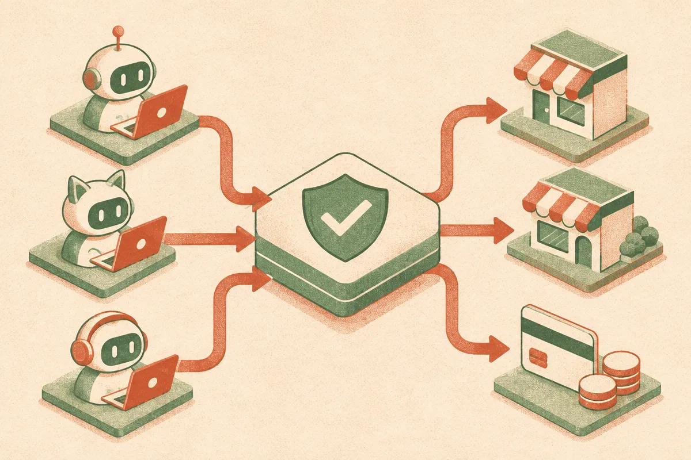

TL;DR: Agent commerce will not work at scale unless agents can prove who they represent, what they are allowed to do, and how a bad transaction gets unwound.

## What problem are OpenAI and Anthropic trying to avoid?

My primary source here is CoinDesk’s report, “OpenAI, Anthropic and rivals seek AI agent rules to prevent commerce chaos,” which says OpenAI, Anthropic, and other technology companies are backing standards meant to let AI agents work together without any one company controlling the system.

That last clause matters.

The obvious version of agent commerce is easy to imagine. “Find me a flight under $500.” “Order printer paper when we are low.” “Renew the SaaS plan if the discount is still active.” The demo version is fun. The operational version is messy.

An agent needs to identify the user or business it represents. It needs to prove permissions. It needs to know spending limits. It needs to tell a merchant whether it is browsing, negotiating, reserving, or buying. It needs receipts. It needs logs. It needs a way to handle fraud, refunds, chargebacks, substitutions, shipping failures, and “the agent misunderstood me.”

Without common rules, each platform builds its own little toll road. OpenAI agents talk best to OpenAI-friendly services. Anthropic agents talk best to Anthropic-friendly services. Merchants implement five slightly different agent APIs. Payment networks get nervous. Users get confused. Bad actors find the gaps.

That is the “commerce chaos” risk CoinDesk is pointing at. Not science fiction. Just normal internet commerce, with a new actor in the middle.

## Why does “no one company in control” matter?

Because agent commerce sits at the intersection of search, payments, identity, and distribution. Whoever controls the default agent could shape which products are seen, which merchants are trusted, which payment paths are easiest, and which fees become normal.

We have seen this movie in other markets. Browsers, app stores, search engines, ad networks, payment buttons. The technical layer becomes a business layer. The business layer becomes policy by default.

So shared standards are not just plumbing. They are market structure.

That does not mean standards magically fix power. Big companies can back “open” rules and still win through distribution, model quality, cloud contracts, or preferred integrations. But common protocols at least create a fighting chance for smaller merchants, payment providers, and tool builders to plug in once instead of begging every agent platform for access.

The useful standard would answer boring questions. What is an agent? How does it declare intent? How does a merchant verify delegated authority? How are spending caps expressed? What data must be logged? How does revocation work? What happens when two agents negotiate and one exceeds its authority?

If those answers are vague, the standard becomes theater. If they are too rigid, nobody ships. The right target is a minimum viable trust layer.

## What should builders do before this settles?

I would not wait for a universal agent-commerce protocol before experimenting. I also would not let an autonomous agent touch real money without guardrails.

Start with constrained workflows. Reordering known supplies. Drafting purchase requests. Comparing vendors. Preparing carts for human approval. Renewing contracts only inside hard limits. Treat the agent as a junior operator with a checklist, not a blank-check buyer.

The key design pattern is explicit authority. Every action should carry scope. Who requested it? What account is it acting for? What is the maximum spend? Which vendors are allowed? Is the agent allowed to purchase, or only recommend? Can it accept substitutions? Can it store payment credentials? Can it retry after failure?

Then keep evidence. Not just chat transcripts. Structured logs. Inputs, tool calls, approvals, final actions, confirmations, and exceptions. If an agent buys the wrong thing, your first question will not be philosophical. It will be: what happened, and who approved it?

Practitioner’s Take: If you are building with agents today, design your commerce flows as if a neutral standard will arrive later. Separate identity, permissions, payment, and audit logs now. Use humans for approval on anything material. The catch most teams miss is that agent commerce is less about smarter shopping and more about accountable delegation. That is the part that has to work before the clever stuff matters.
