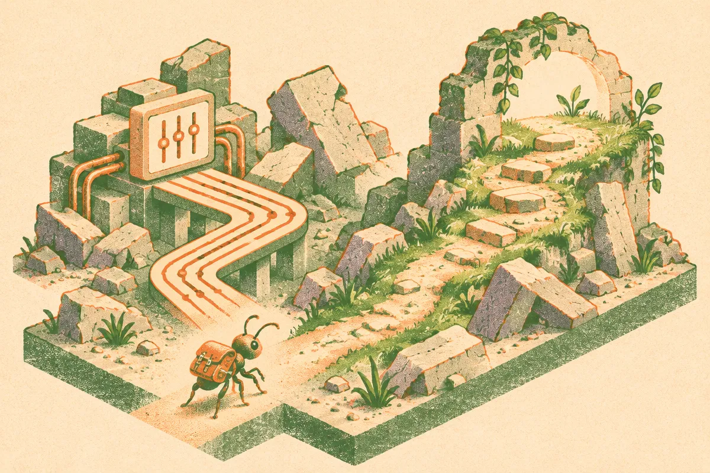

TL;DR: The useful idea in cyborg cockroaches is not “AI bugs,” it is offloading the hardest robotics problem, movement through messy terrain, to a living system while AI handles limited steering decisions.

## What is actually new here?

Matt Wolfe’s report, “They built cyborg cockroaches with built-in AI...,” describes work from the University of Osaka using Madagascar hissing cockroaches fitted with a small backpack computer and stimulation wires. According to Wolfe, pulses to the antenna steer turns, and pulses to the rear trigger running.

That part is not the new concept. Cyborg insects have been a research topic for years. The more interesting piece is local terrain judgment.

Older versions, as Wolfe describes them, treated the insect too much like a remote-control car. Steer left. Steer right. Avoid that object. The problem is obvious once you picture real rubble: a cockroach can climb over plenty of things a wheeled robot would have to route around. If you micromanage every obstacle, you throw away the insect’s best feature.

The Osaka system reportedly classifies the terrain under or ahead of the roach into cases like flat ground, climb, drop, or hole, with about 92% accuracy. When it detects a climb, it stops steering and lets the insect handle locomotion.

That is the operator lesson. Good autonomy is often knowing when not to act.

## Why use a cockroach instead of building a better robot?

Because legs are hard.

Robotics teams can spend years on locomotion, balance, compliance, power draw, durability, and recovery from falls. Biology already solved a lot of that. A cockroach is compact, energy efficient, good at squeezing through gaps, and comfortable in terrain that makes most lab robots look fragile.

The trade is control. A living animal is not a clean actuator. It has its own behavior. It can refuse, fatigue, panic, or react to stimuli in ways the system does not predict. That makes the AI layer less like a robot brain and more like a manager of nudges.

This is where the “built-in AI” phrase can mislead. Based on Wolfe’s description, this does not sound like a general agent making broad rescue plans. It sounds like a small onboard classifier deciding whether the system should steer, pause steering, or trigger movement.

That is still useful. In fact, it may be more useful than a grander claim. Edge AI often wins when the task is narrow, local, and tied to a physical action. Classify terrain. Change control mode. Save power. Avoid sending every decision to a remote operator.

## Is this close to real search-and-rescue use?

Not from the evidence provided.

Wolfe notes that Singapore sent 10 cyborg cockroaches into rubble after the Myanmar earthquakes last year, but they did not find anyone. He also says Osaka’s version is still in labs only. That is the right framing: promising research, not a deployable rescue fleet.

The gap is not just model accuracy. A 92% terrain classification number, if reported correctly, says little about the full mission. Search-and-rescue requires communications through concrete, repeatable steering under stress, localization, sensor payloads, battery life, animal handling, training protocols, safety rules, and public acceptance. A system can classify climbs well and still fail the job.

There is also an ethics layer. Using insects does not trigger the same reaction as using mammals, but “less concern” is not “no concern.” Researchers and agencies will need clear rules on animal treatment, mission limits, and disposal. Weird tech gets attention. Field tech needs governance.

My read: the strongest version of this idea is not a swarm of spy bugs. It is a cheap, semi-autonomous probe for places where sending humans is dangerous and conventional robots are too large, expensive, or brittle. Small sensors. Narrow autonomy. Human-supervised missions.

Practitioner's Take: If you are building embodied AI, copy the architecture before you copy the insect. Let the physical system do what it is naturally good at, then use AI for the smallest decision that improves reliability. In software terms, do not build an “agent” when a classifier plus a control policy will do. The catch most people miss: the demo metric is not the product metric. Terrain accuracy is nice. Mission success, recoverability, and operator trust are what decide whether this leaves the lab.
