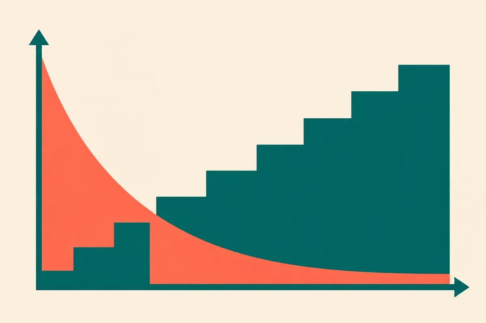
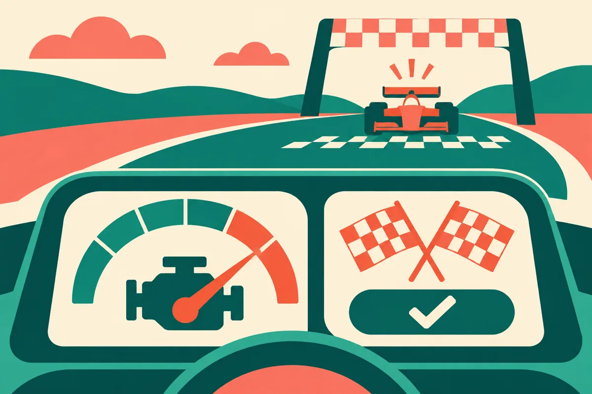

TL;DR: Perplexity is a clean signal for whether a model is learning to predict text, and a terrible signal for whether it can do your job, so use it to watch training and never to decide what ships.

OpenAI's post "Perplexity and Intelligence" makes a careful, slightly defensive argument: perplexity measures something real about model progress, and it could give developers a shared language for evaluating capability. I agree with the first half. I want to push hard on the second, because the gap between "measures progress" and "measures intelligence" is exactly where a lot of teams waste money.

Let me lay out what perplexity actually is, where it earns its keep, and where it starts lying to you.

## What does perplexity actually measure?

Perplexity is a measure of how surprised a model is by the next token. Lower is better. A model with perplexity of 10 on some text is, loosely, as confused as if it were choosing uniformly among 10 options at each step. Train a bigger model on more data and perplexity drops in a smooth, almost boring way. That smoothness is the whole appeal. It is the metric behind the scaling-law curves everyone screenshots.

Here is why practitioners should care about it at all. Perplexity is cheap, continuous, and sensitive. You can compute it on a held-out set every few minutes of training and watch the number move. Benchmark accuracy, by contrast, is lumpy. A model can get materially smarter while its score on a multiple-choice eval sits flat, because accuracy only flips when the model crosses a threshold on each question. Perplexity sees the progress underneath that happens before the threshold flips.

So as a training instrument, perplexity is genuinely good. It tells you the optimization is working, it catches regressions early, and it compares two checkpoints of the same architecture fairly. OpenAI framing it as a tool for measuring progress is correct and honestly a little overdue to say out loud, given how much public attention has shifted to benchmark leaderboards.

## Why doesn't lower perplexity mean smarter?

This is where I part ways with the "shared approach to evaluating emerging capabilities" framing in OpenAI's post. Perplexity measures compression of a text distribution. Intelligence, in the sense builders care about, is the ability to do a task correctly. Those two things correlate until they don't, and the places they come apart are the places that matter most.

A few concrete failure modes.

Perplexity rewards fluency, not correctness. A model can assign high probability to a confident, well-formed, wrong answer. Hallucinations are often low-perplexity. The model is not confused. It is confidently producing plausible text that happens to be false. No next-token loss will flag that for you.

Perplexity is dominated by the easy tokens. Most tokens in any corpus are grammatical glue: articles, common phrasings, predictable continuations. A model gets most of its perplexity win by nailing those. The handful of tokens that encode the actual reasoning step, the single digit in an arithmetic answer, the key clause in a legal clause, barely move the aggregate number. So two models can have nearly identical perplexity and wildly different accuracy on the thing you care about.

Perplexity is not comparable across tokenizers or domains. A model with a different vocabulary, or evaluated on different text, produces perplexity numbers that are not apples to apples. This is the quiet trap. Someone reports a perplexity figure, someone else reports a lower one, and the comparison is meaningless because the measurement surfaces differ. Benchmark accuracy at least forces a shared task.

And the big one for 2026: post-training breaks the perplexity-to-capability link entirely. Reinforcement learning from human feedback, reasoning-focused RL, instruction tuning. These often raise perplexity on raw text while making the model dramatically more useful. A model tuned to reason step by step, or to refuse, or to follow a format, is deliberately moving probability mass away from the "natural" text distribution. Lower perplexity would mean it had learned to imitate the internet better, which is not the goal anymore. OpenAI's own product line is the clearest evidence here. The capabilities people pay for come from exactly the training stages where perplexity stops being the north star.

## So where does perplexity belong in a real eval stack?

Use it as an instrument, not a verdict. Here is how I'd actually place it.

During pretraining, perplexity on a held-out set is your primary live signal. Watch it, trust it, let it tell you the run is healthy. This is its home turf and it does the job better than anything else.

For comparing checkpoints of the same model family on the same data, perplexity is a fair tiebreaker and an early-warning system. Lower perplexity on your target domain text before fine-tuning is a reasonable proxy that the base model has seen relevant distribution.

For deciding what ships, perplexity is close to useless, and this is the part teams get wrong. The decision to deploy should rest on task evals that mirror the job: accuracy on your actual questions, pass rates on your actual workflows, graded outputs on your actual rubric. If you are building agents, that means scored task completion, not next-token loss. If you are doing retrieval, it means answer correctness against ground truth. Perplexity does not see any of that.

The failure pattern I keep seeing: a team picks a base model partly on a reported perplexity or loss number, fine-tunes it, and never builds a task eval because the loss curve "looked good." Then the model ships and underperforms in ways the loss never predicted. The loss was measuring the wrong thing with great precision.

## What should a builder take from OpenAI's framing?

The useful reading of "Perplexity and Intelligence" is narrow and worth keeping: perplexity gives the field a shared, continuous way to talk about pretraining progress, and that is valuable because benchmark saturation makes the top of the leaderboard noisy. On that point OpenAI is right.

The reading to resist is that perplexity can serve as a shared standard for "emerging capabilities." Capabilities are task-shaped. They emerge in the post-training stages where perplexity goes quiet or even backward. A shared evaluation standard for capability has to be built from tasks, with transparent rubrics and held-out sets, and the industry still does not have a great one. Perplexity is not going to become that, and I'd be wary of any pitch that implies it could.

Practitioner's take: treat perplexity like a thermometer and your task evals like the actual diagnosis. In your training pipeline, log perplexity on a held-out slice of your target domain and use it to catch regressions and confirm the run is converging. But before you fine-tune anything, write the eval you'll use to decide if it worked: twenty to a hundred real tasks, scored by a rubric or against ground truth, run on every checkpoint. Then watch both numbers. When perplexity keeps dropping and your task score stalls, that gap is the whole story. It means you've squeezed what next-token prediction can give you and the remaining gains live in data quality, post-training, or scaffolding, not in more of the same loss curve. The catch most people miss: a great loss number buys you confidence you haven't earned, and the only cure is the task eval you were tempted to skip.
