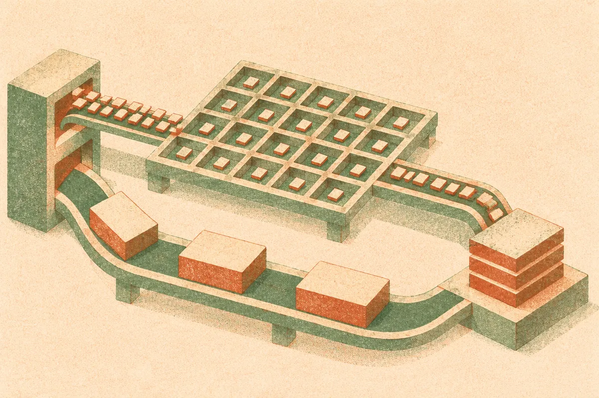

TL;DR: Fixed BPE tokenization saves compute up front, but learned or adaptive grouping could cut waste when models repeatedly process text chunks that clearly belong together.

## What is actually wrong with BPE tokenization?

bycloud’s “The current tokenization is suboptimal, and we just got a solution.” makes a useful point that gets lost in most model chatter: language models do not read words. They read tokens.

That sounds basic. It is also where a lot of cost and behavior gets baked in before training even starts.

Most modern LLMs use BPE, byte pair encoding. The tokenizer builds a fixed vocabulary by repeatedly merging character sequences that show up often in training data. This is practical. It compresses text. It avoids a separate embedding for every rare word. It gives the model a manageable set of pieces that can be recombined into almost anything.

But frequency is not meaning.

The example bycloud uses is “New York.” A tokenizer may treat that as two positions, “New” and “York,” even though the phrase often refers to one city. The model can learn that the two belong together, but it cannot change the fact that they arrive as separate positions in the transformer. The split happened before training. It is frozen.

That is the subtle tax. The model attends over more positions than it might need. It decodes more steps than it might need. One extra token is not a crisis. Billions of avoidable token positions across training, inference, agents, search, and long-context workflows start to matter.

## Why should builders care about token boundaries?

Because tokenization is not just a research artifact. It shows up in bills, latency, context limits, and weird product behavior.

If your system stuffs retrieved docs, chat history, tool outputs, code, and logs into a prompt, the tokenizer decides how much room you really have. A 10,000-word document is not the unit your model sees. The actual unit is tokenized text, and some strings are much more expensive than they look.

This gets worse with agents. Agents carry state. They resend history. They accumulate tool traces. They quote files. bycloud’s sponsorship segment reports that Verta Inference caches repeated agent context and, in Verta’s testing as relayed there, served about 99% of already-sent context from cache with first tokens around 150 milliseconds past 25,000 tokens. I would treat those as vendor-reported performance claims, not general law. Still, the shape of the problem is real: repeated context is expensive, and repeated token positions are the thing being paid for.

That is why adaptive grouping is interesting. If a model could learn that some spans should behave more like one unit, it might reduce useless work without giving up the flexibility of subword tokenization. The win would not only be prettier linguistics. It could mean shorter effective sequences, faster decoding, and cleaner internal representations for names, phrases, identifiers, and recurring domain terms.

## Is learned token grouping ready to change production models?

Not from the material here. bycloud points to “today’s paper,” but the supplied material does not include the paper title, authors, lab, arXiv ID, or benchmark details. So I would not treat this as a settled replacement for BPE yet.

The hard part is not noticing that fixed token boundaries are imperfect. People have known that for years. The hard part is making a learned grouping system that trains stably, serves efficiently, preserves compatibility with existing stacks, and does not create new failure modes in multilingual text, code, rare names, or adversarial inputs.

There is also a deployment catch. Tokenizers are everywhere. They sit in training pipelines, inference servers, SDKs, prompt counters, embedding systems, eval harnesses, and billing logic. Changing tokenization is not like swapping a prompt template. It touches the contract between text and model.

My take: this is one of those “small” model architecture details that could have outsized operational impact if it works. Not because it makes models magically smarter, but because it attacks wasted sequence length. That is one of the least glamorous bottlenecks in AI systems, and one of the most expensive.

For builders, the practical move is not to wait for a new tokenizer and rewrite your stack. Measure token waste now. Check which inputs explode in token count: URLs, code, tables, logs, product names, multilingual copy, JSON, tool traces. Compress repeated context. Cache where possible. Normalize noisy inputs before they hit the model. The catch most readers miss is that “better tokenization” is partly a model research problem, but token discipline is already an application design problem.
