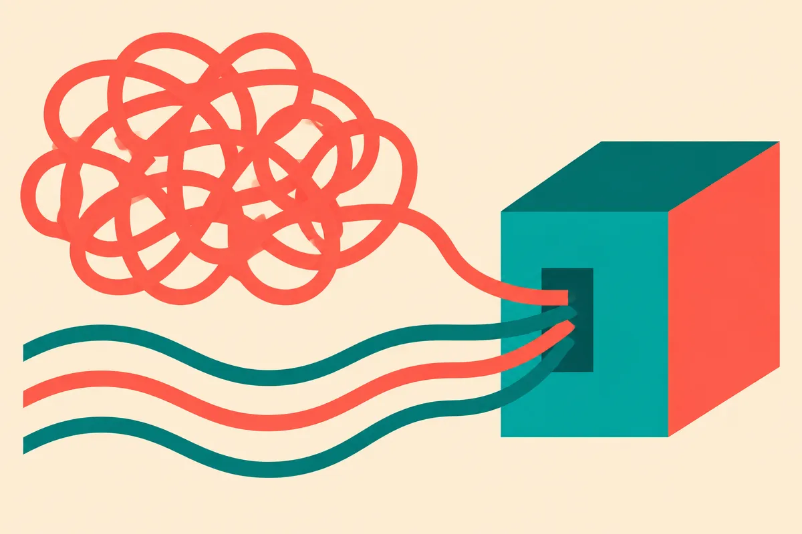

TL;DR: A browser game where you play the subagent taking orders from an LLM is a surprisingly good teaching tool for the thing most builders get wrong about multi-agent systems: the handoff, not the model.

The source here is a single Show HN post titled "Show HN: I built a game where you are an LLM's subagent" on Hacker News. That is all I have to work from, so I am not going to pretend there are benchmarks or a paper behind this. There aren't. But the premise is good enough to think with, and the thing it pokes at is real: most people building agents spend their energy on the orchestrator and treat the subagent as a function call that just works. It doesn't just work. The game inverts the seat you normally sit in, and that inversion is the whole point.

## What is the game actually putting you inside?

In a standard multi-agent setup, a top-level model (the orchestrator) decomposes a task and dispatches pieces to subagents. The subagent gets a prompt, some context, maybe a tool list, and is expected to come back with a result. You, the builder, usually write the orchestrator logic and the subagent prompt, then watch the whole thing from above.

This game flips it. You are the subagent. You receive the instructions an orchestrator LLM would hand down, and you have to execute against them with whatever context you were given. No more, no less.

That constraint is the lesson. When you are the subagent, you feel every gap in the instructions immediately. Ambiguous scope. Missing context the orchestrator assumed you had. A goal stated at the wrong altitude ("improve the file") versus a goal you can actually act on ("rename this function and update its three callers"). You experience, from the inside, what a real subagent experiences silently: it just guesses, and the guess is where your agent system breaks.

I have debugged enough agent chains to know this is where the failures live. Not in the model's reasoning. In the handoff. The orchestrator knows things it never wrote down, and the subagent inherits a task stripped of that knowledge.

## Why does the handoff matter more than the model?

There is a reflex in agent building to reach for a smarter model whenever a chain underperforms. The subagent flubbed the task, so swap in the bigger model. Sometimes that helps. Often it doesn't, because the problem was never capability. It was specification.

A subagent is only as good as the contract it was handed. If the orchestrator passes down a vague goal, the smartest model in the world will produce a confident, plausible, wrong answer, because it has to fill the gaps with assumptions and it has no way to flag that it did. Playing the subagent makes this visceral. You get the note, the note is incomplete, and you have two bad options: ask for clarification (which a lot of agent setups don't even allow mid-task) or guess and move on.

That is the design insight hiding in a Show HN toy. The quality of a multi-agent system is set at the moment of delegation. What you put in the subagent's context window, how tightly you scope the task, whether you give it a way to say "I don't have enough to do this," all of that matters more than which model you plugged into the slot.

## How does this change what a builder should test?

If the handoff is the failure surface, then that is what you should instrument and evaluate. Most people eval the final output of the whole chain. Useful, but it tells you the system failed without telling you where.

Break it down. For each subagent dispatch, ask the questions the game forces you to ask when you are on the receiving end:

- Could I actually execute this task from the context I was given, with no outside knowledge?
- Is the goal stated at an altitude I can act on, or is it an aspiration?
- If I lacked something, did I have a channel to say so, or was I forced to guess?

Run your own prompts through that filter. Better yet, do what the game does and read the subagent's instructions as if you had no memory of writing the orchestrator. The context you silently assume is exactly the context the subagent never receives. I have caught more agent bugs by rereading my own dispatch prompts cold than by any amount of model swapping.

This also reframes context engineering as a delegation problem rather than a stuffing problem. The goal is not to pour everything into the subagent's window. It is to hand down precisely the slice it needs to act, scoped so tightly that a reasonable executor could not misread it. Too little and it guesses. Too much and it drowns, loses the thread, optimizes the wrong part. The game makes you feel both failure modes from the chair where they actually hurt.

## What is the catch?

A browser game is a teaching tool, not evidence. It makes a point about delegation feel true because you experience it, but feeling something is true and measuring that it holds across your real workloads are different things. Don't walk away thinking "subagents are the bottleneck" as a law. On some tasks the model genuinely is the limit. On others the orchestrator's decomposition is wrong before any subagent is even dispatched. The handoff is one failure surface, an underrated one, not the only one.

And I want to be honest about the sourcing: this is one Show HN post with a title and a premise. I am extrapolating the design lessons from the concept, not reporting verified claims about the game's content or how well it plays. Treat the specifics as my reading, not the author's stated intent.

Practitioner's take: next time an agent chain underperforms, before you upgrade the model, copy the exact instruction your orchestrator hands the subagent into a blank window and try to complete the task yourself with nothing but what is on screen. If you can't, no model will reliably either. Fix the contract first: scope the goal to something executable, pass down the context you were silently assuming, and give the subagent a sanctioned way to report missing information instead of guessing. That is a free afternoon of work and it fixes more failures than a quarter of model benchmarking. The game is a clever way to internalize this, but you can run the same exercise today with the prompts already in your codebase.
