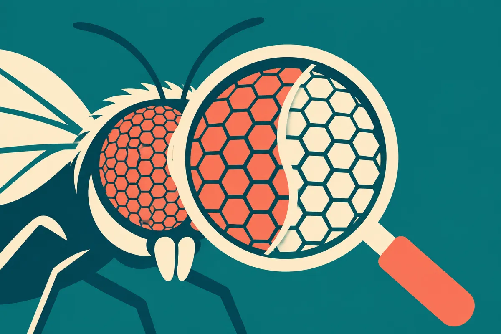

TL;DR: The honest answer to "is this image real or generated?" is now "I cannot tell from looking," and that shifts the burden from your eyes to your provenance workflow.

A set of close-up insect portraits made the rounds on Hacker News this week under the title "Surprisingly Adorable Insect Portraits." The thread, which is the only source I have on this, is doing what these threads always do now: half the comments admire the craft, the other half argue about whether the shots are real macro photography or synthetic. That argument is the actual story. Not the bugs.

I want to be careful here. The Hacker News post gives a title and a link and not much else. I am not going to pretend I know the photographer's gear or whether a diffusion model touched a single pixel. What I can talk about is the pattern, because this is the fourth or fifth time this year I have watched the same comment fight break out over the same kind of image.

## Why can't people tell if the insect photos are real anymore?

Macro photography is the perfect stress test for image detection, and that is why these threads keep happening.

Real macro has tells that used to be reliable. Razor-thin depth of field. Focus stacking artifacts where the sharp plane does not quite line up. The specific way compound eyes catch a ring light. Dust, pollen, imperfect symmetry, a leg bent at an angle no one would compose on purpose. For years those were the fingerprints of a real lens pointed at a real bug.

Generated images used to fail exactly there. Too clean. Suspiciously symmetric. Eyes that looked painted rather than lit. Hairs that merged into mush under scrutiny.

That gap has mostly closed. Modern image models learned the imperfections. They produce plausible depth of field, plausible grime, plausible asymmetry. So the Hacker News commenters are not being dumb when they cannot agree. They are looking for tells that the current generation of tools has specifically learned to hide.

The uncomfortable part: the people most confident they can spot a fake are often the ones getting fooled. Overconfidence in visual detection is itself a tell, just not the kind anyone wants.

## Is this actually a problem, or just a party trick?

For insect photos, honestly, it is close to a party trick. Nobody gets hurt if a pretty bee turns out to be synthetic. The stakes are low and the vibes are high.

But the same capability that makes a fake bee indistinguishable from a real one is the capability that matters everywhere else. Product photography. Real estate listings. Journalism. Scientific figures. Dating profiles. Evidence. The insect thread is a low-stakes demo of a high-stakes shift.

Here is the thing that bugs me (sorry) about "can you tell?" as a framing: it treats detection as a human perception game. It is not. The eye lost this contest. Pretending otherwise just trains people to trust confident guessers.

So the question stops being "can I see the difference" and becomes "can I verify where this came from." Those are completely different problems, and only one of them is solvable at scale.

## So how are you actually supposed to verify an image now?

Provenance, not forensics. You want to know the chain of custody, not squint at pixels.

The most concrete tool here is C2PA, the Coalition for Content Provenance and Authenticity, which defines a standard for embedding signed metadata into a file: what device or model made it, what edits happened, who signed off. Adobe, camera makers, and several platforms have shipped support for it. When the signature is present and intact, you get something a human eyeball cannot give you: a cryptographic claim about origin.

I will flag the catch clearly, because the catch is the whole game. C2PA metadata is trivially stripped. Screenshot an image and the provenance is gone. Re-upload through a platform that scrubs metadata and it is gone. So provenance works beautifully in a closed pipeline where everyone participates, and falls apart the moment a file crosses an untrusted boundary. Which is most of the internet.

Pixel-level detectors exist too, and some vendors sell them as reliable. I would not stake anything important on them. They are a cat-and-mouse game against the exact models they are trying to catch, and the mouse is winning most rounds. Treat a detector score as weak evidence, never a verdict.

The practical stance for 2026: assume any image you did not capture or generate yourself could be synthetic, and build your trust from where it came from rather than how it looks.

## What does this mean if you publish images for a living?

If you run a content operation, the shift is from "is my image real" to "can I prove my image is mine, and does anyone care."

Three things worth doing now. First, preserve provenance on anything you originate. Shoot or generate through tools that write C2PA data, and keep the originals. If authenticity ever matters for your brand, you want the signed source file, not a re-exported JPEG three platforms deep.

Second, label your own synthetic work honestly. Not because a regulator is forcing you yet, but because the audience trust penalty for getting caught quietly faking is going up, and the penalty for disclosing is going down. The insect thread shows people do not mind generated images. They mind being deceived about it.

Third, stop using "it looks real" as an acceptance criterion in any workflow where origin matters. For a blog header, who cares. For anything load-bearing, product proof, testimonials, news, before-and-afters, the standard has to be sourcing, not appearance.

Practitioner's take: run the test yourself this week. Pull ten images from your own pipeline, strip the metadata, and ask three people on your team to sort real from generated. Watch the accuracy. It will humble everyone and that is the point. Then pick the two or three places in your operation where image origin actually carries risk, and put a provenance rule on those and only those: originate through C2PA-aware tools, archive the signed source, disclose synthetic work. Do not boil the ocean trying to verify every pixel on the internet, because you cannot, and the vendors promising they can are selling you the losing side of a cat-and-mouse game. The catch most people miss is that provenance only protects content you control from the moment of creation. Once a file leaves your hands and gets screenshotted, the chain is broken and no amount of squinting brings it back. So the move is not better detection. It is tighter custody over the images you actually own.
