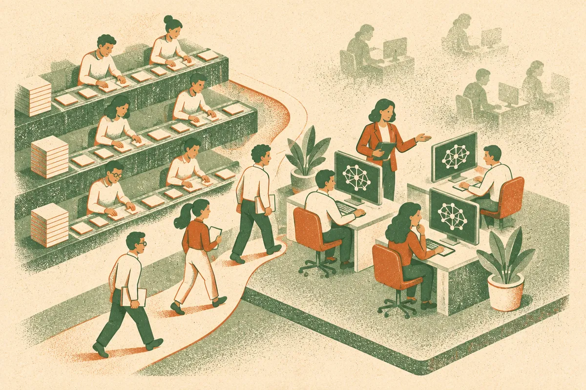

TL;DR: If AI can touch nearly half of jobs, the practical move is not panic or denial, it is mapping work task by task and funding the transition before the org chart breaks.

## What does “AI will replace jobs” actually mean for operators?

Marketing AI Institute’s “AI Stands to Replace Jobs. Here’s a Plan to Put People First” frames the issue around a blunt claim: nearly half of American jobs fall into five categories that sit directly in AI’s path, and Andrew Yang says the economy is not ready for it.

That is the right level of alarm, but it is still too broad for anyone running a team.

Jobs do not get automated all at once. Tasks do. A support rep does not vanish because a model can draft an answer. The role changes when ticket triage, knowledge lookup, response drafting, follow-up summaries, QA scoring, and escalation notes are all partly automated. Same for junior marketers, recruiters, analysts, paralegals, coordinators, and back-office operators.

The risk is not just headcount reduction. It is silent work redesign. Someone adds an AI assistant. Someone else stops hiring for entry-level work. A manager raises output expectations. The training ladder disappears. Six months later, the company has fewer beginners, more review work, and no clear plan for how people build judgment.

That is the part most AI adoption decks skip.

## Where should a “people first” plan start?

Start with the work, not the model.

For each exposed role, list the recurring tasks, the systems touched, the decisions made, and the failure cost when the task goes wrong. Then mark which tasks are already being assisted by AI, which could be assisted safely, and which should stay human-led for now.

That sounds boring. Good. Boring is how you avoid magical thinking.

A useful plan also separates productivity gains from labor decisions. If a model saves five hours a week in a role, that does not automatically mean the role is redundant. It might mean faster turnaround, better documentation, more customer coverage, or time for work that always got deferred. Or yes, it might mean fewer seats over time. But those are management choices, not laws of physics.

Yang’s warning, as reported by Marketing AI Institute, is that the economy is not ready. I would narrow that further: most institutions are not even measuring the exposure correctly. They are counting jobs when they should be counting workflows, career ladders, training pathways, and local labor shocks.

Policy matters here, but company policy matters first for anyone deploying these systems. Who gets access? Who gets trained? Who reviews outputs? Who is told their role is changing before it changes under them? Who benefits if productivity rises?

## The hidden problem: AI can erase the first rung

The biggest near-term problem may be entry-level work.

A lot of beginner labor is inefficient by design. Junior people draft the first version, clean the spreadsheet, summarize the meeting, classify the inbox, research the market, write the first memo. Senior people correct it. That is how judgment gets transferred.

AI is very good at attacking that first draft layer.

If companies remove too much of it, they may get a short-term margin win and a long-term talent problem. Fewer juniors learn the messy basics. Seniors become reviewers of machine output. The middle thins out. Then everyone complains that nobody has taste, context, or ownership.

The fix is not to preserve busywork forever. The fix is to redesign apprenticeship. Let AI handle some grunt work, but make people show their reasoning, compare model outputs, audit mistakes, interview customers, sit in on escalations, and learn the business context the model does not own.

A “people first” AI plan should have three operating rules: disclose when workflows are being redesigned, retrain before roles are eliminated where possible, and protect the learning work that creates future experts. Not every job can be saved. Pretending otherwise is unserious. But letting automation happen through drift is worse.

For builders, the move this week is simple: pick one role your AI tools already affect and map ten recurring tasks inside it. Mark each task as automate, assist, or protect. Then ask what training, review, and career progression look like after the tool is live. The catch most readers miss: the model rollout is not the hard part. The hard part is keeping the human system from quietly losing its next generation of capable operators.
